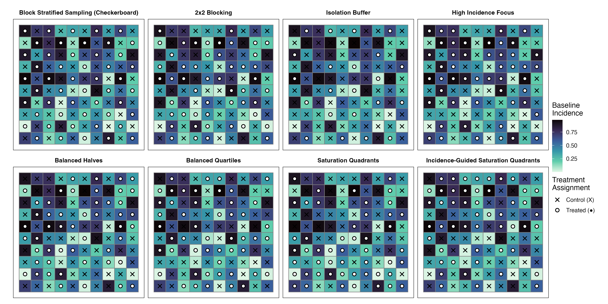

# Modular Incidence Simulation for Spatial CRT Design Evaluation

## Current status (2026-11-02)

The grid simulation, the observed-incidence NC application (2026-10-02) and the methods
extensions (2026-10-20/21) are complete. The CTJ paper had its V5 revision on 2026-10-27;
the CTJ paper, the Supplementary Information (SI) and Chapter 3
(`paper/thesis_chapter/Thesis_Chapter.qmd`) are complete drafts, not yet submitted. The
SUDDEN meeting talk (`presentation/sudden_talk_2026-10-29.qmd`) was given on 2026-10-29.
Next is the full SI prose review. Open items are in [docs/TODO.md](docs/TODO.md), dated
progress in the progress log of [ROADMAP.md](ROADMAP.md), and author decisions with their
reasons in [DECISIONS.md](DECISIONS.md).

> For session context and quick technical reference, see [AGENTS.md](AGENTS.md).

From the project root, run `Rscript code/tests/test_manuscript_exhibits.R` and
`python3 paper/tools/verify_manuscripts.py` to check the documents against saved
results and each other. MSE comparisons use the approved three-decimal precision.
These checks do not rerun the simulations.

### Manuscript feedback (2026-11-11)

The [FCL feedback register](paper/ctj_manuscript/revisions/2026-11-10-paper-2-revisions/feedback.html)
groups 58 written comments and two strikeouts with their marked text, PDF page,
paper section and provisional Chapter 3 destination. Open the HTML file in a browser;
no server or build is needed. Search and filters help locate comments, and note fields
support the next revision plan. Notes save in browser storage only; use **Export your
notes** to keep or share a copy. The annotated PDF, extracted JSON and usage notes
are in the same [revision folder](paper/ctj_manuscript/revisions/2026-11-10-paper-2-revisions/README.md).
The papers have not been revised in response to this register yet.

### Allocation risk (grid)

A nested study compares all eight designs with Simple Random Sampling (SRS) on the
spread and upper tail of allocation-specific mean squared error (MSE), at fixed incidence
surfaces and parameter corners (queen weights, oracle ML, τ = 1). The current run uses all
ten surfaces (`surfaces10`, 2026-10-27); it reproduces the earlier two-surface pilot
exactly on surfaces 1–2 and changes no conclusion. Findings:
[surfaces10](docs/findings/2026-10-27-allocation-risk-surfaces10-findings.md) and the
original [methods note](docs/findings/2026-09-27-allocation-risk-findings.md). It does not
replace the full grid benchmark.

From `code/`, with `VECLIB_MAXIMUM_THREADS=1`, `OPENBLAS_NUM_THREADS=1` and
`OMP_NUM_THREADS=1` set before starting R, run `Rscript 16_allocation_risk.R surfaces10 8`,
then `Rscript 18_allocation_risk_precision.R surfaces10`. From the project root,
`Rscript code/17_allocation_risk_summary.R surfaces10` (and `surfaces10_precision_R400`)
writes `results/allocation_risk/summary/surfaces10/`, and `Rscript code/21_downside_by_design.R`
writes the per-design downside table and the allocation-distribution figure there. Outputs
are in `results/allocation_risk/surfaces10/` and `surfaces10_precision_R400/`; the
two-surface `pilot/`, `precision_R400/` and the top-level files in `summary/` are
superseded but kept. Behavior checks are in `code/tests/test_allocation_risk.R` and
`code/tests/test_allocation_risk_summary.R`. Individual-fit caches are gitignored.

## Overview

This project evaluates which **treatment assignment design** produces the most accurate
estimates of an intervention effect when outcome incidence is spatially heterogeneous
and spillover effects are present. The setting is a Spatial Cluster Randomized Trial
(CRT) on a 10x10 regular lattice grid of 100 clusters.

**Research question:** Across a wide range of spatial dependence, spillover magnitude,
and incidence structures, which of 8 candidate treatment assignment strategies minimizes
estimation error (MSE) and maintains valid inferential coverage?

**Application context:** Sudden Unexpected Death (SUD) in North Carolina counties.
The Poisson incidence mode uses a SUD base rate of 35/100,000 (Mirzaei et al.),
consistent with county-level Poisson analyses by Gan et al. and Watson et al.

---

## Project Lineage

This is a clean-room rewrite of
`archive/OutcomeIncidenceDesign_Legacy/SpatialCRT_Incidence_TreatmentAssignment_Simulation.Rmd`
(~600 lines, monolithic Rmd). Refactoring goals:

1. **Modularity** — numbered R scripts (01-09) that can be run independently or sourced in sequence
2. **Three incidence modes** — Added Spatial (SAR filter) and Poisson modes alongside iid Uniform
3. **Correctness fixes** — Seven specific bugs and design flaws identified and corrected (see below)
4. **Long-run reliability** — Replaced `save.image()` with targeted `saveRDS()`, added per-scenario seeding, ETA logging, and degenerate case handling

The predecessor Rmd is preserved untouched.

---

## File Inventory

All scripts are in `code/` unless a path is given. Run `wc -l` for current lengths.

| File | Purpose | Key Functions / Outputs |
|------|---------|---------------|
| `00_design_names.R` | Canonical design display names | `apply_design_names()` |
| `00_mathematical_specification.Rmd` | Theory doc with full LaTeX DGP formulas | (rendered to HTML) |
| `01_spatial_setup.R` | Regular lattice grid, rook/queen weight matrices | `build_spatial_grid()`, `get_active_spatial()` |
| `02_incidence_generation.R` | Three incidence generation modes | `generate_incidence()` + 3 mode functions |
| `03_designs.R` | Eight treatment assignment strategies | `get_designs()`, `get_design_names()`, `is_design_deterministic()` |
| `04_estimation.R` | DIM and MLE estimation with CI extraction | `estimate_tau()` |
| `05_run_simulation.R` | Main orchestrator, nested parameter loop | `run_incidence_config()` |
| `06_visualizations.R` | All plots and summary tables | 18 functions; entry point `run_all_visualizations()` |
| `07_results_summary.Rmd` | Rendered results report (HTML/PDF) | Knitted summary of all MLE findings |
| `08_design_recommendations.R` | Personalized design recommendations | `run_recommendation_report()`, `table_scenario_lookup()`, `generate_commentary()` |
| `09_MLE_design_recommendation_report.qmd` | Companion narrative report | Rendered to `results/09_MLE_design_recommendation_report.{html,pdf}` |
| `10_statistical_comparisons.R` | Formal statistical hypothesis tests | `run_friedman_test()`, `run_nemenyi_posthoc()`, `run_pairwise_wilcoxon()`, `run_conditional_tests()`, `plot_cd_diagram()`, `plot_mse_boxplot_with_stars()`, `plot_pvalue_heatmap()` |
| `11_statistical_comparisons_report.qmd` | Statistical comparisons narrative report | Rendered to `results/11_statistical_comparisons_report.{html,pdf}` |
| `12_six_design_statistical_comparisons.R` | Friedman/Nemenyi/Wilcoxon on the six manuscript designs plus SRS, named-label figures | `results/six_design_manuscript/` |
| `13_dissertation_results_extract.R` | Per-incidence-mode, per-parameter and robustness numbers for the chapter | `results/six_design_manuscript/dissertation_results_extract.txt` |
| `14_manuscript_supplement_figures.R` | Eight-design consolidation test, SI figure suite, reordered main-text figures, STALE synthetic application table | `results/eight_design_supplementary/`, `results/six_design_manuscript/{queen,rook}/si_figures/` |
| `15_srs_benchmark.R` | SRS benchmark against the proposed designs (relative efficiency, share beating SRS, paired tests) | `results/srs_benchmark/` |
| `16_allocation_risk.R` | Allocation-specific MSE at fixed incidence surfaces (profiles smoke, benchmark, pilot, surfaces10) | `results/allocation_risk/<profile>/` |
| `17_allocation_risk_summary.R` | Allocation-risk summaries and precision | `results/allocation_risk/summary/<profile>/` |
| `18_allocation_risk_precision.R` | Extends 50 matched blocks from R = 100 to R = 400 outcomes | `results/allocation_risk/<profile>_precision_R400/` |
| `19_manuscript_exhibits.R` | Nine-design grid regime means and paired ratios to SRS (CTJ Table 2) | `results/srs_benchmark/` |
| `20_manuscript_figure_revision.R` | Compact CTJ figures from completed results | `results/manuscript_exhibit_revision_20261002/`, `paper/*/figures/compact/` |
| `21_downside_by_design.R` | Per-design mean and worst-decile MSE ratios to SRS, allocation-distribution figure (CTJ Figure 3) | `results/allocation_risk/summary/surfaces10/` |
| `22_grid_burden_share.R` | Burden share treated by design on the grid surfaces | `results/grid_burden_share/` |
| `23_methods_extension_figures.R` | NC methods-extension figures (power vs N, colleges needed, spread vs gain) | `results/methods_ext_figures/*.{pdf,png}` |
| `24_methods_extension_tables.R` | Table bodies for chapter Appendix A9 and SI Section 15 | `results/methods_ext_figures/tables/` |
| `25_design_assignment_figures.R` | Example assignments on one illustrative surface: CTJ Table 1 maps, SI/Chapter 3 panel figure, slide version | `paper/ctj_manuscript/figures/compact/design_thumbs/`, `design_assignments_panels.pdf`, `presentation/figures/` |
| `26_grid_tdf_intervals.R` | Exact re-fit of the grid recording t + df coverage and power; 12/13/14/19 apply them via `apply_tdf_intervals()` | `results/grid_tdf_2026-10/` |
| `27_interval_comparison.R` | Wald vs t + df coverage (grid and application) and the application's yearly t + df coverage | `results/grid_tdf_2026-10/interval_comparison.csv`, `application/results/methods_ext_2026-10/stored/` |
| `paper/tools/verify_manuscripts.py` | Reconcile manuscript cells, derived supplement and assets; `--chapter` checks another chapter file, `--pending-si` reports a table not yet in the SI | Aggregate CSV inputs; fails on drift |
| `paper/tools/copy_figures.sh` | Copies the figures that scripts write under `results/` into both manuscript figure folders | `paper/ctj_manuscript/figures/`, `paper/thesis_chapter/figures/` |
| `presentation/tools/make_figures.R` | Spillover-regime schematic and case-identification flowchart for the talk deck | `presentation/figures/` |

---

## How to Run

### Prerequisites

```r
install.packages(c("spdep", "spatialreg", "dplyr", "tidyr",
                   "digest", "parallel", "ggplot2", "viridis"))
```

### Running the simulation (2026-09 revision; ~14 minutes on 10 cores)

```bash
cd projects/IncidenceDesign/code
# BLAS must be single-threaded per worker (the runner refuses otherwise):
VECLIB_MAXIMUM_THREADS=1 OPENBLAS_NUM_THREADS=1 OMP_NUM_THREADS=1 Rscript 05_run_simulation.R pilot  # ~1 min
VECLIB_MAXIMUM_THREADS=1 OPENBLAS_NUM_THREADS=1 OMP_NUM_THREADS=1 Rscript 05_run_simulation.R full   # ~14 min
```

- One run fits both estimators (oracle, primary; non-oracle, sensitivity) to the same
  simulated data, and writes them to `results/sim_data/` (`pilot` output goes to
  `results/pilot_rev_2026-09/`).
- Checkpoints are kept per work unit under `results/checkpoints/rev_2026-09/<profile>/`, with
  a manifest. Any change to parameters, code (01–05), packages or BLAS makes the runner
  refuse to resume, so delete that directory to start fresh.
- DIM is not run by the revised script (the DIM baseline in `sim_data/` predates the revision).
- Method specification: `docs/plans/2026-09-24-simulation-revision-spec.md`.

### Tests

```bash
VECLIB_MAXIMUM_THREADS=1 OPENBLAS_NUM_THREADS=1 OMP_NUM_THREADS=1 Rscript tests/test_simulation_revision.R
Rscript tests/verify_full_run_rev_2026-09.R
```

- The first runs the design, seeding, aliasing and known-answer tests, plus the ~7-minute
  estimator-equivalence test (`SKIP_EQUIVALENCE=1` skips it).
- The second runs the integrity checks on the latest full run.
- `tests/crosscheck_lagsarlm_rev_2026-09.R` recomputes 1% of the scenarios with `lagsarlm`.

### Generating Visualizations Only

```r
source("06_visualizations.R")

# All configs, most recent MLE results (primary estimator):
run_all_visualizations(results_dir = normalizePath("../results"), estimation_mode = "MLE_tau_sweep")

# Single incidence config with all tables:
r <- load_latest_results(estimation_mode = "MLE_tau_sweep")
cfgs <- split_by_incidence_config(r)
run_standard_tables(cfgs[["iid Uniform"]], "iid Uniform")
```

Design example maps (CTJ Table 1, SI/Chapter 3 figure, slides), from the project root:

```bash
Rscript code/25_design_assignment_figures.R
```

### Generating Design Recommendations

```r
source("08_design_recommendations.R")

# Full recommendation report (PDF + console output):
run_recommendation_report(estimation_mode = "MLE_tau_sweep")

# Specific scenario lookup:
r <- load_latest_results(estimation_mode = "MLE_tau_sweep")
cfgs <- split_by_incidence_config(r)
table_scenario_lookup(cfgs[["iid Uniform"]], rho = 0.2, gamma = 0.7,
                      spill_type = "both", nb_type = "queen")
```

---

## Simulation Design Summary

**Grid:** 10x10 regular lattice, N = 100 clusters. Two contiguity structures:
rook (4-connected) and queen (8-connected).

**Data Generating Process — Spatial Durbin Model (SDM):**

```
Y = (I - rho*W)^{-1} * [tau*Z + gamma*Spill(Z) + beta*X + epsilon]
```

where beta = 1.0, sigma = 1.0, and `Spill(Z)` is the row-standardized mean treatment of
neighbors. Two spillover modes: `control_only` (gamma applied only to control units) and
`both` (applied to all units). (Despite the historical "SDM" label, only treatment is
spatially lagged.)

**Monte Carlo structure (2026-09 revision):** K = 10 incidence surfaces per config ×
J = 25 design draws per surface = 250 fits per scenario. The design for surface k is drawn
from X_k, the outcome and analysis use the same X_k, and every fit has its own noise draw.
All draws are seeded from keys.

**Incidence modes:**
- **iid Uniform:** X_i ~ Uniform(0,1) independently
- **Spatial:** SAR filter + pnorm transform — spatially correlated but marginally Uniform(0,1)
- **Poisson:** Spatially correlated log-rates -> Poisson counts (100,000 people per cluster, ≈35 expected deaths) -> rank-normalized rates in [0,1]

**Treatment designs:** 8 strategies — Checkerboard, High Incidence Focus, Saturation
Quadrants, Isolation Buffer, 2x2 Blocking, Balanced Quartiles, Balanced Halves,
Incidence-Guided Saturation Quadrants.

<p align="center">
  
  <br><em>Sample treatment assignments for each design applied to a single realization of iid Uniform(0,1) baseline incidence. Tile color indicates baseline incidence (darker = higher). Circles = treated, crosses = control.</em>
</p>

**Estimation:** ML spatial-lag model, oracle `Y ~ Z + Spill + X` (primary) and non-oracle `Y ~ Z + X` (sensitivity), fit with `fit_sar_lag()`. That's the same estimator as `spatialreg::lagsarlm(method = "eigen")` (validated to ~1e-7 on 5,120 fits) at ~120× the speed, since `lagsarlm` spends ~94% of its time in a `gc()` call.

**True tau (tau-sweep):** τ ∈ {0.8, 1.0, 1.5, 2.0, 3.0} — swept to assess design robustness across effect sizes and estimate power curves.

**Total scenarios:** 5 tau × 5 incidence configs × 2 neighbor types × 4 rho × 4 gamma × 2 spillover types × 8 designs = **12,800 scenarios**.
The production run (2026-09-27, tag `20260927_000502`) adds Simple Random Sampling as
Design 9, for **14,400 scenario rows** per estimator (× 250 fits × 2 estimators). Designs
1–8 are identical to the earlier 2026-09-24 run (`results/srs_reproduction_check.txt`).

---

## Results Summary

### Revised simulation (production run 2026-09-27, 14,400 scenario rows × 2 estimators)

The results for oracle, τ = 1 and the 6 manuscript designs are below; `results/six_design_manuscript/`
has the full detail.

| Design | Queen MSE | Rook MSE |
|---|---|---|
| Incidence-Guided Saturation Quadrants | 0.091 | 0.072 |
| Balanced Quartiles | 0.131 | 0.084 |
| Isolation Buffer | 0.160 | 0.133 |
| High Incidence Focus | 0.245 | 0.206 |
| 2x2 Blocking | 0.319 | 0.128 |
| Checkerboard | 1.087 | 0.480 |

- **Coverage** is ≈0.94 for every design except Checkerboard × rook, which is 0.15 because τ is not
  identified when WZ = 1 − Z. Those estimates are kept but flagged. Coverage doesn't separate
  the designs; MSE does.
- **Across τ:** under queen the rank order is the same at every τ (Friedman χ² 377–456, all
  p < 2e-16). Per-τ tests share draws, so they aren't independent confirmations. Under
  rook, 2x2 Blocking and Isolation Buffer swap at τ = 0.8.
- **Robustness:** every adjacent pair differs significantly on 50 independent (config × surface)
  units.
- **Consolidation:** Saturation Quadrants and Balanced Halves are statistically indistinguishable
  from Incidence-Guided Saturation Quadrants and Balanced Quartiles, which is why the
  manuscripts carry 6 designs.
- **Non-oracle sensitivity:** bias −0.12 to −0.40 and coverage 0.51–0.90 for every design. It also
  has lower variance where Z and WZ are collinear (queen Checkerboard MSE 1.09 → 0.11).
- **Integrity** (`results/sim_data/full_run_verification.txt`): N_Valid_Est = 250 everywhere and
  zero non-aliasing warnings. Aliasing occurs only in Checkerboard × rook, plus 20 Isolation
  Buffer × rook scenarios that each drew the exact checkerboard once.

### Superseded (April 2026)

The April tau-sweep and March baseline results (e.g. "D8 MSE 0.079, D1 0.802") rest on the
implementation oversights fixed by the revision. They're archived in
`results/archive/pre_revision_20260924/` (see its README) and must not be cited. The live CTJ/SI drafts now use the verified revised results and completed application; old drafts are archived.

### Results Directory Structure

```
results/
  MLE_tau_sweep_design_recommendations_{queen,rook}.pdf  # 08 figures/tables PDF (oracle, per neighbor type)
  MLE_tau_sweep_incidence_overview.pdf        # Incidence heatmaps + distributions
  MLE_statistical_comparisons.pdf             # 10 figures (8 designs, tau = 1)
  00/07/09/11 rendered reports                # regenerated in Phase C
  sim_data/
    sim_results_MLE_tau_sweep_combined_20260927_000502.rds         # PRIMARY (oracle), 14,400 rows (9 designs incl. SRS)
    sim_results_MLEnonoracle_tau_sweep_combined_20260927_000502.rds # non-oracle sensitivity
    sim_results_*_{iid,spatial,poisson}_20260927_000502.rds          # per-mode splits
    surface_results_*_20260927_000502.rds     # one row per (scenario, surface)
    warnings_*_20260927_000502.csv            # non-aliasing warnings (none)
    run_info_20260927_000502.rds              # manifest, parameters, sessionInfo
    full_run_verification.txt                 # checks on the 20260927_000502 run
    *_20260924_025509.*                       # earlier eight-design run (12,800 rows), superseded
    sim_results_DIM_*_20260304_195321.rds     # pre-revision DIM baseline (not re-run)
  six_design_manuscript/                      # 12 (oracle), 13, 14: summaries + queen/ and rook/ figures
  six_design_manuscript_nonoracle/            # 12 (non-oracle)
  eight_design_supplementary/                 # 14(a) consolidation check
  estimator_validation/                       # fit_sar_lag vs lagsarlm (5,120 fits) + 1% full-run cross-check
  pilot_rev_2026-09/                          # B4 pilot outputs + pilot_report.txt
  srs_benchmark/                              # 15 and 19: SRS benchmark, regime means, paired ratios (CTJ Table 2)
  grid_tdf_2026-10/                           # 26 and 27: t + df re-fit and interval comparison
  allocation_risk/                            # 16-18, 21: surfaces10/ and surfaces10_precision_R400/ current;
                                              #   pilot/, precision_R400/, top-level summary/ files superseded
  grid_burden_share/                          # 22: burden share treated by design
  methods_ext_figures/                        # 23 figures, 24 tables/ (NC methods extensions)
  manuscript_exhibit_revision_20261002/       # 20: plot-data CSVs behind the compact CTJ figures
  mle_per_config/                             # 06 per-config PDFs
  figures/design_samples_8panel.{png,pdf}
  archive/pre_revision_20260924/              # everything from the April runs
  checkpoints/rev_2026-09/                    # (git-ignored) manifest-checked unit checkpoints
```

**Key rule:** Results for iid Uniform, Spatial, and Poisson, and for rook and queen, are
reported **separately**; pooled numbers appear only when labeled as pooled. The combined .rds exists for loading convenience only.
`load_latest_results()` automatically detects the `sim_data/` subdirectory.

### Paper Directory Structure

> **Note:** the modular Quarto manuscript framework described in earlier versions of
> this README (`paper/manuscript/` with `_abstract.qmd`/`_methods.qmd`/etc. child
> sections) was retired 2026-07-02 in favor of two manuscripts written fresh from
> scratch (see below). That structure is preserved read-only as `paper/archive/pre_unification_20260702/`
> for reference/fact-checking only.

```
paper/
  SpatialCRT_IncidenceDesign.bib              # Single bibliography shared by both manuscripts
  SAGE_Journal_Template/                      # sagej.cls, SageH.bst, SageV.bst (CTJ render dependency)
  report/
    IncidenceSpatialCRT_Report.qmd            # Unified project report (sources R modules)
    IncidenceSpatialCRT_Report.pdf            # Rendered PDF
    IncidenceDesign_ProjectSummary.qmd        # Brief project summary report (ranked figures)
    IncidenceDesign_ProjectSummary.pdf        # Rendered PDF summary
  ctj_manuscript/                             # PRIMARY — Clinical Trials (SAGE) submission draft
    manuscript_ctj/                           # CTJ_Manuscript.{tex,pdf}: full benchmark/application plus
                                               #   detailed subset; 6 exhibits (journal cap). CTJ_Reading.{tex,pdf}
                                               #   two-column preview; CTJ_Exhibits.tex shared exhibits
    supplementary_info/                       # Supplementary_Information.{tex,pdf}: reproducibility, full
                                               #   8-design comparison, sensitivity, NC application detail
    cover_letter/                             # Cover_Letter_Draft.{md,pdf}
    figures/                                  # Main-text + SI figures and Figure_Legends.md (incl.
                                               #   compact/, real_sud/); archive/ holds unused figures (README)
    submission_checklist.md
  thesis_chapter/                       # Canonical full chapter and appendix, no length ceiling
    Thesis_Chapter.{qmd,pdf}
    figures/                                  # Chapter figures; archive/ holds unused figures (README)
    notes/trimmed-material.md                 # Text cut or moved by the length review
    shared-refs.bib -> ../SpatialCRT_IncidenceDesign.bib  # symlink (Quarto underscore workaround)
  tools/verify_manuscripts.py                 # Table/figure/reference consistency checker
  tools/copy_figures.sh                       # Copies figures from results/ into both figure folders
  archive/                                    # Frozen snapshots, reference only (do not edit)
    pre_unification_20260702/                 # Retired modular-Quarto manuscript + section drafts
    pre_completion_20261002/                  # Chapter/CTJ/SI sources before the Oct 2 completion pass
    manuscript_provenance_20261002.json       # Oct 2 SHA-256 source/output manifest
(The SUDDEN meeting deck is in presentation/ at the project root, with its own
figures/archive/; prelim slides live in bios-dissertation/slides/.)
```

The **unified report** (`paper/report/`) consolidates all code-side reports into a single
end-to-end reference (50+ pages): spatial setup, DGP, 8 design illustrations, estimation
methods, simulation design, all MLE results, full statistical comparisons (Section 10 with
Friedman/Nemenyi/Wilcoxon tests and conditional CD diagrams), and design recommendations.

The **project summary report** (`paper/report/IncidenceDesign_ProjectSummary.{qmd,html,pdf}`)
is a shorter companion document with the ranked-figure suite (clean CD diagrams, bias-variance
decomposition, rank/MSE heatmaps) that the CTJ manuscript and its SI figures were adapted from.

The **dissertation chapter** is the canonical long-form source, with a full body
and appendix. The **CTJ manuscript** is its standalone condensed derivative:
3,165 prose/heading words (3,314 including end declarations), a 279-word structured abstract and exactly six exhibits
(two tables/four figures). It includes all nine designs in the full benchmark
and application while preserving the detailed six-design grid analysis as a
labeled subset. The supplement retains full methods/results and all 22 chapter
tables. April/synthetic application numbers are absent from the live drafts.

Current CTJ figures are vector PDFs in `figures/compact/`: `nc_planning_map.pdf`,
`grid_accuracy.pdf`, `grid_bias_variance.pdf`, and `nc_annual_accuracy.pdf`.
They span both reading columns, with 9-point base fonts at their 174-mm export width.
The chapter uses the compact annual comparison in its body and retains absolute
MSE/tail displays in Appendix A7; full parameter grid figures remain in the chapter/SI.
Older assets remain preserved. Recreate these displays without rerunning simulation:

```sh
Rscript code/20_manuscript_figure_revision.R
Rscript code/tests/test_manuscript_exhibits.R
python3 paper/tools/verify_manuscripts.py
```

The export reads completed results, writes traceable plot-data CSVs to
`results/manuscript_exhibit_revision_20261002/`, and copies the selected PDFs to the
manuscript figure directories (all four to CTJ; annual heatmap to the chapter). Its exact bias/variance decomposition corrects
sample variance by 249/250; annual heatmap cells divide means by matched SRS means.
It does not estimate pooled MC intervals or change computational outputs/weights.
Selection/provenance: [exhibit findings](docs/findings/2026-10-02-ctj-exhibit-revision-findings.md).
Submission components: [checklist](paper/ctj_manuscript/submission_checklist.md),
[cover letter](paper/ctj_manuscript/cover_letter/Cover_Letter_Draft.md) and separate
[figure legends](paper/ctj_manuscript/figures/Figure_Legends.md).

Regenerate journal grid exhibits: `Rscript code/19_manuscript_exhibits.R`.
After re-running scripts that write figures under `results/`, run `bash paper/tools/copy_figures.sh` to copy them into both manuscript figure folders.
Regenerate the per-design downside table source (chapter Table `tab:downside`, SI Table S12): `Rscript code/21_downside_by_design.R`.
Verify document tables/figures/references: `python3 paper/tools/verify_manuscripts.py`.
The checker reads authorized aggregate outputs and rejects incorrect values.
Chapter builds use the approved Quarto/sync workflow; CTJ/SI use TinyTeX/latexmk
(`latexmk <file>.tex` in `paper/ctj_manuscript/manuscript_ctj/` or `supplementary_info/`;
intermediates go to the hidden `.build/`, see AGENTS).

---

## Key Design Decisions

1. **Incidence surfaces generated once per `(mode, rho_X, k)`** and shared by every block of
   the config. Spatial model parameters affect outcome propagation, not incidence itself.

2. **Matched surfaces (2026-09):** each design draw is built from the same incidence surface
   the outcome and analysis use. The pre-revision code built designs from surface 1 but
   analyzed surface k.

3. **Key-based seeding** — every draw of X, Z and ε is seeded from a key with fixed RNG
   kinds, so results are identical sequentially, in parallel and in any order.

4. **Separate reporting by incidence mode and neighbor type** — queen is primary, rook the
   sensitivity case; pooling only when labeled.

5. **Oracle spillover in MLE** — the primary model includes the true Spill covariate. The
   non-oracle model (`Y ~ Z + X`) is fit to the same data as a sensitivity analysis.

6. **DIM iteration counts** — Originally planned at 100,000 iterations/scenario; reduced
   to 2,500 (25 design x 100 outcome resamples) for practical runtime.

7. **All designs included** — the default `design_ids` sweep in `05_run_simulation.R` is
   1–9: the eight proposed designs plus Simple Random Sampling (Design 9).

---

## Known Issues & Bugs Fixed

| # | Issue | Root Cause | Fix |
|---|-------|-----------|-----|
| 1 | PDF render failure | `\u03c1` (Unicode rho) unsupported by `pdf()` device | Replace with literal `"rho"` text |
| 2 | Pairwise dominance NaN | `make.names()` mangled column names in `pivot_wider` output | Use `wide[[designs[i]]]` direct bracket access |
| 3 | Eta-squared > 1.0 | `var(group_means)/var(total)` incorrect formula | Proper: `SS_between/SS_total`, where `SS_between = sum(n_j*(mean_j - grand_mean)^2)` |
| 4 | `I()` namespace conflict | `I <- diag(N)` shadowed `base::I()` | Renamed to `I_mat` |
| 5 | Degenerate Z crash | Designs occasionally produce all-treated or all-control | Early `NA` return in `estimate_tau()` |
| 6 | R sprintf 10k limit | `complete_after_mle.R` format string too long | Docs written separately; the script was deleted 2026-11-02 (it overwrote the docs with April content) |

Added 2026-10-14 from AGENTS.md (simulation revision and later):

| Bug | Symptom | Fix |
|-----|---------|-----|
| Design/outcome incidence mismatch (fixed 2026-09) | Designs used `X[,1]`; outcome replicate k used `X[,k]` (cor ≈ 0) | Matched surfaces (M1) |
| Poisson ties (fixed 2026-09) | 1,000 per cluster → ~5 distinct X; High Incidence Focus treated 14–50; `ntile()` broke ties by grid position | 100,000 per cluster; `random_tie_rank()` per draw; exact N/2 |
| Unreproducible seeds (fixed 2026-09) | X and eps drawn before the per-scenario seed; forked workers reseeded | Key-based `set_seed_key()` for every draw |
| Overstated MC precision (fixed 2026-09) | Deterministic designs copied 25× against 10 noise draws | One noise column per fit; SEs from surface means |
| Silent aliasing (fixed 2026-09) | Checkerboard × rook: WZ = 1 − Z; `lagsarlm` dropped Spill, and `suppressWarnings` hid it | `withCallingHandlers`; `N_Aliased`, `Z_WZ_rank_deficient` |
| Stale checkpoints (fixed 2026-09) | Old checkpoints loaded silently on re-run | Manifest check refuses mismatches |
| `lagsarlm` slowness | ~76 ms/fit, ~94% of it an unconditional `gc()` on exit | `fit_sar_lag()` (validated, ~0.6 ms/fit) |
| Rank-trajectory axis (fixed 2026-09) | `plot_rank_trajectories()` y-limits hard-coded to 6 silently dropped ranks 7–8 | Limits from `max(Rank)` |
| Commentary pivot (fixed 2026-09) | `generate_commentary()` pivot lacked `True_Tau` → list-columns on tau-sweep files | `True_Tau` added to pivot keys |
| Naive MC SEs (fixed 2026-09) | `add_mc_ses()` overwrote stored surface-level SEs | Returns stored SEs when present |


---

## Status History

Short dated history; detail is in the progress log of [ROADMAP.md](ROADMAP.md), open
items in [docs/TODO.md](docs/TODO.md), and future extensions in ROADMAP.md.

- 2026-03 to 2026-04: modular pipeline (01–11), eight designs, statistical comparisons,
  unified report and the April τ sweep. Those results are superseded and archived.
- 2026-07-02/03: first CTJ and chapter drafts, SI, and a synthetic-incidence NC
  application (now in `application/archive/synthetic_2026-07/`).
- 2026-09-24 to 2026-09-27: simulation revision (M1–M8), full re-run, SRS added as
  Design 9 (production run `20260927_000502`), real SUD data aggregated to 58 clusters.
- 2026-10-02: observed-incidence NC application complete; chapter, CTJ and SI drafts complete.
- 2026-10-20/21: methods extensions A0–A7 (power, partial participation, interval
  calibration, estimation-method and spillover-form sensitivities).
- 2026-10-26/27: t + df intervals throughout; grid allocation risk on ten surfaces;
  CTJ V5 revision.
- 2026-10-29: SUDDEN meeting talk.
- 2026-11-02: project cleanup ([review](docs/reviews/2026-11-02-project-cleanup-review.md)).

---

## Application to Real NC Geography

`application/` adapts all eight strategies and SRS to 58 community-college
clusters partitioning NC's 100 counties. The observed 2018–2021 corrected SUD
counts and populations are fixed; no primary synthetic incidence is generated.
Incidence directs allocation; the primary education DGP has β = 0 and constant
τ = 1. The hypothetical β = 1/X-adjusted sensitivity, rook corners and alternative
regional summaries are separate. Production comprises 1,248 yearly reporting rows
and 7,598,000 independent fits; tail refinement adds 2,280,000 outcomes for the
same sampled allocations. Results, models, budgets, precision and limitations
are in [application README](application/README.md) and the
[HTML companion](application/report/real_sud_companion.html). Restricted county
sources/derived files and fit caches remain ignored. The methods extensions of
2026-10-20/21 (power, partial participation, interval calibration and sensitivities) are in
`application/results/methods_ext_2026-10/`, with the
[report](docs/findings/2026-10-21-methods-extensions-report.md). The old synthetic runs and
proposal report are archived in `application/archive/synthetic_2026-07/` and unused in
current documents.

---

## Relationship to SpillSpatialDepSim

IncidenceDesign extends the simulation framework from `projects/SpillSpatialDepSim/`.
SpillSpatialDepSim established the SAR model, spillover mechanics, and block stratification
approach in an applied NC DOC context (8–12 districts). IncidenceDesign asks the same
core design question at larger scale (100 clusters) with systematic variation across
incidence modes and formal design strategies.

---

## References

- Mirzaei, A. et al. (2019). Sudden unexpected death rates.
- Gan, W. et al. (2019). County-level Poisson regression for SUD mortality.
- Watson, K. et al. (AHA). Census tract-level spatial analysis of SUD.
- LeSage, J. & Pace, R.K. (2009). *Introduction to Spatial Econometrics*. CRC Press.
- R packages: `spdep` (Bivand et al.), `spatialreg` (Bivand & Piras), `digest`, `ggplot2`, `viridis`
