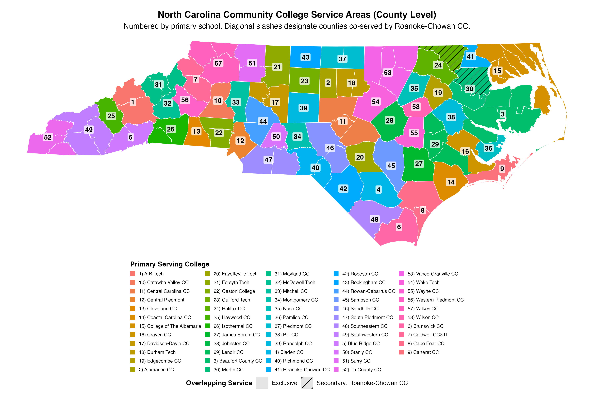

# NC SUD Application

**Status (2026-11-02):** the observed-incidence application (2026-10-02, with a
separate tail refinement) and the methods extensions (2026-10-20/21) are complete.
Findings: [observed-incidence application](../docs/findings/2026-10-02-nc-sud-application-findings.md),
[methods-extension findings](../docs/findings/2026-10-20-methods-extensions-findings.md) and
[methods-extension report](../docs/findings/2026-10-21-methods-extensions-report.md). Design:
[application plan](../docs/plans/2026-10-02-nc-sud-application-plan.md). The July 2026
synthetic-incidence runs and proposal report are archived in
[`archive/synthetic_2026-07/`](archive/synthetic_2026-07/README.md). Project-wide status:
[`../ROADMAP.md`](../ROADMAP.md) and [`../docs/TODO.md`](../docs/TODO.md).

## Revised observed-incidence pipeline

From the IncidenceDesign project directory:

```sh
Rscript application/tests/test_application_data.R
VECLIB_MAXIMUM_THREADS=1 OPENBLAS_NUM_THREADS=1 OMP_NUM_THREADS=1 Rscript application/tests/test_real_sud.R
VECLIB_MAXIMUM_THREADS=1 OPENBLAS_NUM_THREADS=1 OMP_NUM_THREADS=1 Rscript application/code/run_real_sud.R smoke 4
VECLIB_MAXIMUM_THREADS=1 OPENBLAS_NUM_THREADS=1 OMP_NUM_THREADS=1 Rscript application/code/run_real_sud.R pilot 8
VECLIB_MAXIMUM_THREADS=1 OPENBLAS_NUM_THREADS=1 OMP_NUM_THREADS=1 Rscript application/code/run_real_sud.R production 8
Rscript application/code/real_sud_summary.R
Rscript application/code/render_real_sud_companion.R production
Rscript application/tests/verify_real_sud.R production
VECLIB_MAXIMUM_THREADS=1 OPENBLAS_NUM_THREADS=1 OMP_NUM_THREADS=1 Rscript application/code/refine_real_sud_tail.R 8
Rscript application/tests/verify_real_sud.R tail_confirmation
```

`real_sud_setup.R` validates observed annual/pooled cluster inputs, cached queen/
rook weights and legal-boundary geography, and freezes four regions plus yearly
spatial blocks. `real_sud_simulation.R` simulates education outcomes with known
τ = 1 and estimates τ with the validated SAR ML engine. Incidence informs
allocation only in the primary model. The separate matched baseline sensitivity
adds rank-scaled X to the DGP and fitted matrix.

`run_real_sud.R` runs each manifest-keyed computational source once, refines
Monte Carlo precision, and expands results into separately reported years with
annual treatment/population diagnostics and shared Source_ID provenance.
Production has 1,248 reporting blocks and 936 computational sources before any
additional focused tail confirmation. Outputs live under
`results/real_sud_rev_20261002/{smoke,pilot,production}/`: `performance.csv`,
`allocation_metrics.csv`, `warnings_failures.csv`, `results.rds`, and manifest.
Fit checkpoints are ignored. Code/input changes refuse checkpoint reuse; preserve
the earlier profile and use a new output location when computation changes.

The offline [HTML companion](report/real_sud_companion.html) displays aggregate
maps, model diagrams and interactive result filters. Only authorized 58-cluster
aggregates are displayed. The current display uses completed production and separately identified refined-tail results.
The new behavioral suite verifies model meaning, exact budgets, fixed-prefix
extensions, duplicate covariance, annual reuse diagnostics and estimator agreement.
See [implementation findings](../docs/findings/2026-10-02-nc-sud-implementation-findings.md)
for the walkthrough and current verification evidence.

`refine_real_sud_tail.R` separately extends outcomes to at least R400 for all
designs at primary queen corners (rho 0/0.5, gamma 0.8, both regimes, all years).
It validates the parent manifest and preserves main outputs and allocation/fit
prefixes. This refines the same allocation sample; it is not independent
confirmatory allocations. Cross-selected outcome-half diagnostics show selection
uncertainty. `test_real_sud_tail.R` checks those diagnostics with a hand fixture.

This directory adapts the IncidenceDesign simulation framework from a regular 10x10 grid to the North Carolina Community College service-area application. The application uses 58 irregular spatial clusters, Queen-contiguity neighbors, and population-balanced design adaptations to evaluate treatment assignment strategies for a future SUD intervention study.

## Methods extensions (2026-10-20)

Plan: [docs/plans/2026-10-20-methods-extensions-plan.md](../docs/plans/2026-10-20-methods-extensions-plan.md);
findings and teach-back: [docs/findings/2026-10-20-methods-extensions-findings.md](../docs/findings/2026-10-20-methods-extensions-findings.md).
New files only; the hashed production files are sourced, not edited (V9). From the
project directory, BLAS pinned to one thread (`VECLIB_MAXIMUM_THREADS=1
OPENBLAS_NUM_THREADS=1 OMP_NUM_THREADS=1`):

```sh
Rscript application/tests/test_methods_extensions.R          # V3-V7, V11 (SKIP_LAGSARLM=1 to skip V5's lagsarlm part)
Rscript application/code/methods_ext_stored.R                # A0, A1, A2, A5 Stage 1 from stored fits
Rscript application/code/methods_ext_participation.R a3 10   # A3 partial participation + power (pilot | a3 | a4)
Rscript application/code/methods_ext_participation.R a4 10   # A4 unequal trained professionals
Rscript application/code/methods_ext_summaries.R 10          # N80, MDE, translation, guidance, V1/V2/V8
Rscript application/code/methods_ext_sensitivity.R a7 10     # also a5, a6car, a6bayes; add "smoke" for a quick run
Rscript application/code/methods_ext_sensitivity_summary.R   # A5 Stage 2, A6 (V10), A7
Rscript application/tests/verify_methods_ext_manifests.R     # V9
```

`run_methods_ext_queue.sh` chains the post-A3/A4 steps unattended (under `caffeinate`).
Outputs: `results/methods_ext_2026-10/{stored,participation,summaries,a5,a6car,a6bayes,a7,sensitivity_summaries,verification}/`,
each with a manifest; per-task checkpoints and per-fit tables are gitignored.

**2026-10-21 reruns (author decisions of 2026-10-21, `../DECISIONS.md`).**
`run_methods_ext_queue_v2.sh` runs `tests/test_methods_ext_v2.R`, the A3 rerun with
≥ 2-college saturation regions and t + df test counts (`methods_ext_participation.R a3v2 10`,
output `participation/a3v2/`), its reproduction check against the first A3 run
(`tests/check_a3v2_reproduction.R a3 a3v2`), the long-chain Bayesian CAR rerun
(`methods_ext_sensitivity.R a6bayeslong 10`), the v2 summaries
(`methods_ext_summaries.R 10 a3v2 summaries_v2`), `methods_ext_bayes_long_summary.R` and
V9; any failed step stops the queue (`queue_v2.log`). Separately,
`methods_ext_sensitivity.R a6bayeslag` with `methods_ext_bayes_lag_summary.R` fits a
Bayesian SAR-lag model, and `methods_ext_bayes_long_tdf.R` adds ML t + df coverage to the
long-chain comparison.

Current outputs are `summaries_v2/` and `sensitivity_summaries_v2/`. The first-run
`summaries/` and `sensitivity_summaries/` are kept; `code/24_methods_extension_tables.R`
still reads A5 Stage 2, A6 CAR and A7 from `sensitivity_summaries/` (those analyses were
not rerun), A2 tests and A5 Stage 1 from `stored/`, and the rest from the v2 folders.
`methods_ext_core.R` holds the shared helpers (key seeds in a new namespace,
participant subsets, participant W with zero rows for islands, rule-A exposure,
designs on subsets, manifests).

## Directory Structure

```text
application/
  code/      R scripts for mapping, real-data aggregation, weights, designs, the observed-incidence
             runs, methods extensions, and the superseded synthetic runner
  data/      NC Community College mapping CSVs and nc_cluster_weights.rds (tracked) + restricted
             SUD source data and derived/ outputs (gitignored; see "Real SUD incidence data" below)
  tests/     data, observed-run, summary, tail, companion and methods-extension checks
  notes/     service-area cluster map
  report/    application study report (qmd/pdf), offline HTML companion and its assets
  results/   real_sud_rev_20261002/ (observed-incidence runs), methods_ext_2026-10/,
             cached population and tigris files
  archive/   synthetic_2026-07/ (July 2026 synthetic runs and proposal report)
```

## Study Region

Counties are assigned to one of 58 clusters based on primary North Carolina Community College service coverage. The map below shows the county-level assignment used to form the irregular spatial clusters for randomization and outcome simulation.



## Historical: synthetic-incidence application (July 2026)

Before the observed data arrived, the pipeline ran on synthetic Poisson SAR incidence
(`code/run_application_profiles.R`, `code/synthetic_sud_data.R`) with the pre-revision
design rules and `lagsarlm`. Those runs, their proposal report and their findings are
superseded and archived in `archive/synthetic_2026-07/`. The 2026-09-24 design rules
(random tie-breaking, exact budgets, only the graph checkerboard deterministic) are in
`code/application_designs.R` and are used by the observed-incidence runs.

## Real SUD incidence data (aggregated 2026-09-25)

Real county-level SUD data replace the synthetic placeholder as input. The design
comparison on them is the observed-incidence run above (2026-10-02).

**Sources** (copied from OneDrive `UNC Dissertation (Lin)/Project 2 - Prior Incidence
Weighting/Application - Sudden Death/SUD Data - Ashkan/data/`; **gitignored**, because they are
restricted death-certificate data and this repo is public):

| File | Role | Content |
|---|---|---|
| `data/final_county_sudden.csv` | **Numerator + denominator** + covariates | `num_obs` = sudden unexpected out-of-hospital deaths, ages 18–64, from Habib's corrected case filtering (23,523 deaths). `pop_18_64` = SEER year-specific population aged 18–64 (Σ 2018–2021 = 25,594,321 person-years). Also 36 static county covariates plus year-varying `cvd_rate`. |
| `data/sudden_county_year.csv` | Reconciliation only | Habib's `Temporal Trends Data.R` output: `CORES` (3-digit county FIPS), `DOD_YR`, `num_obs` = the older counts behind Habib (2026). 21,147 deaths. Carried as `deaths_habib2026`. |

**Numerator decision (author, 2026-09-25; Habib, personal communication, 2026-09-25).**
The SUD counts come from `final_county_sudden$num_obs` (23,523 deaths). That file reflects
Habib's corrected case filtering: heart-failure deaths are no longer excluded as presumed
non-sudden, because he found a small but non-negligible overlap between adjudicated sudden
cardiac death and heart-failure patients. This reverses the earlier choice of the 21,147
counts. Those counts match the published paper (`habib_temporal_2026`) but not the corrected
method, so they're kept only as the reconciliation column `deaths_habib2026`.

Statewide rates per 100,000 (numerator, then Habib 2026 in parentheses): 83.9 (75.1) in
2018, 85.9 (77.9) in 2019, 97.1 (86.7) in 2020, 100.5 (90.6) in 2021, and 91.9 (82.6)
pooled. The corrected counts are ≥ the Habib (2026) counts in all 400 county-years (equal in
48). The `deaths_habib2026` column still reproduces the paper exactly, including county
range Orange 41.2 to Swain 215.6 (the paper says 216.0). On the numerator the pooled county
range is Orange 44.3 to Swain 242.5.

The two files join on `county_fips = 37000 + CORES`.

**Code** (`code/`; each file has a header saying what it does and where it fits):

| File | Role |
|---|---|
| `run_sud_aggregation.R` | Entry script: runs the three steps below, checks that clusters add up to counties, writes `data/derived/` |
| `sud_load_data.R` | Step 1: `load_sud_county_data()` reads and joins the two sources; stops unless it's a complete 100 × 4 panel |
| `sud_incidence.R` | Step 2: `compute_incidence()` (rate formulas) and `aggregate_sud_to_clusters()` (county → college) |
| `sud_reconcile.R` | Step 3: `reconcile_sud_counts()` writes the QC report: numerator vs the Habib (2026) counts, and those counts vs the paper |
| `build_cluster_weights.R` | Queen and rook contiguity weights for the 58 clusters → `data/nc_cluster_weights.rds` |
| `cc_mapping_data.R` | County → college mapping (strict 1-to-1, 100 counties → 58 colleges) |

**Regenerate** (after placing both sources in `data/`):

```bash
Rscript projects/IncidenceDesign/application/code/run_sud_aggregation.R
Rscript projects/IncidenceDesign/application/code/build_cluster_weights.R
Rscript projects/IncidenceDesign/application/tests/test_application_data.R
```

Outputs in `data/derived/` (gitignored):

| File | Content |
|---|---|
| `sud_cluster_incidence.csv` | Long: 58 colleges × period ∈ {2018, 2019, 2020, 2021, 2018-2021}; deaths, person-years, rates |
| `sud_county_incidence.csv` | The same for the 100 counties |
| `sud_reconciliation_report.txt` | Statewide totals for both counts vs the paper, the Habib (2026) paper checks, and the 23,523 vs 21,147 comparison |
| `figures/observed_sud_incidence_<period>.png` | Cluster maps (`plot_real_sud_incidence_maps()` in `run_application_profiles.R`) |

**Rate definitions** (d = deaths, P = population aged 18–64, T = 4 years):
- yearly: d_t / P_t × 100,000
- **average** (`rate_per_100k` in the 2018-2021 rows): Σd / ΣP × 100,000, per 100,000
  person-years
- **total** (`rate_cumulative_per_100k`): Σd / (ΣP / T) × 100,000 = T × average, deaths per
  100,000 over the whole period
- `mean_of_yearly_rates`: diagnostic only. It differs from the average by ≤ 0.75 per 100k.

**Key facts** (numerator = corrected counts):
- Pooled cluster rates are 45.3–194.9 per 100k (median 125.6); Wake Tech is lowest,
  Edgecombe CC highest.
- The smallest cluster-year count is 5 deaths (Pamlico CC, 2018).
- Year-to-year cluster rank Spearman is 0.72–0.82 (all six year pairs).
- Cluster ranks barely differ from the Habib (2026) counts (pooled Spearman 0.982). The code
  switch is `deaths_col = "deaths_habib2026"`.

`load_real_sud_data()` / `integrate_real_sud_data()` in `run_application_profiles.R` now wrap
this code. They used to guess columns by regex, which picked `county_name` as the count
column, and silently filled missing counts with 0 and missing populations with 1.

### Contiguity weights (`data/nc_cluster_weights.rds`, tracked)

Public geography only, so it's committed.
- **Contents:** `queen` and `rook` entries, each holding `nb` (spdep neighbor list),
  `adjacency` (binary, symmetric) and `W` (row-standardized, rows sum to 1), plus a
  `clusters` table. Rows and columns are named by `Primary_College`, so join by name, not
  position.
- **Degree:** queen 1–8 neighbors per cluster (mean 4.93), rook 1–8 (mean 4.79). Tri-County
  CC, the state's southwest corner, has one neighbor.
- **Queen-only pairs (corner touches):** Montgomery–South Piedmont, Richmond–Stanly,
  Johnston–Vance-Granville, Nash–Wake Tech.
- **Boundaries:** built from the full legal county boundaries (`cb = FALSE`), so counties
  that meet across water are neighbors. Author decision, 2026-09-25: an education
  intervention can plausibly benefit nearby counties across a river or sound. Compared with
  the shoreline-clipped cartographic boundaries (`cb = TRUE`, used by the earlier synthetic
  runs), this adds 3 pairs: College of The Albemarle–Martin CC (Chowan River),
  Carteret–Pamlico (Neuse River) and Carteret–Beaufort County CC (Pamlico Sound).

### Source-data notes and open questions for Ashkan Habib

- **Two scripts in `SUD Data - Ashkan/scripts/`:**
  - `Temporal Trends Data.R` builds `sudden_county_year.csv`.
  - `Data Age and County Residence Restriction.R` is a Lenoir-only extract.
  - Neither builds `final_county_sudden.csv` in our copy. Habib says his R script and
    `final_county_sudden` reflect the corrected filtering; we don't have that version.
- **Notes on `Temporal Trends Data.R`:**
  - It defines a heart-failure (I50) pattern but never applies it. That's now explained:
    under the corrected filtering, heart failure is deliberately not excluded (Habib,
    2026-09-25).
  - Its multi-line free-text regex can't match "KIDNEY FAILURE" or "LIVER FAILURE".
- **Answered (Habib, 2026-09-25):** which count to use (23,523, `final_county_sudden`) and
  whether heart failure is excluded (no).
- **Settled by the author (2026-09-25):** there is no separate updated script to request.
  Publications cite Habib (2026) for the case definition and state that heart-failure deaths,
  excluded in that paper, are included here, because some heart-failure patients died of
  adjudicated sudden cardiac death (Habib, personal communication). That inclusion is why
  `final_county_sudden` has more deaths (23,523 vs 21,147; 91.9 vs 82.6 per 100,000).
- **Still open (confirmation items, not blockers):**
  1. Should the free-text filter match KIDNEY / LIVER FAILURE?
  2. Is `pop_18_64` the SEER mid-year estimate? Unknown (author, 2026-09-25): check Habib's
     master's paper; ask him if it doesn't say. Not a blocker.
  3. Data-use agreement: plan to include cluster-level derived results (counts, rates, maps)
     in the chapter and CTJ; the author will obtain approval before publication (2026-09-25).
     Don't publish county-level counts.

## Current results

Observed-incidence results are in `results/real_sud_rev_20261002/` (`production/`,
`tail_confirmation/`, `exhibits/`), and the methods extensions in
`results/methods_ext_2026-10/`. Interpretation is in the findings documents linked at the
top. The remaining source-data questions for Ashkan Habib are listed above.

Exhibit generation: `Rscript application/code/real_sud_summary.R` requires verified
production and tail outputs and writes traced tables/PNG/PDF figures under
`results/real_sud_rev_20261002/exhibits/`. It matches sensitivity references at the
same year and parameters, avoiding mismatched rook/queen averages. Run
`Rscript application/tests/test_real_sud_summary.R` and
`node application/tests/test_companion.mjs` to check reference matching and the
actual saved HTML's filters/data/figure assets. The DOM fixture does not verify
visual rendering in a browser; local PNG figures have been visually reviewed.
