## {.title-slide-custom data-menu-title="Title" data-footer-part=""}

<!-- SUDDEN project meeting deck, 2026-10-29. Draft 1 (2026-10-28).
     Sources: CTJ manuscript and exhibits (commit 00270ae + declarations fix), SI,
     Chapter 3 (paper/thesis_chapter/Thesis_Chapter.qmd) and the methods-extension
     results (results/methods_ext_figures/). Outline: OUTLINE.md.
     Footer section label: set by data-footer-part on every content slide
     (theme/footer-part.html); there are no section-divider slides.
     Speaker notes: full verbatim script for the main body, with [time | running
     total] at the top of each; backup slides carry short "use when asked" notes. -->

::: {.center}

<h1 class="talk-title" style="font-size: 1.75em; line-height: 1.15; margin-top: 1.8em; margin-bottom: 0.3em; color: var(--unc-navy); border-bottom: none;">
Sampling Design for Spatial Cluster Randomized Trials Under Heterogeneous Incidence
</h1>

<strong style="color: var(--unc-carolina-blue);">Andrew J Walther</strong>

Department of Biostatistics, University of North Carolina at Chapel Hill 
SUDDEN project meeting &middot; October 29, 2026

:::

::: {.notes}
[0.5 min | running 0.5]

- Good morning, and thank you for having me.
- I'm Andrew Walther, a PhD student in biostatistics working with Dr. Lin.

- In plain terms, the question today is which community colleges should get Dr. Simpson's SUD-prevention education program first, when death rates differ across the state and the program can spread between neighboring colleges.

- This is about designing the trial, not evidence yet that the program works, and I'd most like your feedback on the North Carolina application.
:::

## Outline {data-menu-title="Outline" data-footer-part=""}

•BackgroundSudden unexpected death, Lenoir County pilot, spillover, and community college service area clusters

•MethodsSpillover variants, spatial autoregressive outcome model, sampling design evaluation, candidate designs vs. simple random sampling

•Simulation ResultsDesign intervention estimation accuracy on a simulated 100-cluster region

•ApplicationNorth Carolina SUD data, application of designs to NC map, accuracy, downside risk, and participation required

•DiscussionTake-home, limitations, and next steps

::: {.notes}
[0.25 min | running 0.75]

- Here is the plan.
- I'll start with why sudden death matters and where the pilot idea came from, then the methods, a short simulation section, and most of the time on the North Carolina application, before the take-home and next steps.
:::

## Sudden unexpected death takes a large and uneven toll on working-age adults {data-menu-title="SUD burden" data-footer-part="Background"}

::: {.columns}
::: {.column width="50%"}
<h3>Nationally</h3>

- **Sudden unexpected death (SUD):** an unexpected natural death outside the hospital in a working-age adult
- About **49 per 100,000 men and 22 per 100,000 women** aged 20–64 each year (US estimate from SUDDEN adjudication in Wake County)
- About **2 million years of life lost**, **10%** of all-cause years of life lost at these ages, and about $51 billion in lifetime productivity loss

Mirzaei et al., Medical Care 2019; Gan et al., J Gen Intern Med 2019.

:::
::: {.column width="50%"}
<h3>In North Carolina, 2018–2021</h3>

23,523 presumed SUD deaths among adults aged 18–64, from death certificates

84 → 101 statewide deaths per 100,000 per year (corrected counts), rising each year from 2018 to 2021

Higher in rural counties, in 2014 about 100 per 100,000 in highly rural NC counties against 68 in highly urban ones (Gan et al.)

:::
:::

::: {.notes}
[0.75 min | running 1.5]

- Sudden unexpected death is why this project exists, an unexpected natural death outside the hospital in a working-age adult.

- Dr. Simpson's group estimated about 49 per 100,000 men and 22 per 100,000 women aged 20 to 64 die this way each year, about two million years of life lost.

- In North Carolina, death certificates from 2018 to 2021 identify about 23,500 presumed sudden deaths among adults aged 18 to 64, and the statewide rate rose every year, from about 84 to about 101 per 100,000.

- And the burden is uneven, about 100 per 100,000 in highly rural counties against 68 in highly urban ones in Gan and colleagues' 2014 data, which raises the question of where prevention should start.
:::

## Dr. Simpson's Lenoir County pilot is the starting point for a statewide trial {data-menu-title="From pilot to statewide" data-footer-part="Background"}

<b class="k">SUD as a social problem</b>SUDDEN findings show sudden death tracks access to care, income and rurality, so prevention has to reach communities, not only hospitals

→

<b class="k">Lenoir County pilot idea</b>Teach SUD prevention through Lenoir Community College's workforce-development and disaster-response training (Lenoir, Greene and Jones counties), where Dr. Simpson notes SUD rates spike after flooding

→

<b class="k">Trainees (to confirm)</b>Students and staff in those programs, possibly including EMS and healthcare trainees; students earn credit, and the response goes beyond getting people to the hospital

→

<b class="k">After the pilot</b>Share what works with the other counties and all 58 community colleges; colleges talk to each other, so training can spill over

→

<b class="k">This project</b>Which colleges should get it first, and how should incidence guide that choice?

::: {.columns style="margin-top: 0.5em;"}
::: {.column .smallcol width="50%"}
- The pilot is delivered **county-wide through a college**, not by census tract, so the natural unit is a college's service area
- Dr. Simpson expects early effects in **process measures** (taking medicine, timely clinic visits), not SUD rates; for the design study we assume a trainee **education score**
:::
::: {.column .smallcol width="50%"}
- A statewide trial treats some colleges and holds others as controls, and colleges talk to each other, so training can spread
- Our proposal uses past SUD incidence to guide **where** the program goes while keeping the trial randomized
:::
:::

::: {.notes}
[1.5 min | running 3]

- SUDDEN showed that sudden death tracks access to care, income and rurality, so prevention has to reach communities, not only hospitals.

- Dr. Simpson's pilot idea is to teach SUD prevention through Lenoir Community College's workforce-development and disaster-response training, which serves Lenoir, Greene and Jones counties.
- Lenoir County floods regularly, and Dr. Simpson has seen SUD rates spike after flooding, which is part of why disaster response is the vehicle.

- The trainees are students and staff in those programs, who earn credit for the work, and the aim is outreach that goes beyond getting people to the hospital.
- For our model we assumed they include EMS and other healthcare trainees, and that is one of the points I'd most like clarified.

- Dr. Simpson expects early effects in process measures, such as people taking their medicine and timely clinic visits, and for the design study we assumed an education score of the trainees.

- After the pilot, the plan is to share what works with all 58 community colleges, and colleges talk to each other, so the training can spill over.

- That is where this project comes in, asking which colleges should get the program first, and how past incidence should guide that while keeping the trial randomized.
:::

## When a program reaches neighbors, a simple comparison can miss its effect {data-menu-title="Spillover examples" data-footer-part="Background"}

::: {.cards .two style="margin-top: 0.6em;"}
::: {.card}
<h3>Bed nets, northern Ghana</h3>

Children living near households with insecticide-treated bed nets had lower mortality, even when their own household had none.
:::
::: {.card}
<h3>School deworming, western Kenya</h3>

Untreated children attending schools near treated schools had fewer worm infections.
:::
:::

Spillover means that treating one group changes outcomes in the groups next to it

- A trial that compares treated with untreated clusters assumes each cluster's outcome depends only on its own treatment
- With spillover, untreated neighbors look better than they would have, so the treated-versus-control gap understates the effect

Binka et al., Trop Med Int Health 1998; Miguel and Kremer, Econometrica 2004.

::: {.notes}
[0.75 min | running 3.75]

- Two classic examples show why geography matters.
- In northern Ghana, children living near households with treated bed nets had lower mortality, even without a net of their own.
- In western Kenya, deworming at one school reduced worm infections in untreated children at nearby schools.

- That is spillover.
- A standard cluster trial assumes each cluster's outcome depends only on its own treatment.
- With spillover, untreated neighbors look better than they otherwise would, so the simple treated-versus-control difference understates the effect.
- An education program can spread the same way, through colleagues, shared hospitals and regional meetings.
:::

## Analysis methods exist, but guidance on which clusters to treat is thin {data-menu-title="The design gap" data-footer-part="Background"}

::: {.columns}
::: {.column width="48%"}
### After the trial (analysis)
- Spatial models separate a program's direct effect from the effect of treated neighbors
- They need a trial designed to give them that contrast
:::
::: {.column width="4%"}
:::
::: {.column width="48%"}
### Before the trial (design)
- Which clusters should be treated?
- Options serve different goals (balance a covariate, vary the treated share by region, keep treated clusters apart)
- Few studies compare them under spillover and uneven incidence together
:::
:::

<strong>Our earlier work</strong> (BMC Medical Research Methodology, 2026) compared random and stratified allocation on small grids. This project adds uneven incidence, a larger study region, more designs and the real North Carolina map.

::: {.notes}
[0.5 min | running 4.25]

- Statisticians have good tools for analyzing spillover after a trial, but only if the design gave them enough contrast to work with, and that is decided when we choose which clusters to treat.
- Several allocation ideas exist, and few studies compare them when spillover and uneven incidence occur together.
- Our earlier paper compared two simple rules on small grids.
- This project adds uneven incidence, more designs and the real North Carolina map.
:::

## The trial's clusters are North Carolina's 58 community college service areas {data-menu-title="Service-area clusters" data-footer-part="Background"}

::: {.columns}
::: {.column width="71%"}
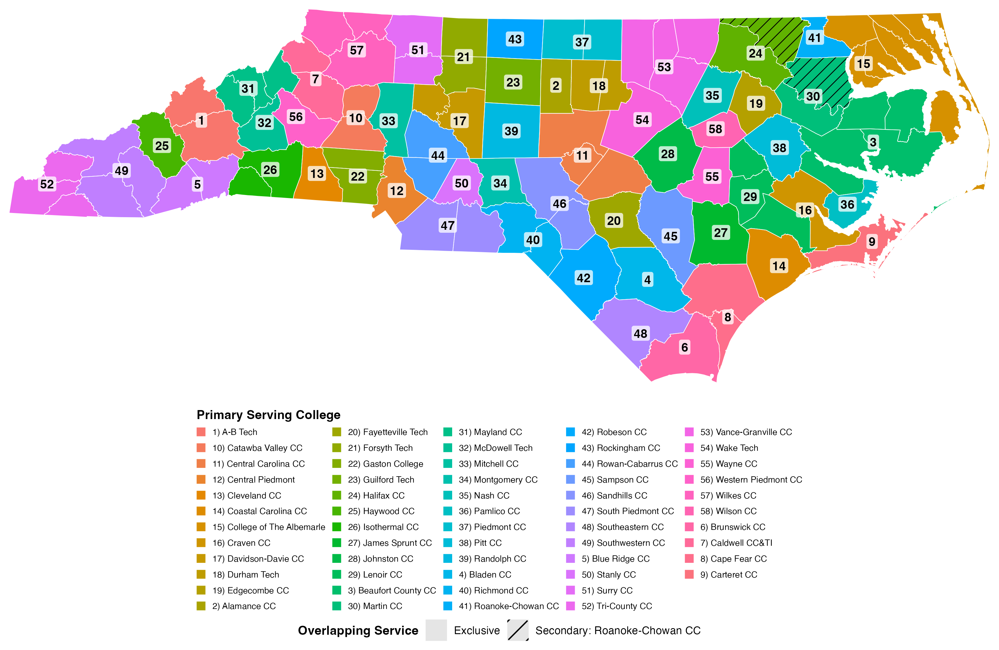
:::
::: {.column .smallcol width="29%"}

<b class="k">100 counties</b>Each assigned to its primary serving college (state list of colleges and the counties they serve)

<b class="k">58 service areas</b>31 colleges serve one county, 18 serve two, 9 serve three to seven

<b class="k">Shared counties</b>Bertie and Northampton (hatched) also lie in Roanoke-Chowan's network; each is assigned to its primary college

<b class="k">Neighbors</b>Two service areas are neighbors if they share a border or a corner (legal boundaries, including across water)

The trial measures an education outcome, not SUD deaths. Incidence guides allocation only.

:::
:::

::: {.notes}
[1 min | running 5.25]

- To set up the trial, we grouped the state's 100 counties into the service areas of the 58 community colleges, using the state's list of which college serves which county.

- Each color is one college's service area, and those are our clusters.

- Thirty-one colleges serve a single county and the rest serve two to seven, and the two counties shared with Roanoke-Chowan went to their primary college.

- Two service areas are neighbors if they share a border or a corner, and the pilot site, Lenoir Community College, is number 29 on the map.

- From here on I'll call the people trained and assessed in each college "professionals", and the outcome is their average education score, so incidence decides only who is treated.

- We model a simple two-arm comparison at one point in time, as if control colleges receive the program later.
:::

## Spillover can reach only the untreated colleges, or every college {data-menu-title="Two spillover regimes" data-footer-part="Methods"}

<figure>
<figcaption>Spillover to controls only untreated colleges gain</figcaption>
<svg width="460" height="350" viewBox="0 0 460 350" role="img" aria-label="Grid in which only untreated cells next to treated cells gain">
<g stroke="#8a96a3" stroke-width="2">
<rect x="10" y="10" width="100" height="100" fill="#1f5fa6"/><rect x="120" y="10" width="100" height="100" fill="#e0e7ef"/><rect x="230" y="10" width="100" height="100" fill="#1f5fa6"/><rect x="340" y="10" width="100" height="100" fill="#e0e7ef"/>
<rect x="10" y="120" width="100" height="100" fill="#e0e7ef"/><rect x="120" y="120" width="100" height="100" fill="#1f5fa6"/><rect x="230" y="120" width="100" height="100" fill="#e0e7ef"/><rect x="340" y="120" width="100" height="100" fill="#e0e7ef"/>
<rect x="10" y="230" width="100" height="100" fill="#e0e7ef"/><rect x="120" y="230" width="100" height="100" fill="#e0e7ef"/><rect x="230" y="230" width="100" height="100" fill="#e0e7ef"/><rect x="340" y="230" width="100" height="100" fill="#1f5fa6"/>
</g>
<g fill="#FBAF3D" stroke="#13294B" stroke-width="2">
<circle cx="190" cy="40" r="20"/><circle cx="410" cy="40" r="20"/><circle cx="80" cy="150" r="20"/><circle cx="300" cy="150" r="20"/><circle cx="410" cy="150" r="20"/><circle cx="80" cy="260" r="20"/><circle cx="190" cy="260" r="20"/><circle cx="300" cy="260" r="20"/>
</g>
<g font-size="30" font-weight="700" fill="#13294B" text-anchor="middle">
<text x="190" y="50">+</text><text x="410" y="50">+</text><text x="80" y="160">+</text><text x="300" y="160">+</text><text x="410" y="160">+</text><text x="80" y="270">+</text><text x="190" y="270">+</text><text x="300" y="270">+</text>
</g>
</svg>
</figure>
<figure>
<figcaption>Spillover to both arms treated and untreated colleges gain</figcaption>
<svg width="460" height="350" viewBox="0 0 460 350" role="img" aria-label="Grid in which treated and untreated cells next to treated cells gain">
<g stroke="#8a96a3" stroke-width="2">
<rect x="10" y="10" width="100" height="100" fill="#1f5fa6"/><rect x="120" y="10" width="100" height="100" fill="#e0e7ef"/><rect x="230" y="10" width="100" height="100" fill="#1f5fa6"/><rect x="340" y="10" width="100" height="100" fill="#e0e7ef"/>
<rect x="10" y="120" width="100" height="100" fill="#e0e7ef"/><rect x="120" y="120" width="100" height="100" fill="#1f5fa6"/><rect x="230" y="120" width="100" height="100" fill="#e0e7ef"/><rect x="340" y="120" width="100" height="100" fill="#e0e7ef"/>
<rect x="10" y="230" width="100" height="100" fill="#e0e7ef"/><rect x="120" y="230" width="100" height="100" fill="#e0e7ef"/><rect x="230" y="230" width="100" height="100" fill="#e0e7ef"/><rect x="340" y="230" width="100" height="100" fill="#1f5fa6"/>
</g>
<g fill="#FBAF3D" stroke="#13294B" stroke-width="2">
<circle cx="80" cy="40" r="20"/><circle cx="190" cy="40" r="20"/><circle cx="300" cy="40" r="20"/><circle cx="410" cy="40" r="20"/><circle cx="80" cy="150" r="20"/><circle cx="190" cy="150" r="20"/><circle cx="300" cy="150" r="20"/><circle cx="410" cy="150" r="20"/><circle cx="80" cy="260" r="20"/><circle cx="190" cy="260" r="20"/><circle cx="300" cy="260" r="20"/>
</g>
<g font-size="30" font-weight="700" fill="#13294B" text-anchor="middle">
<text x="80" y="50">+</text><text x="190" y="50">+</text><text x="300" y="50">+</text><text x="410" y="50">+</text><text x="80" y="160">+</text><text x="190" y="160">+</text><text x="300" y="160">+</text><text x="410" y="160">+</text><text x="80" y="270">+</text><text x="190" y="270">+</text><text x="300" y="270">+</text>
</g>
</svg>
</figure>

Treated college
Control college
Gains from treated neighbors (more treated neighbors, larger gain)

- **Controls only** is classic contamination, in which untreated colleges learn from treated neighbors
- **Both arms** means treated colleges also gain from treated neighbors, for example through shared trainings
- Which one holds is a judgment about how the program spreads, and the best design depends on it

::: {.notes}
[1 min | running 6.25]

- This is the most important idea in the talk.
- Spillover can work in two ways.
- Blue squares are treated colleges, grey are controls, and an orange plus marks a college that gains from treated neighbors.

- On the left, only untreated colleges gain.
- That is classic contamination, where staff at an untreated college pick up the training from colleagues next door.
- On the right, treated colleges also gain, for example through joint sessions, so the program is stronger wherever more neighbors are treated.
- In both, the gain grows with the share of neighbors that are treated.

- Which version is closer to the truth is a judgment about how this program spreads, and it decides which design works best.
- I'd welcome your view on that in the discussion.
:::

## One outcome model links treatment, spillover and neighbors {data-menu-title="Outcome model" data-footer-part="Methods"}

$$
Y = (I - \rho W)^{-1}\left[\,\tau Z + S(Z) + \beta X + \epsilon\,\right], \qquad \epsilon \sim N(0, I)
$$

<strong>Spillover to both arms</strong> &nbsp;$S(Z) = \gamma\, WZ$ &emsp;&emsp;&emsp; <strong>Spillover to controls only</strong> &nbsp;$S(Z) = \gamma\,(1 - Z) \circ WZ$

$Y$Outcome of each cluster (in the application, a college's mean education score)
$Z$Treatment indicator, 1 if the cluster is treated and 0 if control
$W$Neighbor matrix. Under queen contiguity two clusters are neighbors if they share an edge or a corner. Each row sums to 1, so $(WZ)_i$ is the share of cluster $i$'s neighbors that are treated
$\tau$Direct effect of a cluster's own treatment before outcomes spread between neighbors through $(I-\rho W)^{-1}$ (not a total effect), in standard deviations of the noise $\epsilon$; the quantity we estimate
$\rho$Spatial dependence, how much a cluster's outcome follows its neighbors' outcomes (0 to 0.5)
$S(Z)$Spillover, the gain from treated neighbors, in one of the two regimes above
$(I-\rho W)^{-1}$Spreads every cluster's outcome to its neighbors, neighbors' neighbors and so on ($I$ is the identity matrix)
$\gamma$Spillover magnitude, the gain when every neighbor is treated (0.5 to 0.8 on the grid; 50% or 80% of $\tau$ in the power analysis)
$\beta$How strongly incidence shifts the outcome. $\beta = 1$ on the grid; for the NC education outcome $\beta = 0$ (primary), with $\beta = 1$ only as a hypothetical sensitivity
$X$Cluster incidence on a 0 to 1 scale (simulated on the grid; in NC, the rank of the observed SUD rate scaled to 0 to 1, used only when $\beta = 1$)
$\epsilon$Independent standard normal noise in each cluster's outcome
$\circ$Elementwise product, so $(1-Z)\circ WZ$ is zero for treated clusters

::: {.notes}
[1 min | running 7.25]

- You don't need the algebra, since every symbol is defined below, so I'll say it in words.

- A college's score Y is the direct effect of its own treatment, tau times Z, plus spillover from treated neighbors, S of Z, plus a possible effect of incidence, beta times X, plus noise.

- The two spillover forms are the two regimes I just showed, with gamma the size of the gain, and the matrix in front lets neighboring colleges' scores move together, with rho setting how strongly.

- Tau is what we estimate, the push a college gets from its own training before it ripples out to neighbors.

- To simulate one trial, we pick an allocation with a design, generate every college's score from this model, and fit the same model to estimate tau, thousands of times over.

- On the grid beta is one, so incidence shifts outcomes, and for the education outcome in North Carolina beta is zero.
:::

## We judge each design by its average error, its intervals and its worst allocations {data-menu-title="Performance measures" data-footer-part="Methods"}

We estimate the program's effect $\tau$ with a spatial model that allows for spillover (a spatial lag model fitted by maximum likelihood, including the true spillover term), and repeat the trial thousands of times in simulation.

::: {.cards .three style="margin-top: 0.6em;"}
::: {.card}
<h3>Mean squared error (MSE)</h3>

The average of $(\hat\tau - \tau)^2$ over simulated trials. It combines bias and imprecision. **Lower is better.**
:::
::: {.card}
<h3>Coverage</h3>

The share of 95% confidence intervals that contain the true $\tau$. It should be close to 95% (we use a small-sample corrected interval).
:::
::: {.card .amber}
<h3>Allocation risk</h3>

A trial gets **one** allocation. How bad are the worst ones? For each allocation $a$, $m(a)$ is its expected squared error; we report the **mean of the worst 10%** of allocations.
:::
:::

Every design is compared with <strong>simple random sampling (SRS)</strong>, a completely random choice of half the clusters, the usual default. A ratio to SRS below 1 means lower error than SRS.

::: {.notes}
[0.75 min | running 8]

- We judge each design three ways.
- We simulate the trial thousands of times and estimate the effect each time with a spatial model that includes the spillover.

- Mean squared error is the average squared distance between the estimate and the truth, so lower is better.
- Coverage is how often the 95 percent confidence interval contains the truth, which should be about 95 percent.
- Allocation risk asks how bad the worst 10 percent of allocations are, since a real trial only gets one.
- Most results are ratios to simple random sampling, the usual default, so a ratio below one is better than random.
:::

## Six designs and simple random sampling choose treated clusters differently {data-menu-title="The designs" data-footer-part="Methods"}

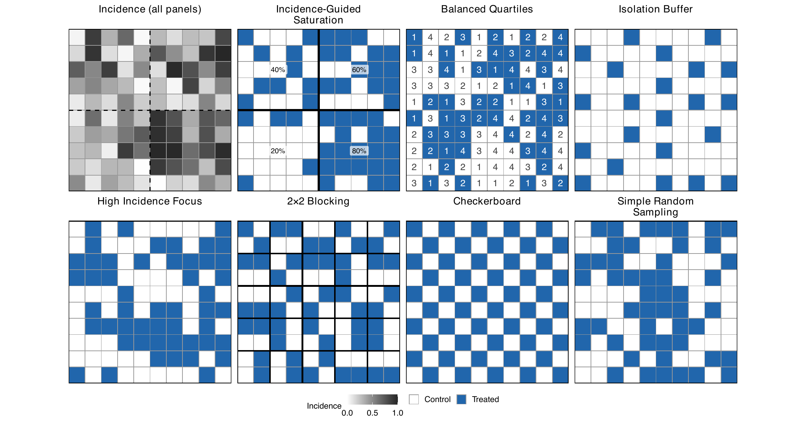

One example assignment per design on the 100-cluster grid (blue, treated; white, control). Top-left panel is the incidence surface used by every example (darker is higher). Percentages give each quadrant's treated share; numbers in Balanced Quartiles give each cluster's incidence quartile.

<strong>Target incidence</strong> High Incidence Focus &nbsp;&middot;&nbsp; <strong>Balance incidence</strong> Balanced Quartiles &nbsp;&middot;&nbsp; <strong>Separate or alternate</strong> Checkerboard, Isolation Buffer, 2×2 Blocking &nbsp;&middot;&nbsp; <strong>Vary the treated share by region</strong> Incidence-Guided Saturation (80, 60, 40, 20%)

::: {.notes}
[1 min | running 9]

- Here are the designs on a simulated 10 by 10 grid.
- The top-left panel is the incidence map, darker meaning higher, and each other panel is one example allocation, with blue treated.

- High Incidence Focus treats the highest-incidence half.
- Balanced Quartiles splits clusters into four incidence groups and treats half of each, so the arms have similar incidence.
- Checkerboard strictly alternates, Isolation Buffer keeps treated clusters from touching, and 2×2 Blocking treats two of every four clusters in each small block.

- The one I'll come back to most is Incidence-Guided Saturation.
- It treats 80 percent of the clusters in the highest-incidence quadrant, then 60, 40 and 20 percent in the others.
- Every region has treated and control clusters, but the treated share varies, and the highest-burden region gets the most.
- Simple random sampling, bottom right, is the reference.
:::

## The grid study varied every condition we cannot pin down in advance {data-menu-title="Grid study design" data-footer-part="Simulation Results"}

<table class="deck" style="font-size: 0.8em; margin-top: 0.4em;">
<thead><tr><th style="text-align:left">Condition</th><th style="text-align:left">Values</th></tr></thead>
<tbody>
<tr><td style="text-align:left">Study region</td><td style="text-align:left">10 × 10 grid of 100 clusters; queen neighbors (rook, edges only, as a sensitivity)</td></tr>
<tr><td style="text-align:left">How incidence varies across space</td><td style="text-align:left">Independent, spatially smooth (2 strengths), Poisson death counts (2 strengths)</td></tr>
<tr><td style="text-align:left">Spatial dependence of outcomes, $\rho$</td><td style="text-align:left">0, 0.01, 0.2, 0.5</td></tr>
<tr><td style="text-align:left">Spillover magnitude, $\gamma$</td><td style="text-align:left">0.5, 0.6, 0.7, 0.8</td></tr>
<tr><td style="text-align:left">Spillover regime</td><td style="text-align:left">Controls only, both arms</td></tr>
<tr><td style="text-align:left">Treatment effect, $\tau$</td><td style="text-align:left">0.8, 1, 1.5, 2, 3 (results shown at $\tau = 1$)</td></tr>
<tr><td style="text-align:left">Replication</td><td style="text-align:left">10 incidence maps × 25 allocations and outcomes = 250 simulated trials per scenario</td></tr>
</tbody>
</table>

A regular grid lets us vary conditions systematically before moving to the real map.

::: {.notes}
[0.5 min | running 9.5]

- We first tested the designs on this grid, where we could vary every condition we cannot pin down in advance, from the incidence pattern to the spillover regime, with 250 simulated trials per scenario.
- I'll show an effect of one standard deviation.
- The ordering was much the same at other effect sizes, with one change at large effects in the backup slides.
:::

## On the grid, the spillover regime decides which design wins {data-menu-title="Grid results" data-footer-part="Simulation Results"}

::: {.columns}
::: {.column width="56%"}
<table class="deck" style="font-size: 0.78em;">
<thead><tr><th style="text-align:left">Design</th><th>Spillover to controls only</th><th>Spillover to both arms</th></tr></thead>
<tbody>
<tr><td style="text-align:left">Incidence-Guided Saturation</td><td class="better">0.63</td><td class="worse">1.08</td></tr>
<tr><td style="text-align:left">Isolation Buffer</td><td class="better">0.74</td><td class="worse">3.80</td></tr>
<tr><td style="text-align:left">Balanced Quartiles</td><td class="same">1.02</td><td class="same">0.99</td></tr>
<tr><td style="text-align:left">High Incidence Focus</td><td class="worse">1.53</td><td class="worse">3.82</td></tr>
<tr><td style="text-align:left">2×2 Blocking</td><td class="worse">2.68</td><td class="worse">1.47</td></tr>
<tr><td style="text-align:left">Checkerboard</td><td class="worse">9.84</td><td class="worse">1.47</td></tr>
<tr><td style="text-align:left">Simple Random Sampling (MSE)</td><td>0.215</td><td>0.042</td></tr>
</tbody>
</table>

MSE relative to SRS, grid, queen neighbors, $\tau = 1$; blue lower than SRS, orange higher, grey not distinguishable from SRS (paired 95% interval includes 1).

:::
::: {.column width="44%"}

<strong>Controls only</strong> Incidence-Guided Saturation had <strong>37% lower error</strong> than SRS (MSE 0.136 vs 0.215)

<strong>Both arms</strong> No design beat SRS. Balanced Quartiles matched it; Incidence-Guided Saturation was 8% higher

Checkerboard and 2×2 Blocking were worse than SRS in both regimes, and far worse under controls only

Coverage of 95% intervals was 94–95% for every design.

:::
:::

::: {.notes}
[0.75 min | running 10.25]

- The two regimes tell different stories.
- With spillover to controls only, Incidence-Guided Saturation has 37 percent lower error than random sampling, and Isolation Buffer is also better.
- With spillover to both arms, nothing beats random sampling, Balanced Quartiles ties it, and Incidence-Guided Saturation is about 8 percent worse.

- Checkerboard and 2×2 Blocking are worse than random in both regimes, Checkerboard almost ten times worse under controls only.
- When treatment is finely interspersed, every control has about the same share of treated neighbors, so the model cannot tell treatment apart from spillover.
- Saturation creates regions with many treated neighbors and regions with few, which gives the model that contrast.

- So there is no single best design, and it depends on how spillover travels.
:::

## SUD deaths were identified from death certificates with a validated algorithm {data-menu-title="Case identification" data-footer-part="Application"}

::: {.columns}
::: {.column width="64%"}

<b>412,514</b> North Carolina deaths, 2018–2021

→

Exclude ages under 18 or over 64

↓

<b>111,665</b> deaths among adults aged 18–64

→

Exclude deaths in a hospital, hospice or nursing home

↓

Out-of-hospital deaths

→

Exclude suicide, homicide and accidents

↓

Natural out-of-hospital deaths

→

Exclude expected deaths from cancer

↓

<b>23,523</b> presumed sudden unexpected deaths

:::
::: {.column .smallcol width="36%"}
- The algorithm (Gan et al. 2019) was **validated against SUDDEN physician adjudication** of health records, EMS and death-certificate reports (as described in Habib 2026)
- Prepared by Ashkan Habib by county and year; rates use SEER population aged 18–64 (25.6 million person-years)
- Steps follow Gan et al. (2014 data, 83,509 certificates → 4,278 SUD); the statewide counts add a few exclusion rules (Habib 2026) and keep heart-failure deaths (excluding them gave 21,147)
:::
:::

::: {.notes}
[0.75 min | running 11]

- For the North Carolina data, Ashkan identified sudden deaths from death certificates with the algorithm from Gan and colleagues, which was validated against SUDDEN's physician adjudication.

- Of about 412,000 deaths in the state from 2018 to 2021, about 112,000 were in adults aged 18 to 64.

- The algorithm then removes deaths in a hospital, hospice or nursing home, deaths from suicide, homicide and accidents, and expected deaths from cancer, and the statewide data apply a few further exclusion rules that we still need to clarify.

- What remains, 23,523 deaths, are presumed sudden unexpected deaths, with SEER population estimates as the denominators.
:::

## We built the application study in six steps, fixing every rule before looking at results {data-menu-title="Application pipeline" data-footer-part="Application"}

<b class="k">1 · Data</b>County-year SUD deaths and SEER population aged 18–64, 2018–2021

→

<b class="k">2 · Clusters</b>100 counties into 58 college service areas; neighbors share a border or a corner

→

<b class="k">3 · Incidence</b>Yearly SUD rate per 100,000 for each service area; each year a separate planning input

→

<b class="k">4 · Designs</b>Each rule adapted to the map: four fixed regions, spatial blocks, a map Checkerboard

→

<b class="k">5 · Simulate</b>Education scores from the outcome model with $\beta = 0$, $\tau = 1$; 100 allocations × 100 outcomes per setting

→

<b class="k">6 · Evaluate</b>Error, coverage, risk of an unlucky allocation, and power with 15 to 58 participating colleges

::: {.columns style="margin-top: 0.8em;"}
::: {.column width="50%"}
- Incidence is **held fixed** at the observed rates; only the allocations and the education scores are simulated
- Spatial dependence $\rho$ = 0, 0.2, 0.5 and spillover $\gamma$ = 0.5, 0.8, in both regimes
:::
::: {.column width="50%"}
- 7.6 million simulated trials; every setting met its precision targets with no estimation failures
- Sensitivity analyses: $\beta = 1$, rook neighbors, other region orderings, other spatial models
:::
:::

::: {.notes}
[0.75 min | running 11.75]

- Here is how we built the application.

- We started from the county counts and population, grouped counties into the 58 service areas, and computed each area's SUD rate for each year.

- We then adapted each design to the real map before looking at any results, for example by fixing four geographic regions for the saturation design.

- Next we simulated education scores from the outcome model, with incidence not affecting the score, and an effect of one standard deviation.

- Finally we compared the designs on error, coverage, the risk of an unlucky allocation, and power with between 15 and 58 participating colleges.
:::

## SUD incidence is uneven across North Carolina and shifts from year to year {data-menu-title="NC incidence" data-footer-part="Application"}

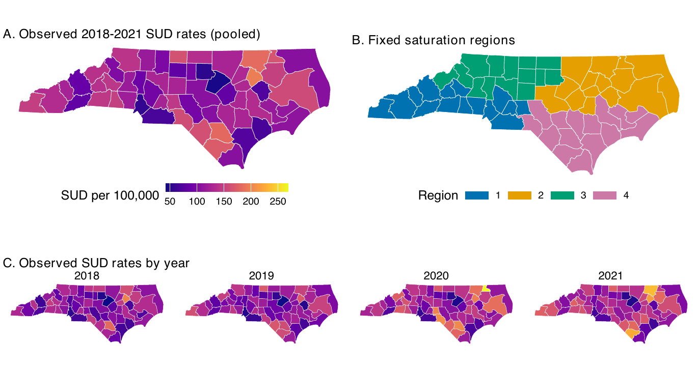

Panel A, SUD deaths per 100,000 adults aged 18–64, pooled 2018–2021, by college service area. Panel B, the four fixed regions used by Incidence-Guided Saturation. Panel C, yearly rates on the same color scale.

- **23,523 deaths** over 25.6 million person-years (ages 18–64), corrected county death-certificate counts (Gan et al. case definition)
- Each year is a separate planning input; incidence decides who is treated, not the education outcome

::: {.notes}
[0.75 min | running 12.5]

- Panel A shows the resulting SUD rates per 100,000 adults aged 18 to 64, pooled over 2018 to 2021, for each service area.

- They range from about 45 to 195 per 100,000, and the highest tend to be in service areas with small populations.

- Panel C shows each year on the same scale, and the ranking shifts, partly because a few deaths swing the rate in a small area.

- That is one reason we treated each year as its own planning scenario.

- Panel B shows the four fixed regions used by Incidence-Guided Saturation, chosen for compactness and balance before we looked at any results.
:::

## Each design was adapted to the map before we looked at any results {data-menu-title="NC allocations" data-footer-part="Application"}

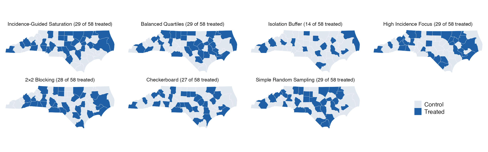

One example allocation per design on the 58-college map, 2018 incidence (Isolation Buffer treats 14 here, about 16 on average). Checkerboard becomes an alternating pattern on the irregular map; 2×2 Blocking becomes spatial blocking of 14 groups of nearby colleges; Incidence-Guided Saturation uses the four fixed regions.

- Most designs treat **29 of 58** colleges. Checkerboard treats 27, spatial blocking 27–31, and Isolation Buffer only about 16
- We report these budgets rather than force them to be equal

::: {.notes}
[0.75 min | running 13.25]

- Each design was translated to the real map, with every rule fixed before we looked at results.
- Here is one example allocation of each for 2018, with blue colleges treated.

- Most designs treat 29 of the 58 colleges.
- Checkerboard becomes an alternating pattern that does its best on an irregular map.
- 2×2 Blocking becomes spatial blocking, which treats half of each of 14 groups of nearby, similar colleges.
- Isolation Buffer treats only about 16.
- High Incidence Focus, top right, is the same 29 highest-rate colleges every time, so it is not really randomized.
:::

## Treating half the colleges does not always reach half the population {data-menu-title="Budgets and reach" data-footer-part="Application"}

<table class="deck" style="font-size: 0.76em;">
<thead><tr><th style="text-align:left">Design</th><th>Colleges treated (of 58)</th><th>2018</th><th>2019</th><th>2020</th><th>2021</th></tr></thead>
<tbody>
<tr><td style="text-align:left">Incidence-Guided Saturation</td><td>29</td><td>53%</td><td>45%</td><td>48%</td><td>52%</td></tr>
<tr><td style="text-align:left">Balanced Quartiles</td><td>29</td><td>49%</td><td>50%</td><td>51%</td><td>50%</td></tr>
<tr><td style="text-align:left">Isolation Buffer</td><td>about 16</td><td>27%</td><td>27%</td><td>27%</td><td>27%</td></tr>
<tr><td style="text-align:left">High Incidence Focus</td><td>29</td><td class="worse">22%</td><td class="worse">24%</td><td class="worse">23%</td><td class="worse">22%</td></tr>
<tr><td style="text-align:left">2×2 Blocking (spatial blocks)</td><td>28 / 31 / 27 / 29</td><td>50%</td><td>55%</td><td>48%</td><td>50%</td></tr>
<tr><td style="text-align:left">Checkerboard</td><td>27</td><td>50%</td><td>50%</td><td>50%</td><td>51%</td></tr>
<tr><td style="text-align:left">Simple Random Sampling</td><td>29</td><td>50%</td><td>50%</td><td>50%</td><td>50%</td></tr>
</tbody>
</table>

Average share of North Carolina's adults aged 18–64 living in treated service areas, by planning year. Geographic reach, not the number of professionals trained.

High Incidence Focus treats half the colleges but reaches under a quarter of the working-age population, since the highest-rate service areas are small.

::: {.notes}
[0.5 min | running 13.75]

- Treating half the colleges does not mean reaching half the people.
- This table shows the share of the state's working-age adults living in treated service areas.

- Most designs reach about half.
- High Incidence Focus treats 29 colleges but reaches only 22 to 24 percent, since the highest-rate areas are small.
- Isolation Buffer treats about 16 colleges and reaches about 27 percent.
- This is geographic reach, not the number of professionals trained, which depends on how many staff each college puts through the program.
:::

## With 58 colleges, Incidence-Guided Saturation beats SRS under spillover to controls only {data-menu-title="NC accuracy" data-footer-part="Application"}

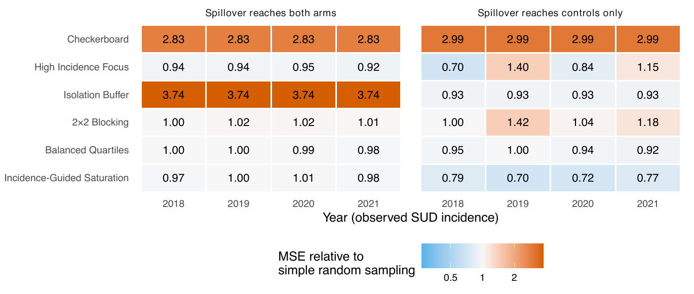

Mean MSE divided by SRS's in the same year and regime (each cell averages six settings of $\rho$ and $\gamma$). Blue is lower error than SRS, orange higher. Years share one map and several designs share simulations across years, so years are not independent replications.

::: {.columns}
::: {.column .smallcol width="50%"}
- **Both arms:** SRS, Balanced Quartiles and Incidence-Guided Saturation are within about 3% of each other
- Checkerboard is about 3 times SRS's error in both regimes; Isolation Buffer 3.7 times under both arms
:::
::: {.column .smallcol width="50%"}
- **Controls only:** Incidence-Guided Saturation had **21–30% lower error** than SRS in every year
- High Incidence Focus swings from 0.70 to 1.40 times SRS as its treated colleges change with each year's incidence
:::
:::

::: {.notes}
[1.25 min | running 15]

- Here is accuracy on the real map with all 58 colleges, by year, with spillover to both arms on the left, controls only on the right, and blue better than random sampling.

- Under controls only, Incidence-Guided Saturation, the bottom row, has 21 to 30 percent lower error than random sampling in every year, the same message as the grid.
- Under both arms, random sampling, Balanced Quartiles and Incidence-Guided Saturation are within about 3 percent of each other.
- Checkerboard is about three times worse in both regimes.

- Treating the highest-rate colleges is the intuitive choice, and under both arms its one fixed allocation even looks slightly better than random here, but it is not randomized.
- Its error swings with the year under controls only, and if high-burden areas also differ in staffing or training to begin with, we cannot separate that from the program, and in our check where they did, its error rose roughly fourfold.
- Incidence-Guided Saturation sends more of the program to higher-burden regions while keeping randomization in every region, though on this map the shift is small.
:::

## Under controls-only spillover, Incidence-Guided Saturation also lowers the risk of a bad draw {data-menu-title="Allocation risk" data-footer-part="Application"}

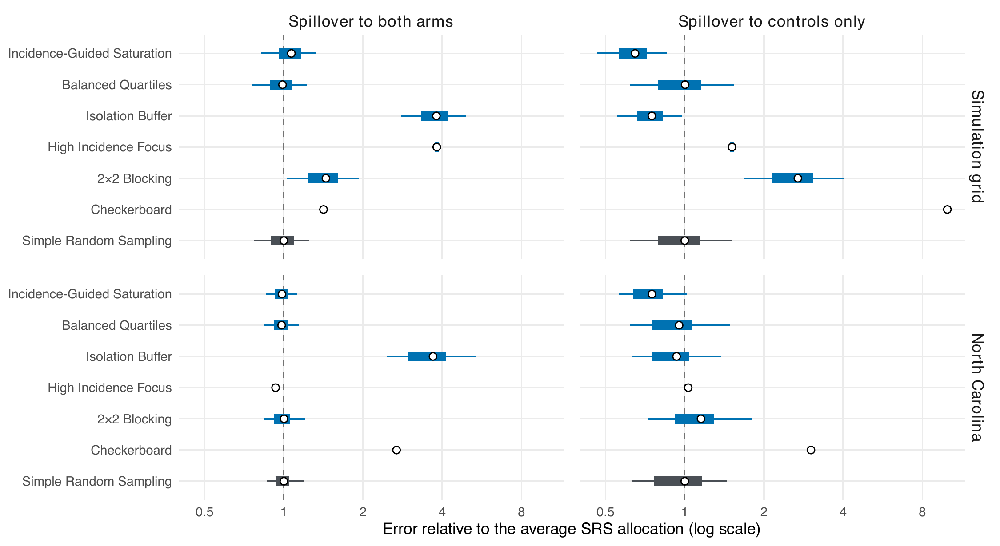

Each bar is the spread of error across one design's possible allocations, relative to SRS's average (thin line 5th–95th percentile, thick bar 25th–75th, circle the mean); top, grid; bottom, NC. Dark grey marks SRS. Under controls only, Incidence-Guided Saturation's worst 10% of allocations had <strong>21–43% lower error</strong> than SRS's worst 10% in NC (grid 0.19 vs 0.35); under both arms the differences are small and mostly simulation noise.

::: {.notes}
[0.75 min | running 15.75]

- A real trial gets one allocation, so we also asked how bad an unlucky draw can be.
- Each bar is the spread of error across a design's possible allocations, relative to the average random allocation, with the grid on top and North Carolina below.

- Look at the right-hand panels, spillover to controls only.
- Random sampling, the dark grey bar, reaches well above its average, so some random allocations are noticeably worse.
- Incidence-Guided Saturation's bar sits to the left, and in North Carolina its worst 10 percent of allocations had 21 to 43 percent lower error than random sampling's worst 10 percent.
- Under both arms, the two differ little in their worst allocations, and what you see is mostly simulation noise.
:::

## About 36 colleges give 80% power at one SD when spillover reaches every college {data-menu-title="Colleges needed" data-footer-part="Application"}

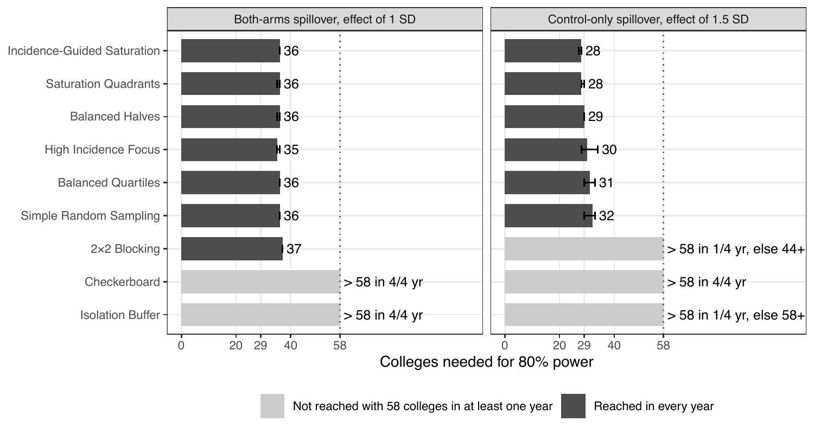

Colleges needed for 80% power (corrected $t$ test, 5% false-positive rate), random volunteering, $\rho = 0.5$, spillover from a fully treated neighborhood equal to 80% of the direct effect. Effects are in college-level standard deviations (SD). Bars, mean over 2018–2021; whiskers, range; grey, not reached with 58 colleges in at least one year. Saturation Quadrants and Balanced Halves are backup variants.

- Counts are **participating** colleges, about half treated; one college-level SD ≈ 0.3 SD per professional (25 assessed, ICC 0.05)
- **Both arms, 1 SD:** 35–37 participating colleges with any design except Checkerboard and Isolation Buffer
- **Controls only:** no design reaches 80% power at 1 SD even with all 58; at 1.5 SD, Incidence-Guided Saturation needs 28 colleges against 32 for SRS

::: {.notes}
[0.75 min | running 16.5]

- How many colleges do we need?
- This counts participating colleges, about half treated and half control, needed for an 80 percent chance of detecting the effect, with effects in college-level standard deviations, roughly a third of an SD for an individual professional.

- On the left, spillover to both arms, almost every design needs 35 to 37 participating colleges, so the design barely matters, while Checkerboard and Isolation Buffer don't get there even with all 58.
- On the right, controls only is much harder.
- No design reaches 80 percent power at one SD even with all 58, so the chart shows one and a half SDs, where Incidence-Guided Saturation needs 28 colleges against 32 for random sampling.
:::

## If fewer colleges join, Incidence-Guided Saturation's advantage shrinks {data-menu-title="Partial participation" data-footer-part="Application"}

::: {.columns}
::: {.column width="64%"}
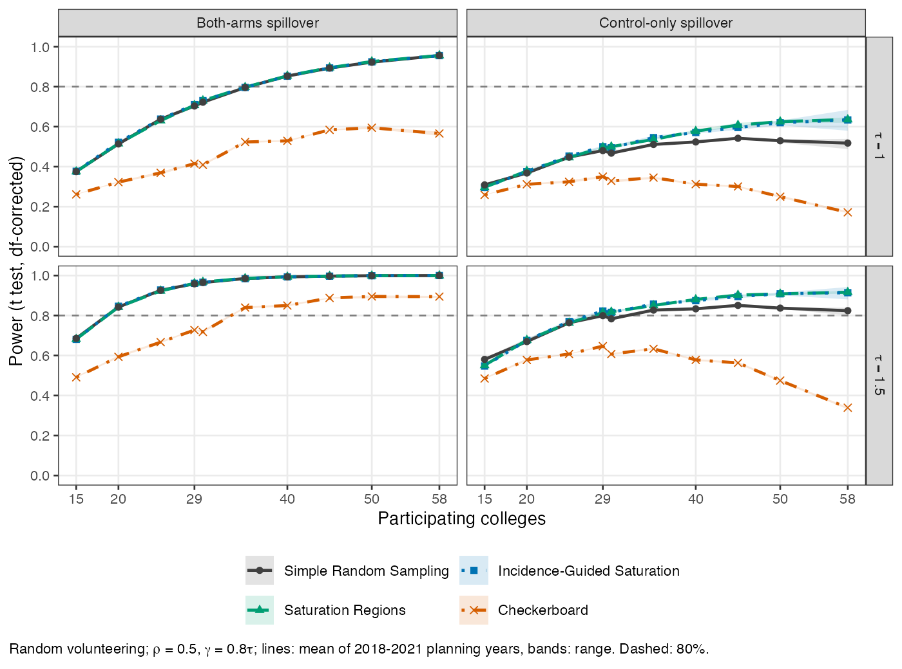
:::
::: {.column .smallcol width="36%"}
<table class="deck" style="font-size: 0.74em;">
<thead><tr><th>Participating colleges</th><th>Incidence-Guided Saturation error vs SRS (controls only)</th></tr></thead>
<tbody>
<tr><td>58</td><td class="better">22% lower</td></tr>
<tr><td>40</td><td class="better">9% lower</td></tr>
<tr><td>29</td><td class="better">5% lower</td></tr>
<tr><td>20</td><td class="same">about 1% lower</td></tr>
</tbody>
</table>

- Under controls only, SRS power stalls past about 40 colleges (Incidence-Guided Saturation keeps rising slowly), since nearly every control then has treated neighbors
- If higher-incidence colleges are more likely to volunteer, the advantage is 2% or less at 20–29 colleges

Figure, $\rho = 0.5$, spillover 80% of the effect (Saturation Quadrants is a backup variant). Table, $\tau = 1$, averaged over $\rho = 0, 0.5$ and spillover 50% or 80% of the effect; the 21–30% on the accuracy slide uses the main settings.

:::
:::

::: {.notes}
[0.75 min | running 17.25]

- Not every college will join.
- Under spillover to both arms, on the left, every added college helps.
- Under controls only, on the right, the gain slows past about 40 colleges, and for random sampling it stalls.
- When almost everyone is in, almost every control college sits next to treated ones, and the spillover blurs into the treatment, which is why random sampling dips slightly and Checkerboard loses about half its power near 58.

- In the table, Incidence-Guided Saturation's edge is about 22 percent less error with all 58 colleges and almost gone with 20, and smaller still if high-incidence colleges are the keenest to join.
- So how many colleges will join is a real design question.
:::

## A one-SD college effect is a modest effect for each trained professional {data-menu-title="Effect size in practice" data-footer-part="Application"}

::: {.columns}
::: {.column .smallcol width="48%"}
A college score averages $m$ professionals. With intraclass correlation ICC (share of score variance between colleges), the college-level noise SD ($\epsilon$), in individual SD units, is
$$\sigma_c = \sqrt{\text{ICC} + (1 - \text{ICC})/m}$$
so a college effect of $\tau$ SDs is an individual effect of $d = \tau\,\sigma_c$.

With <strong>25 professionals per college</strong> and <strong>ICC = 0.05</strong>, $\sigma_c \approx 0.30$, so a <strong>one-SD college effect is about 0.3 SD per professional</strong>

:::
::: {.column width="50%"}
<table class="deck" style="font-size: 0.95em; margin-top: 0.4em;">
<thead><tr><th>Professionals per college</th><th>29 participating colleges</th><th>58 participating colleges</th></tr></thead>
<tbody>
<tr><td>10</td><td>0.51</td><td>0.82</td></tr>
<tr><td>25</td><td>0.71</td><td>0.96</td></tr>
<tr><td>50</td><td>0.80</td><td>0.98</td></tr>
</tbody>
</table>

Power with SRS for an individual effect of $d = 0.3$, ICC = 0.05, spillover to both arms. Under controls only, power with all 58 is about 0.53 (SRS) to 0.64 (Incidence-Guided Saturation).

:::
:::

Your input on <strong>how many professionals each college trains</strong> and <strong>how much scores vary between colleges</strong> would sharpen these (pilot scores would tell us the second).

::: {.notes}
[0.75 min | running 18]

- What does one college-level standard deviation mean in practice?
- The college score averages the professionals assessed there, and averaging reduces noise.
- With 25 professionals per college and an intraclass correlation of 0.05, a one-SD college effect is about 0.3 SD for an individual, a modest education effect.

- Under spillover to both arms, 29 participating colleges give about 71 percent power for that effect and all 58 give 96 percent.
- Under controls only it is much lower even with all 58, about 53 percent with random sampling and 64 percent with Incidence-Guided Saturation.
- These numbers depend on how many professionals each college trains and how variable the scores are, which is where your experience comes in.
:::

## Incidence-Guided Saturation was a reasonable middle ground with limited downside {data-menu-title="Take-home" data-footer-part="Discussion"}

Incidence-Guided Saturation gained the most under controls-only spillover, at a small cost under both arms

::: {.cards .two}
::: {.card}
<h3>Spillover to controls only (untreated colleges gain)</h3>

Lowest or near-lowest error with all colleges taking part (21–30% below SRS in NC, 37% on the grid), a lower risk of an unlucky allocation, and the most treatment in the highest-rate region (a small shift on the NC map, where regions are similar). Even with all 58 colleges, power for a one-SD effect is only about 53% (SRS) to 64%
:::
::: {.card .navy}
<h3>Spillover to both arms (every college gains)</h3>

Close to SRS (within 8% on the grid and 3% in NC), so little is lost. About **36 participating colleges** give 80% power for a one-SD college effect (about 0.3 SD per professional) under our assumptions
:::
:::

- Balanced Quartiles stayed close to SRS in both regimes; Checkerboard and 2×2 Blocking never improved on SRS; High Incidence Focus varied by year under controls only and is not randomized
- Its advantage is largest when most colleges join; the right choice still depends on the spillover we expect

::: {.notes}
[1 min | running 19]

- The goal is a design that does reasonably well whichever kind of spillover is true, with limited downside.
- Incidence-Guided Saturation gained the most when spillover reaches untreated colleges, at a small cost when it reaches everyone, while Balanced Quartiles stayed close to random sampling in both.

- When spillover reaches mainly untreated colleges and most colleges take part, Incidence-Guided Saturation had error 21 to 30 percent below random sampling in North Carolina, 37 percent on the grid, and a lower risk of an unlucky allocation.
- Under that kind of spillover, though, even all 58 colleges give only about 53 to 64 percent power for a one-SD effect.

- When spillover reaches every college, it stayed within a few percent of random sampling, and about 36 participating colleges give 80 percent power for a one-SD college effect under our assumptions.

- The final choice still depends on the spillover we expect and how many colleges join.
:::

## Key assumptions remain, and the next step is to define the endpoint and size the trial {data-menu-title="Limitations and next steps" data-footer-part="Discussion"}

::: {.columns}
::: {.column width="50%"}
### Limitations
- Our analysis assumed we know how spillover works; if the analysis ignores spillover, every design underestimates the effect
- Planning incidence was treated as exact and fixed
- Neighboring service areas stand in for how professionals actually communicate
- Designs treat different numbers of colleges, so this is not a comparison at equal cost
- This evaluates trial designs, not the program's effect on SUD
:::
::: {.column width="50%"}
### Next steps
- Define the education endpoint, eligible professionals and budgets
- Choose the plausible spillover regime and contact network with this group, and whether a staggered rollout is feasible
- Sample size for the agreed effect size, participation and intraclass correlation
- Later, a design for an SUD-incidence endpoint (a count outcome)
:::
:::

The regime-specific guidance held under CAR models, a Bayesian spatial lag model and rook neighbors, except a misspecified Bayesian CAR fit (backup slides).

::: {.notes}
[0.75 min | running 19.75]

- A few limits.
- Our analysis assumed we know how spillover works, and if the analysis ignores spillover, every design underestimates the effect.
- We treated past incidence as known and fixed, and used shared borders as a stand-in for how professionals actually talk to each other.
- The designs treat different numbers of colleges, so this is not a comparison at equal cost.
- And this evaluates trial designs, not whether the program reduces sudden death.

- The next steps are ones we would take together.
- We need to define the endpoint and who is trained, agree on the plausible spillover, and then size the trial.
:::

## Thank you! {data-menu-title="Thank you & questions" data-footer-part=""}

::: {.columns .thanks-cols}
::: {.column}
#### Advisor
Feng-Chang Lin

#### Collaborators
Ross J. Simpson, Jr. &middot; Ashkan Habib
:::
::: {.column}
#### Data
Corrected NC county SUD counts (A. Habib), UNC IRB protocol 14-2036; SEER population estimates

#### Papers
Design study manuscript in preparation for *Clinical Trials* 
Earlier work, Walther et al., *BMC Medical Research Methodology* (2026)
:::
:::

Questions welcome

awalther@unc.edu

::: {.notes}
[0.25 min | running 20]

- Thank you to my advisor, Dr. Lin, to Dr. Simpson for the program that motivated this work, and to Ashkan Habib for preparing the county death data.
- I'm happy to take questions.

[Backup slides follow. Press M for the menu or type a slide number and press Enter to jump.]
:::

## Backup &middot; Questions we could put to the group {.backup-slide data-menu-title="B: Questions for the group" data-footer-part="Backup"}

<ol class="asks" style="font-size: 1.0em; margin-top: 0.6em;">
<li><strong>How does the program spread?</strong> Mainly to untreated colleges nearby, or to every college, treated ones included? Is a shared border the right idea of "neighbor"?</li>
<li><strong>What is the education outcome</strong>, when would it be measured, and what improvement would be worth detecting?</li>
<li><strong>How many colleges and professionals?</strong> How many colleges would join (and would higher-incidence ones be keener), how many professionals each would train, and would control colleges accept a delayed start?</li>
<li><strong>Target rates or deaths?</strong> Should allocation favor high-rate areas or the areas where most deaths occur?</li>
<li><strong>Who is trained, and who is assessed?</strong> Students and staff in workforce-development and disaster-response programs, EMS or other healthcare trainees? And in control colleges, who is measured? (for Dr. Simpson)</li>
</ol>

::: {.notes}
Use to steer discussion if it stalls, or direct individual questions to Dr. Simpson. These answers decide the design and the sample size: the spillover regime, the endpoint and the effect worth detecting, participation and professionals per college, and whether to target rates or death counts.
:::

## Backup &middot; Incidence guidance sends more treatment to high-burden regions only where regions differ {.backup-slide data-menu-title="B: Targeting burden" data-footer-part="Backup"}

<table class="deck" style="font-size: 0.8em; margin-top: 0.4em;">
<thead><tr><th style="text-align:left">Design (NC, mean over years)</th><th>Treated share of total incidence (rate-weighted)</th><th>Share of SUD deaths in treated areas</th></tr></thead>
<tbody>
<tr><td style="text-align:left">High Incidence Focus</td><td>62.2%</td><td>35.4%</td></tr>
<tr><td style="text-align:left">Incidence-Guided Saturation</td><td>51.1%</td><td>49.2%</td></tr>
<tr><td style="text-align:left">Saturation Quadrants (same rule, random region order)</td><td>50.4%</td><td>49.6%</td></tr>
</tbody>
</table>

- North Carolina's four regions have similar average incidence (mean ranks 24–34 of 58), so guidance shifts the rate share by less than one point here
- On the grid, where regions differed more, guidance raised the treated share by 2–3 points while **matching the accuracy of random-order saturation**
- High-rate service areas are small, so targeting rates reaches fewer deaths

::: {.notes}
Use when asked whether incidence guidance actually reaches the burden. NC's four regions have similar mean incidence ranks (24–34 of 58), so guidance shifts the treated rate share by under one point; on the grid the gain was 2.1–3.1 points with the same accuracy as random-order saturation. High Incidence Focus reaches 62% of the rate share but only 35% of deaths, since high-rate areas are small. Source: Chapter 3 application results.
:::

## Backup &middot; Full rules for each design on the grid and the NC map {.backup-slide data-menu-title="B: Design rules" data-footer-part="Backup"}

<table class="deck" style="font-size: 0.6em;">
<thead><tr><th style="text-align:left">Design</th><th style="text-align:left">Grid (100 clusters)</th><th style="text-align:left">NC (58 colleges)</th></tr></thead>
<tbody>
<tr><td style="text-align:left">Checkerboard</td><td style="text-align:left">Alternating pattern; no two clusters sharing an edge in the same arm (50 treated)</td><td style="text-align:left">Deterministic map version: visits colleges from most to fewest neighbors, gives each the arm less common among its assigned neighbors (27)</td></tr>
<tr><td style="text-align:left">High Incidence Focus</td><td style="text-align:left">The 50 highest-incidence clusters, ties broken at random</td><td style="text-align:left">The 29 highest observed rates</td></tr>
<tr><td style="text-align:left">Isolation Buffer</td><td style="text-align:left">Add clusters at random from those with no treated neighbor until none remain (about 21 with queen neighbors)</td><td style="text-align:left">Same rule on the NC neighbor graph (about 16)</td></tr>
<tr><td style="text-align:left">2×2 Blocking</td><td style="text-align:left">25 blocks of 2×2; treat 2 at random in each (50)</td><td style="text-align:left">Spatial blocking: 14 groups by $k$-means on location, incidence rank and log-population; treat a random half of each, rounded (27–31 by year)</td></tr>
<tr><td style="text-align:left">Balanced Quartiles</td><td style="text-align:left">Treat half of each incidence-rank quartile (50)</td><td style="text-align:left">Same, with observed rates (29)</td></tr>
<tr><td style="text-align:left">Incidence-Guided Saturation</td><td style="text-align:left">Treat 80, 60, 40, 20% of the four 5×5 quadrants, ordered by mean incidence (50)</td><td style="text-align:left">Same, four fixed regions (chosen from 250 $k$-means partitions for compactness and balance), ordered by mean rank of observed rates (29)</td></tr>
<tr><td style="text-align:left">Simple Random Sampling</td><td style="text-align:left">A completely random half (50)</td><td style="text-align:left">Same (29)</td></tr>
<tr><td style="text-align:left"><em>Saturation Quadrants</em></td><td style="text-align:left"><em>Variant: same saturations, quadrants in random order</em></td><td style="text-align:left"><em>Same, four fixed regions</em></td></tr>
<tr><td style="text-align:left"><em>Balanced Halves</em></td><td style="text-align:left"><em>Variant: treat half of each incidence half</em></td><td style="text-align:left"><em>Same, with observed rates</em></td></tr>
</tbody>
</table>

::: {.notes}
Use when asked how a design works on the real map, or about the two variants. Saturation Quadrants and Balanced Halves performed like Incidence-Guided Saturation and Balanced Quartiles, so the main slides show six designs plus SRS. Ties in incidence are broken at random for every draw.
:::

## Backup &middot; Grid benchmark with absolute error and coverage {.backup-slide data-menu-title="B: Grid benchmark table" data-footer-part="Backup"}

<table class="deck">
<thead><tr><th style="text-align:left" rowspan="2">Design</th><th colspan="3">Both arms</th><th colspan="3">Controls only</th></tr>
<tr><th>MSE</th><th>Coverage</th><th>Ratio to SRS (95% CI)</th><th>MSE</th><th>Coverage</th><th>Ratio to SRS (95% CI)</th></tr></thead>
<tbody>
<tr><td style="text-align:left">Checkerboard</td><td>0.0624</td><td>0.948</td><td>1.47 (1.44, 1.51)</td><td>2.1114</td><td>0.951</td><td>9.84 (9.65, 10.03)</td></tr>
<tr><td style="text-align:left">High Incidence Focus</td><td>0.1617</td><td>0.950</td><td>3.82 (3.71, 3.92)</td><td>0.3292</td><td>0.945</td><td>1.53 (1.45, 1.62)</td></tr>
<tr><td style="text-align:left">Isolation Buffer</td><td>0.1608</td><td>0.948</td><td>3.80 (3.72, 3.87)</td><td>0.1595</td><td>0.950</td><td>0.74 (0.72, 0.77)</td></tr>
<tr><td style="text-align:left">2×2 Blocking</td><td>0.0623</td><td>0.947</td><td>1.47 (1.44, 1.50)</td><td>0.5761</td><td>0.950</td><td>2.68 (2.62, 2.74)</td></tr>
<tr><td style="text-align:left">Balanced Quartiles</td><td>0.0421</td><td>0.949</td><td>0.99 (0.97, 1.02)</td><td>0.2195</td><td>0.942</td><td>1.02 (1.00, 1.05)</td></tr>
<tr><td style="text-align:left">Incidence-Guided Saturation</td><td>0.0459</td><td>0.949</td><td>1.08 (1.06, 1.11)</td><td>0.1355</td><td>0.945</td><td>0.63 (0.61, 0.65)</td></tr>
<tr><td style="text-align:left">Simple Random Sampling</td><td>0.0424</td><td>0.950</td><td>N/A</td><td>0.2146</td><td>0.946</td><td>N/A</td></tr>
</tbody>
</table>

Queen neighbors, $\tau = 1$; each entry averages 80 scenarios (5 incidence configurations × 4 values of $\rho$ × 4 of $\gamma$). Coverage uses the $t$ interval with degrees-of-freedom-corrected SE. Ratio CI: paired over the 50 independent configuration-by-surface units, no multiplicity adjustment.

::: {.notes}
Use when asked for the absolute numbers behind the grid results slide, or whether differences exceed simulation error. Source: CTJ Table 2 (results/srs_benchmark/manuscript_regime_means.csv and manuscript_paired_ratios.csv). Pooled over regimes, Incidence-Guided Saturation 0.0907 vs SRS 0.1285.
:::

## Backup &middot; The grid ordering holds in every incidence configuration {.backup-slide data-menu-title="B: Grid by incidence pattern" data-footer-part="Backup"}

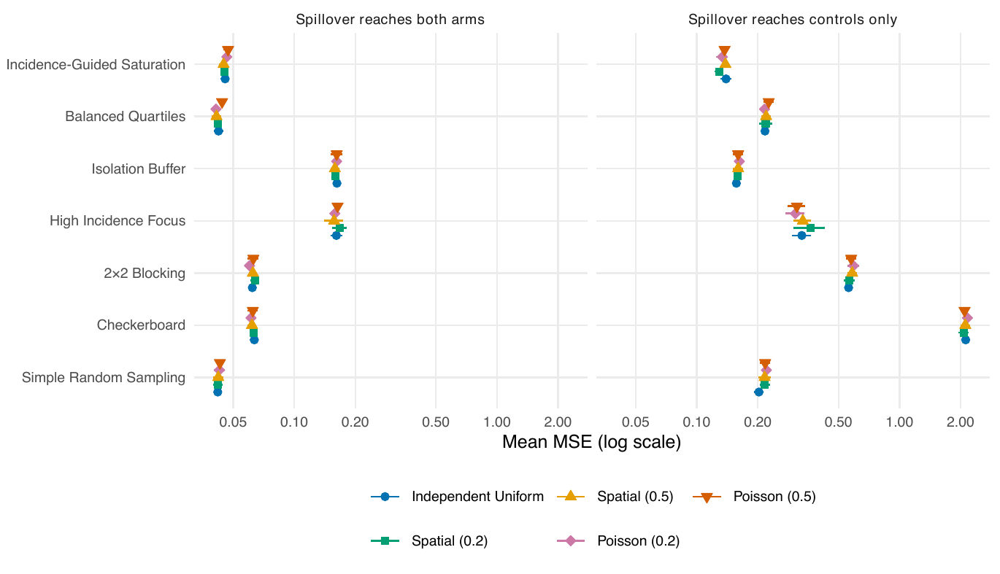

Grid mean MSE at $\tau = 1$, queen neighbors, by incidence configuration (parentheses give incidence dependence $\rho_X$), log scale. Horizontal lines are 95% Monte Carlo intervals over ten incidence surfaces.

::: {.notes}
Use when asked whether the way incidence varies changes the conclusions. It moved each design's MSE by less than 10%, except High Incidence Focus, whose allocation follows incidence directly. Source: CTJ Figure 2.
:::

## Backup &middot; Under rook neighbors, Checkerboard cannot estimate the effect {.backup-slide data-menu-title="B: Rook neighbors" data-footer-part="Backup"}

::: {.columns}
::: {.column width="58%"}
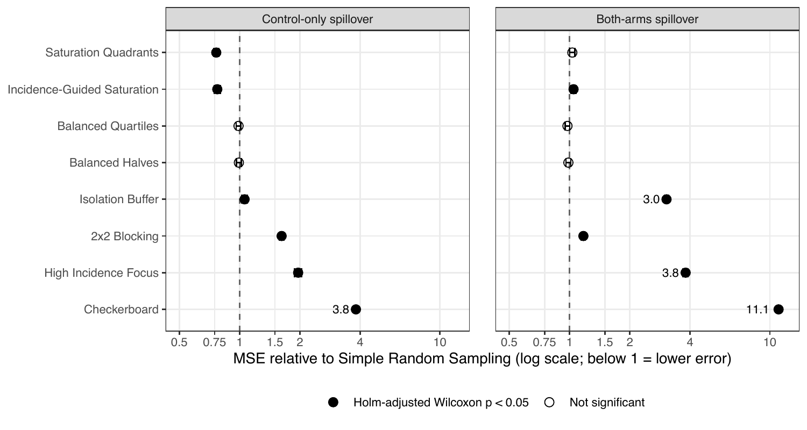
:::
::: {.column .smallcol width="42%"}
- Rook neighbors share an edge only. Under rook, Checkerboard gives $WZ = 1 - Z$, so exposure cannot be separated from treatment, $\tau$ is **not identified**, and the estimate centers on $\tau - \gamma$ (coverage 0.16)
- Under queen, Checkerboard is identified but imprecise, since interior clusters all have half their neighbors treated
- Other designs keep the regime-specific pattern, with differences. Under controls only the saturation advantage is smaller (23–24% lower MSE than SRS, against 37% under queen), and Isolation Buffer loses its advantage (5.8% higher than SRS). Pooled MSE, Incidence-Guided Saturation 0.072 and Balanced Quartiles 0.084 lead
:::
:::

::: {.notes}
Use when asked about the neighbor definition or why strict alternation fails. In NC, rook and queen at matched settings gave the same broad conclusions. Figure: SI rook comparison with SRS (fig_vs_srs_by_regime_rook).
:::

## Backup &middot; Mean and worst-decile error relative to SRS {.backup-slide data-menu-title="B: Allocation risk table" data-footer-part="Backup"}

<table class="deck">
<thead><tr><th style="text-align:left" rowspan="2">Design</th><th colspan="4">Grid</th><th colspan="4">NC application</th></tr>
<tr><th colspan="2">Both arms</th><th colspan="2">Controls only</th><th colspan="2">Both arms</th><th colspan="2">Controls only</th></tr>
<tr><th></th><th>Mean</th><th>Worst 10%</th><th>Mean</th><th>Worst 10%</th><th>Mean</th><th>Worst 10%</th><th>Mean</th><th>Worst 10%</th></tr></thead>
<tbody>
<tr><td style="text-align:left">Checkerboard</td><td>1.41</td><td>1.11</td><td>9.94</td><td>6.22</td><td>2.68</td><td>2.20</td><td>3.02</td><td>1.88</td></tr>
<tr><td style="text-align:left">High Incidence Focus</td><td>3.81</td><td>3.05</td><td>1.51</td><td>0.96</td><td>0.93</td><td>0.76</td><td>1.03</td><td>0.64</td></tr>
<tr><td style="text-align:left">Saturation Quadrants</td><td>1.06</td><td>1.06</td><td>0.62</td><td>0.54</td><td>0.99</td><td>0.94</td><td>0.73</td><td>0.64</td></tr>
<tr><td style="text-align:left">Isolation Buffer</td><td>3.80</td><td>3.97</td><td>0.75</td><td>0.62</td><td>3.69</td><td>4.75</td><td>0.93</td><td>0.91</td></tr>
<tr><td style="text-align:left">2×2 Blocking</td><td>1.44</td><td>1.57</td><td>2.69</td><td>2.64</td><td>1.00</td><td>1.02</td><td>1.15</td><td>1.18</td></tr>
<tr><td style="text-align:left">Balanced Quartiles</td><td>0.99</td><td>0.99</td><td>1.00</td><td>1.01</td><td>0.98</td><td>0.96</td><td>0.95</td><td>1.01</td></tr>
<tr><td style="text-align:left">Balanced Halves</td><td>0.99</td><td>0.99</td><td>1.01</td><td>1.01</td><td>0.98</td><td>0.96</td><td>0.97</td><td>0.99</td></tr>
<tr><td style="text-align:left">Incidence-Guided Saturation</td><td>1.07</td><td>1.07</td><td>0.65</td><td>0.55</td><td>0.98</td><td>0.93</td><td>0.75</td><td>0.68</td></tr>
</tbody>
</table>

Each column averages over settings first, then divides by SRS's average for the same quantity (mean by SRS mean, worst 10% by SRS worst-10% mean). The main slide's 21–43% is the range across the eight NC year × $\rho$ settings. Grid: queen, $\tau = 1$, all 50 configuration-by-surface units at $\rho \in \{0, 0.5\}$, $\gamma \in \{0.5, 0.8\}$. NC: $\rho \in \{0, 0.5\}$, $\gamma = 0.8$, 400 outcomes per allocation, 2018–2021. A design with one allocation has worst-decile mean equal to its mean.

::: {.notes}
Use when asked for the numbers behind the allocation-risk slide. Each worst decile has only ten sampled allocations, so membership is uncertain; split-half checks (select with half the outcomes, evaluate with the other half) kept the control-only pattern. Under both arms most of the spread is outcome noise. Source: Chapter 3 tab:downside (results/allocation_risk/summary/surfaces10/downside_by_design.csv).
:::

## Backup &middot; Population reached by each design, by year {.backup-slide data-menu-title="B: Population reached" data-footer-part="Backup"}

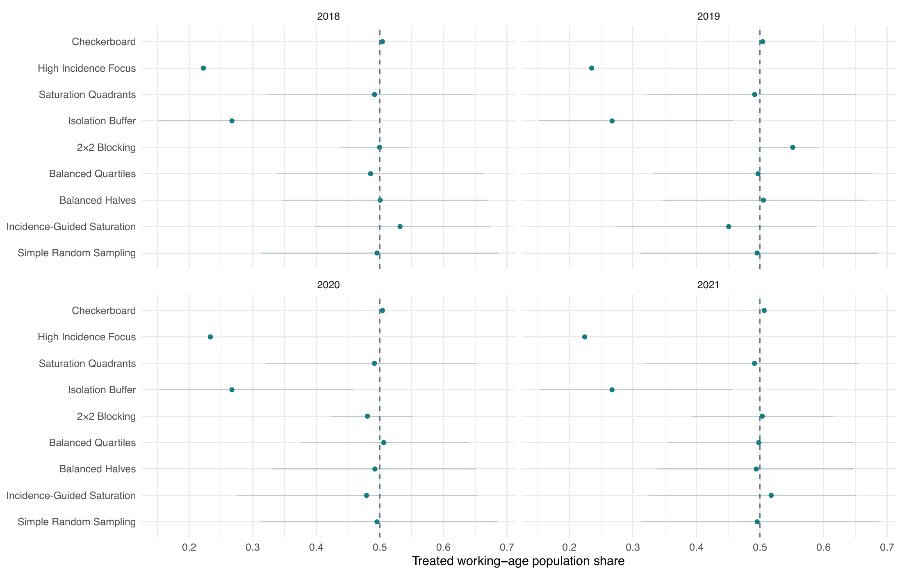

Share of NC adults aged 18–64 living in treated service areas; points are means over sampled allocations and lines show the spread across allocations. Includes the two variants.

::: {.notes}
Use when asked how much of the state each design would reach, or how variable that is from draw to draw. SRS spans roughly 31% to 69% across draws; High Incidence Focus is fixed at 22–24%. Source: Chapter 3 tab:nc-budgets and SI population-share figure.
:::

## Backup &middot; If incidence did shift education scores ($\beta = 1$) {.backup-slide data-menu-title="B: Beta = 1 sensitivity" data-footer-part="Backup"}

- A hypothetical check adds incidence rank to the outcome ($\beta = 1$) and adjusted for in the analysis
- **High Incidence Focus** error rose about **3.7–4.4-fold** under both arms and **1.4–2.5-fold** under controls only
- Aligning treatment with incidence leaves little independent information about $\tau$ once incidence is adjusted for
- Randomized designs were little affected; the regime-specific guidance is unchanged
- Not an empirical claim that SUD incidence predicts education scores; the baseline and the adjustment were added together

::: {.notes}
Use when asked "what if high-incidence colleges also score differently?" This is the main reason High Incidence Focus is not recommended even though its single allocation looked fine in the primary NC model. Source: CTJ Results; Chapter 3 Allocation downside and sensitivity.
:::

## Backup &middot; Leaving the spillover term out of the analysis biases every design {.backup-slide data-menu-title="B: Omitted spillover" data-footer-part="Backup"}

- Grid sensitivity: fit $Y \sim Z$ (plus incidence) without the spillover term
- Every identified design **underestimated** $\tau$: bias $-0.12$ to $-0.40$, coverage 54–91%, at $\tau = 1$ (queen and rook)
- Some designs had *lower* MSE than under the correct model, since less variance outweighed the bias, so low MSE alone does not mean valid inference
- Incidence-Guided Saturation still had the lowest MSE under both neighbor types

A good allocation does not replace an analysis that models spillover.

::: {.notes}
Use when asked "what if we don't know the spillover form?" We did not study a spillover term of the wrong form (wrong network or distance decay); that is listed as future work. Source: CTJ Results; Chapter 3 non-oracle sensitivity.
:::

## Backup &middot; The corrected interval restores 95% coverage {.backup-slide data-menu-title="B: Interval comparison" data-footer-part="Backup"}

::: {.columns}
::: {.column width="55%"}
<table class="deck" style="font-size: 0.8em;">
<thead><tr><th style="text-align:left">Design</th><th>Grid queen Wald / $t$</th><th>NC both Wald / $t$</th><th>NC controls Wald / $t$</th></tr></thead>
<tbody>
<tr><td style="text-align:left">Incidence-Guided Saturation</td><td>93.7 / 94.7</td><td>93.5 / 94.9</td><td>92.7 / 94.2</td></tr>
<tr><td style="text-align:left">Balanced Quartiles</td><td>93.6 / 94.6</td><td>93.3 / 94.8</td><td>92.9 / 94.4</td></tr>
<tr><td style="text-align:left">Isolation Buffer</td><td>93.9 / 94.9</td><td>93.2 / 94.7</td><td>93.1 / 94.7</td></tr>
<tr><td style="text-align:left">High Incidence Focus</td><td>93.8 / 94.8</td><td>93.4 / 94.9</td><td>93.1 / 94.6</td></tr>
<tr><td style="text-align:left">2×2 Blocking</td><td>93.9 / 94.8</td><td>93.2 / 94.7</td><td>92.9 / 94.4</td></tr>
<tr><td style="text-align:left">Checkerboard</td><td>94.1 / 95.0</td><td>93.6 / 94.9</td><td>93.4 / 94.8</td></tr>
<tr><td style="text-align:left">Simple Random Sampling</td><td>93.8 / 94.8</td><td>93.2 / 94.7</td><td>92.9 / 94.5</td></tr>
</tbody>
</table>

Coverage (%) of 95% intervals. Wald: $\hat\tau \pm 1.96\,\widehat{\rm SE}$. Corrected: $\hat\tau \pm t_{0.975,N-p}\,\widehat{\rm SE}\sqrt{N/(N-p)}$, $N$ clusters, $p$ coefficients including $\rho$.

:::
::: {.column width="45%"}
<table class="deck" style="font-size: 0.8em;">
<thead><tr><th>Colleges</th><th>Wald test size</th><th>Corrected size</th></tr></thead>
<tbody>
<tr><td>15</td><td>11.1–12.8%</td><td>4.4–5.4%</td></tr>
<tr><td>29</td><td>8.3–8.8%</td><td>5.0–5.5%</td></tr>
<tr><td>58</td><td>6.3–7.0%</td><td>5.0–5.5%</td></tr>
</tbody>
</table>

False-positive rate at $\tau = 0$ across designs (NC partial participation). Corrected-interval coverage at $\tau = 1$ was 94.0–95.6% at every number of colleges.

:::
:::

::: {.notes}
Use when asked why the intervals are not the usual Wald intervals. Maximum likelihood variance divides by N and the normal reference ignores estimated parameters, so with 58 or fewer clusters Wald intervals are too narrow. Bootstrap and profile-likelihood intervals did not meet the 94–96% rule. Sources: results/grid_tdf_2026-10/interval_comparison.csv; Chapter 3 tab:nc-calibration.
:::

## Backup &middot; Power for individual effects by training size and intraclass correlation {.backup-slide data-menu-title="B: Power translation" data-footer-part="Backup"}

<table class="deck">
<thead><tr><th rowspan="3">$m$</th><th rowspan="3">ICC</th><th rowspan="3">$\sigma_c$</th><th colspan="4">Both arms</th><th colspan="4">Controls only</th></tr>
<tr><th colspan="2">29 colleges</th><th colspan="2">58 colleges</th><th colspan="2">29 colleges</th><th colspan="2">58 colleges</th></tr>
<tr><th>$d$=0.2</th><th>$d$=0.3</th><th>$d$=0.2</th><th>$d$=0.3</th><th>$d$=0.2</th><th>$d$=0.3</th><th>$d$=0.2</th><th>$d$=0.3</th></tr></thead>
<tbody>
<tr><td>10</td><td>0.01</td><td>0.330</td><td>0.33</td><td>0.62</td><td>0.61</td><td>0.90</td><td>0.22</td><td>0.41</td><td>0.24</td><td>0.45</td></tr>
<tr><td>10</td><td>0.05</td><td>0.381</td><td>0.27</td><td>0.51</td><td>0.50</td><td>0.82</td><td>0.18</td><td>0.33</td><td>0.20</td><td>0.36</td></tr>
<tr><td>10</td><td>0.10</td><td>0.436</td><td>0.22</td><td>0.41</td><td>0.40</td><td>0.71</td><td>0.15</td><td>0.27</td><td>0.17</td><td>0.30</td></tr>
<tr><td>25</td><td>0.01</td><td>0.223</td><td>0.61</td><td>0.91</td><td>0.90</td><td>1.00</td><td>0.41</td><td>0.71</td><td>0.44</td><td>0.74</td></tr>
<tr><td>25</td><td>0.05</td><td>0.297</td><td>0.40</td><td>0.71</td><td>0.69</td><td>0.96</td><td>0.26</td><td>0.49</td><td>0.29</td><td>0.53</td></tr>
<tr><td>25</td><td>0.10</td><td>0.369</td><td>0.28</td><td>0.53</td><td>0.52</td><td>0.85</td><td>0.19</td><td>0.35</td><td>0.21</td><td>0.38</td></tr>
<tr><td>50</td><td>0.01</td><td>0.173</td><td>0.81</td><td>0.98</td><td>0.98</td><td>1.00</td><td>0.59</td><td>0.87</td><td>0.63</td><td>0.89</td></tr>
<tr><td>50</td><td>0.05</td><td>0.263</td><td>0.48</td><td>0.80</td><td>0.79</td><td>0.98</td><td>0.31</td><td>0.58</td><td>0.34</td><td>0.62</td></tr>
<tr><td>50</td><td>0.10</td><td>0.344</td><td>0.31</td><td>0.59</td><td>0.58</td><td>0.88</td><td>0.21</td><td>0.39</td><td>0.23</td><td>0.42</td></tr>
</tbody>
</table>

Power of the corrected $t$ test with SRS; $\sigma_c = \sqrt{\rm ICC + (1-ICC)/m}$, $\tau = d/\sigma_c$; random volunteering, $\rho = 0.5$, $\gamma = 0.8\tau$, mean over 2018–2021. Training more professionals in larger colleges (same average $m$ = 25) lowered power by about 0.1 for every design.

::: {.notes}
Use when asked about other training sizes or ICCs. Scaling the effect and noise together leaves the test statistic unchanged when β = 0, so these follow from the college-level simulation (checked by rerunning one setting with both halved). Source: Chapter 3 tab:nc-translation.
:::

## Backup &middot; Other spatial models give the same design guidance {.backup-slide data-menu-title="B: CAR and Bayesian models" data-footer-part="Backup"}

- **CAR (conditional autoregressive) models**: generating or fitting with CAR instead of the spatial lag model left the saturation designs at **0.76–0.82** of SRS's error under controls only, and Checkerboard and Isolation Buffer worst under both arms
- **Bayesian spatial lag model**: posterior means correlated 0.999 with maximum likelihood, credible-interval coverage 94.6–95.3%, same design ordering
- **Exception**: a Bayesian CAR (Leroux prior) fitted to strongly dependent spatial lag data ($\rho = 0.5$) was biased by 0.14–0.22, covered 88–90%, and lost the saturation advantage; it assumes a different dependence structure from the one that generated the data

Leroux et al. 2000; Lee 2013 (CARBayes); LeSage and Pace 2009.

::: {.notes}
Use when asked "did you try a Bayesian model?" or "does this depend on the spatial lag model?" 58 colleges, β = 0. Source: Chapter 3 Appendix A9 (tab:nc-car, tab:nc-bayes).
:::

## Backup &middot; Other forms of spillover {.backup-slide data-menu-title="B: Spillover forms" data-footer-part="Backup"}

<table class="deck">
<thead><tr><th style="text-align:left" rowspan="2">Design</th><th colspan="3">Both arms</th><th colspan="3">Controls only</th></tr>
<tr><th>Share</th><th>Count</th><th>Any treated</th><th>Share</th><th>Count</th><th>Any treated</th></tr></thead>
<tbody>
<tr><td style="text-align:left">Checkerboard</td><td>2.97</td><td>1.78</td><td>1.07</td><td>3.09</td><td>1.41</td><td>n.i.</td></tr>
<tr><td style="text-align:left">High Incidence Focus</td><td>0.91</td><td>0.92</td><td>0.96</td><td>1.03</td><td>1.04</td><td>n.i.</td></tr>
<tr><td style="text-align:left">Isolation Buffer</td><td>3.82</td><td>3.84</td><td>n.i.</td><td>0.95</td><td>1.16</td><td>n.i.</td></tr>
<tr><td style="text-align:left">2×2 Blocking</td><td>1.04</td><td>1.03</td><td>1.00</td><td>1.17</td><td>1.07</td><td>n.i.</td></tr>
<tr><td style="text-align:left">Balanced Quartiles</td><td>1.01</td><td>1.01</td><td>1.00</td><td>0.99</td><td>0.99</td><td>n.i.</td></tr>
<tr><td style="text-align:left">Incidence-Guided Saturation</td><td>1.01</td><td>1.03</td><td>1.04</td><td>0.75</td><td>0.79</td><td>n.i.</td></tr>
</tbody>
</table>

MSE relative to SRS, 58 colleges, $\beta = 0$. Share: proportion of neighbors treated (primary). Count: number of treated neighbors scaled by the mean number of neighbors (4.93). Any treated: 1 if any neighbor is treated. n.i.: not identified in every fit.

- With "any treated neighbor", every Isolation Buffer control is exposed, so its effect cannot be separated; under controls only no design was identified in every fit (saturation was, in 90–92% of fits, with MSE 0.70–0.71 of SRS when identified)

::: {.notes}
Use when asked "what if spillover is all-or-nothing?" The count form keeps the saturation advantage under controls only. Source: Chapter 3 tab:nc-forms.
:::

## Backup &middot; Formal tests agree with the descriptive ranking {.backup-slide data-menu-title="B: Formal tests" data-footer-part="Backup"}

- **Grid, queen, $\tau = 1$, pooled over spillover regimes:** Friedman test across the six designs and SRS over 160 blocks, $\chi^2 = 560.3$, df = 6. Incidence-Guided Saturation ranked best, significantly ahead of every other design and SRS (Nemenyi). SRS and Balanced Quartiles could not be distinguished
- Adjacent designs in the MSE order differed significantly over the 50 independent configuration-by-surface units (Wilcoxon $p \le 4.9\times10^{-9}$); the better design was lower in all 50 for every pair but one (48 of 50)
- **NC:** Friedman tests over 24 year × $\rho$ × $\gamma$ blocks rejected equal ranks in every regime and $\beta$ ($\chi^2$ = 135–180, df = 8). Under controls only the two saturation designs had the two best average ranks
- Blocks share incidence surfaces (grid) or the map and some simulations (NC), so these $p$-values describe consistency rather than independent evidence

::: {.notes}
Use when asked "are the differences statistically significant?" Source: Chapter 3 Results (design performance under queen contiguity; Appendix A9 formal tests).
:::

## Backup &middot; Guidance gains grow with how much regions differ {.backup-slide data-menu-title="B: Spread vs guidance gain" data-footer-part="Backup"}

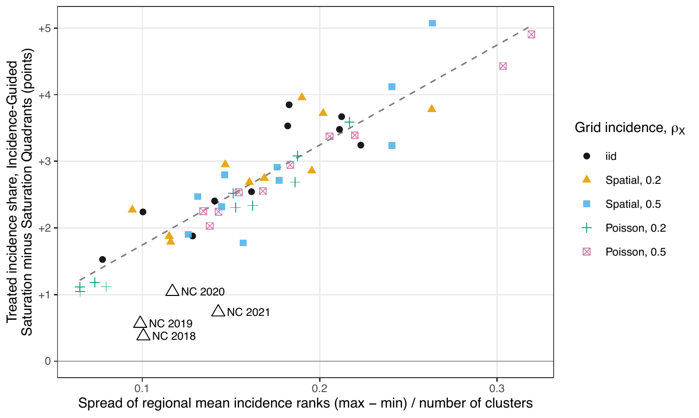

Each point is one simulated grid incidence surface, plotting the spread of the regions' mean incidence ranks against the extra treated share of incidence from incidence guidance over random-order saturation. NC's four planning years (open triangles) sit at the low-spread end and below the grid trend.

::: {.notes}
Use when asked "why does guidance barely change targeting in NC?" On the grid the gain was 2.1–3.1 percentage points, correlation with spread 0.84–0.99. NC regions' mean ranks lie between 24 and 34 of 58 in every year. Source: Chapter 3 Appendix A9 (fig:spread-gain).
:::

## Backup &middot; At larger effects Isolation Buffer catches up under controls only {.backup-slide data-menu-title="B: Larger effects" data-footer-part="Backup"}

- Grid, controls only: Incidence-Guided Saturation's advantage narrows as $\tau$ grows
- At $\tau = 2$, Isolation Buffer and Incidence-Guided Saturation are level (MSE 0.160 and 0.160); at $\tau = 3$ Isolation Buffer is lower (0.160 vs 0.182)
- Most designs carry error in estimating $\rho$ into $\hat\tau$ in proportion to $\tau$; Isolation Buffer largely avoids this since no treated cluster has a treated neighbor
- Isolation Buffer is still 3.8 times SRS's error under both arms and treats fewer clusters

::: {.notes}
Use when asked whether the ranking depends on effect size. Under queen the order by mean MSE among the six designs was otherwise the same at every τ from 0.8 to 3. Source: CTJ Results; Chapter 3 Stability across treatment effect sizes.
:::
