```{r}
#| label: setup
#| include: false
# ============================================================
# Every number on the slides and in the speaker notes is computed here from the
# saved results (results/ and review/, read through tools/load_results.R), not
# typed by hand. The loader also checks that the per-allocation results
# reproduce the corrected summary tables in review/tables/.
# ============================================================
source("tools/load_results.R")

f3 <- function(x) formatC(x, format = "f", digits = 3)
f2 <- function(x) formatC(x, format = "f", digits = 2)
pc <- function(x) sprintf("%.0f%%", x)
CO <- spill_labels[["TrtNoSpill"]]; CI <- spill_labels[["TrtSpill"]]

#' One row of the rank table or the summary table (psi defaults to 0.5).
R <- function(g, sp, rho, psi = 0.5) rank_tab[rank_tab$grid == g & rank_tab$spill == sp & rank_tab$Rho == rho & rank_tab$Psi == psi, ]
S <- function(g, sp, rho, psi = 0.5) summary_tab[summary_tab$grid == g & summary_tab$spill == sp & summary_tab$Rho == rho & summary_tab$Psi == psi, ]
gi <- function(g, col) grid_info[grid_info$grid == g, col]

# Direction of the comparison in every scenario, and agreement with the 2x4 grid
summary_tab$bss_lower <- summary_tab$BSS_MSE < summary_tab$SRS_MSE
ref24 <- summary_tab[summary_tab$grid == "2x4", c("spill", "Rho", "Psi", "bss_lower")]
agree <- function(g) {
  m <- merge(summary_tab[summary_tab$grid == g, c("spill", "Rho", "Psi", "bss_lower")], ref24, by = c("spill", "Rho", "Psi"))
  sum(m$bss_lower.x == m$bss_lower.y)
}
n_scen_grid <- nrow(ref24)                                                     # 16 per grid
n_ci <- sum(summary_tab$spill == CI)                                           # 24
n_ci_srs_lower <- sum(!summary_tab$bss_lower[summary_tab$spill == CI])
n_co01 <- sum(summary_tab$spill == CO & summary_tab$Rho == 0.01)               # 12
n_co01_bss_lower <- sum(summary_tab$bss_lower[summary_tab$spill == CO & summary_tab$Rho == 0.01])
n_sd_lower <- sum(summary_tab$BSS_SD < summary_tab$SRS_SD)                     # of 48
co00_bss_lower_grids <- unique(summary_tab$grid[summary_tab$spill == CO & summary_tab$Rho == 0 & summary_tab$bss_lower])
co01_pct <- range(rank_tab$pct_SRS_worse[rank_tab$spill == CO & rank_tab$Rho == 0.01])
ci_pct_max <- max(rank_tab$pct_SRS_worse[rank_tab$spill == CI])
bias24 <- range(summary_tab$BSS_bias[summary_tab$grid == "2x4"])

# Shorthand for the 2x4, psi = 0.5 scenarios used in the results slides
a <- R("2x4", CO, 0.01); b <- R("2x4", CO, 0); cc <- R("2x4", CI, 0.01); d <- R("2x4", CI, 0)
sa <- S("2x4", CO, 0.01)

# Scale of rho: fitted (row-standardized) rho-hat when the simulation's rho = 0.01
rho_res <- read.csv(file.path(p1_root, "results/rho_mse/rho_mse_results_TrtNoSpill_2x4_A02_B1_P05_R001.csv"))
rhohat_med <- median(0.01 + rho_res$bias)

# Collinearity of x and z (computed in load_results.R from the code's own neighbor lists)
ncol <- function(g, type = "CO") sum(collin[[paste0("collinear_", type)]][collin$grid == g])
pct_col24 <- 100 * mean(collin$collinear_CO[collin$grid == "2x4"])
bias24_r0 <- range(summary_tab$BSS_bias[summary_tab$grid == "2x4" & summary_tab$Rho == 0])
bias24_r1 <- range(summary_tab$BSS_bias[summary_tab$grid == "2x4" & summary_tab$Rho == 0.01])
srs_max_r0 <- R("2x4", CO, 0)$SRS_max
w0 <- all_alloc$MSE[all_alloc$grid == "2x4" & all_alloc$spill == CO & all_alloc$Rho == 0 & all_alloc$Psi == 0.5 & all_alloc$combo == which.max(all_alloc$MSE[all_alloc$grid == "2x4" & all_alloc$spill == CO & all_alloc$Rho == 0.01 & all_alloc$Psi == 0.5])]
bss_rhohat <- 0.01 + rho_res$bias[bss_idx[["2x4"]]]
s0 <- S("2x4", CO, 0); s8 <- S("2x4", CO, 0.01, 0.8)
# 3x3: the one collinear BSS allocation against the other five (Control Only, rho = 0, psi = 0.5)
a33 <- merge(all_alloc[all_alloc$grid == "3x3" & all_alloc$spill == CO & all_alloc$Rho == 0 & all_alloc$Psi == 0.5 & all_alloc$is_BSS, ],
             collin[collin$grid == "3x3", c("combo", "collinear_CO")], by = "combo")
mse33_col <- a33$MSE[a33$collinear_CO]; mse33_other <- max(a33$MSE[!a33$collinear_CO])
# BSS against the random allocations that keep beta identified (some control unexposed),
# Control Only, rho = 0.01, psi = 0.5
idf <- function(g) {
  a1 <- merge(all_alloc[all_alloc$grid == g & all_alloc$spill == CO & all_alloc$Rho == 0.01 & all_alloc$Psi == 0.5, ],
              collin[collin$grid == g, c("combo", "collinear_CO")], by = "combo")
  r <- a1[!a1$is_BSS & !a1$collinear_CO, ]; b <- mean(a1$MSE[a1$is_BSS])
  list(n = nrow(r), beats = sum(r$MSE > b), med = median(r$MSE))
}
id24 <- idf("2x4"); id34 <- idf("3x4"); id33 <- idf("3x3")
w24 <- all_alloc[all_alloc$grid == "2x4" & all_alloc$spill == CO & all_alloc$Rho == 0.01 & all_alloc$Psi == 0.5, ]
w24 <- w24[which.max(w24$MSE), ]
# The slide text calls the worst draw "half the grid treated as one block" ({1,2,3,4} in the
# code's 2x4 numbering, whose rook pairs are 1-2, 3-4, ...); stop if that ever changes.
stopifnot(identical(as.integer(combn(1:8, 4)[, w24$combo]), 1:4),
          !collin$collinear_CO[collin$grid == "2x4" & collin$combo == w24$combo])
bss_pair <- sort(all_alloc$MSE[all_alloc$grid == "2x4" & all_alloc$spill == CO & all_alloc$Rho == 0.01 & all_alloc$Psi == 0.5 & all_alloc$is_BSS])
n_allexp <- function(g) sum(collin$all_exposed_CI[collin$grid == g])
# Downside risk: mean MSE of the worst tenth of random draws, and the worst identified draw
risk <- function(g) {
  a1 <- merge(all_alloc[all_alloc$grid == g & all_alloc$spill == CO & all_alloc$Rho == 0.01 & all_alloc$Psi == 0.5, ],
              collin[collin$grid == g, c("combo", "collinear_CO")], by = "combo")
  m <- a1$MSE
  list(bss = mean(m[a1$is_BSS]), worst10 = mean(m[m >= quantile(m, 0.9)]),
       id_max = max(m[!a1$is_BSS & !a1$collinear_CO]))
}
rk24 <- risk("2x4"); rk33 <- risk("3x3"); rk34 <- risk("3x4")
# The backup says the worst random draw on each grid keeps beta identified; stop if not
stopifnot(all(sapply(c("2x4", "3x3", "3x4"), function(g) abs(risk(g)$id_max - R(g, CO, 0.01)$SRS_max) < 1e-12)))

#' Corrected summary table for one grid as an HTML table (lower MSE shaded).
#' @param g Grid label. @return HTML string.
tab_html <- function(g) {
  t <- summary_tab[summary_tab$grid == g, ]
  t <- t[order(t$spill != CO, -t$Rho, t$Psi), ]
  rows <- sprintf(
    "<tr><td>%s</td><td>%s</td><td>%.1f</td><td%s>%s</td><td>%s</td><td>%s</td><td%s>%s</td><td>%s</td><td>%s</td></tr>",
    ifelse(t$spill == CO, "Control only", "Control &amp; Intervention"), ifelse(t$Rho == 0, "0", "0.01"), t$Psi,
    ifelse(!t$bss_lower, " class=\"lower\"", ""), f3(t$SRS_MSE), f3(t$SRS_SD), f3(t$SRS_bias),
    ifelse(t$bss_lower, " class=\"lower\"", ""), f3(t$BSS_MSE), f3(t$BSS_SD), f3(t$BSS_bias))
  paste0("<table class=\"p1-table\"><thead><tr><th>Spillover into</th><th>&rho;</th><th>&psi;</th>",
         "<th>SRS MSE</th><th>SRS SD</th><th>SRS bias</th><th>BSS MSE</th><th>BSS SD</th><th>BSS bias</th></tr></thead><tbody>",
         paste(rows, collapse = ""), "</tbody></table>")
}
```

## {.title-slide-custom data-menu-title="Title" data-footer-part=""}

<!-- Project 1 talk (prelim Part I, 2026-12-07; also the seed of Dr. Lin's conference
     talk). Draft 1, 2026-10-28. Sources: corrected manuscript
     (review/manuscript/Revisions_V2c_corrected.tex), corrected Chapter 2 and the
     saved results (results/, review/). Numbers come from the setup chunk.
     Footer section label: data-footer-part on every content slide
     (theme/footer-part.html); there are no section-divider slides.
     Speaker notes: verbatim script, one sentence per bullet, with
     [time | running total]; backup slides have short "use when asked" notes. -->

::: {.center}

<h1 class="talk-title" style="font-size: 1.7em; line-height: 1.15; margin-top: 1.8em; margin-bottom: 0.3em; color: var(--unc-navy); border-bottom: none;">
Sampling Design for Spatial Cluster Randomized Trials<br/>with Spillover and Spatial Dependence
</h1>

<p style="font-size: 1.2em; color: var(--unc-grey); margin-top: 1.2em;">
<strong style="color: var(--unc-carolina-blue);">Andrew J Walther</strong>
</p>

<p class="title-meta">
Department of Biostatistics, University of North Carolina at Chapel Hill<br/>
<span style="color:#888;">PhD Preliminary Oral Exam &middot; December 7, 2026</span>
</p>

:::

::: {.notes}
[0.25 min | running 0.25]

- Thank you all for being here.
- This first part is about a design question that comes up whenever a trial treats whole places, namely which places to treat when the treatment can reach the neighbors.
:::

## Outline {data-menu-title="Outline" data-footer-part=""}

<div class="agenda-rows" style="margin-top: 0.8em;">
<div class="agenda-row"><span class="agenda-num">•</span><span class="agenda-name">Background</span><span>Cluster trials of places, spillover, spatial dependence, and what design guidance exists</span></div>
<div class="agenda-row"><span class="agenda-num">•</span><span class="agenda-name">Methods</span><span>Neighbors, the two allocation designs, the two spillover types, the spatial lag model and the simulation</span></div>
<div class="agenda-row"><span class="agenda-num">•</span><span class="agenda-name">Simulation Results</span><span>Where block stratified sampling falls among random allocations, and why</span></div>
<div class="agenda-row"><span class="agenda-num">•</span><span class="agenda-name">Application</span><span>Probation trials across North Carolina judicial districts</span></div>
<div class="agenda-row"><span class="agenda-num">•</span><span class="agenda-name">Discussion</span><span>Choosing a design, take-home, limitations and next steps</span></div>
</div>

::: {.notes}
[0.25 min | running 0.5]

- I'll start with why geography complicates a cluster trial, then the design and model, the simulation results, an application to probation trials in North Carolina, and what I'd recommend.
:::

## When a program is delivered to whole communities, trials randomize places, and places have neighbors {data-menu-title="Trials of places" data-footer-part="Background"}

::: {.columns}
::: {.column width="55%"}
- A **cluster randomized trial (CRT)** assigns whole groups, here geographic areas, to intervention or control
- It is the natural design when a program, policy or supervision practice is delivered to an area rather than to one person
- Geographic clusters share borders, so what happens in one area can depend on its neighbors
- Two separate mechanisms create that dependence, **spillover** and **spatial dependence**, and both affect how well a trial can estimate its effect
- This project began with two planned **probation trials** in North Carolina that randomize counties or districts
:::
::: {.column width="45%"}
<svg width="620" height="430" viewBox="0 0 620 430" role="img" aria-label="A region divided into nine areas, four shaded as intervention areas, with arrows from intervention areas into neighboring control areas">
<g stroke="#ffffff" stroke-width="6">
<rect x="10" y="10" width="190" height="130" fill="#13294B"/><rect x="210" y="10" width="190" height="130" fill="#E1E5EA"/><rect x="410" y="10" width="190" height="130" fill="#13294B"/>
<rect x="10" y="150" width="190" height="130" fill="#E1E5EA"/><rect x="210" y="150" width="190" height="130" fill="#13294B"/><rect x="410" y="150" width="190" height="130" fill="#E1E5EA"/>
<rect x="10" y="290" width="190" height="130" fill="#13294B"/><rect x="210" y="290" width="190" height="130" fill="#E1E5EA"/><rect x="410" y="290" width="190" height="130" fill="#E1E5EA"/>
</g>
<g stroke="#FBAF3D" stroke-width="8" fill="#FBAF3D">
<line x1="160" y1="75" x2="250" y2="75"/><polygon points="262,75 244,64 244,86"/>
<line x1="305" y1="190" x2="305" y2="110"/><polygon points="305,98 294,116 316,116"/>
<line x1="360" y1="215" x2="450" y2="215"/><polygon points="462,215 444,204 444,226"/>
<line x1="105" y1="325" x2="105" y2="250"/><polygon points="105,238 94,256 116,256"/>
</g>
</svg>
<div class="p1-legend"><span><span class="p1-swatch" style="background:#13294B"></span>Intervention area</span><span><span class="p1-swatch" style="background:#E1E5EA"></span>Control area</span><span><span class="p1-swatch" style="background:#FBAF3D"></span>Possible spillover</span></div>
:::
:::

::: {.notes}
[1 min | running 1.5]

- When a program is delivered to a whole community, such as a supervision practice in a probation office, we can't randomize individual people, so a cluster randomized trial assigns whole areas to intervention or control.
- When those clusters are geographic, they have neighbors.
- Two different things tie neighbors together, spillover and spatial dependence.
- This talk asks how the choice of which areas to treat changes what a trial can learn when both are present.
- The question came from two planned probation trials with the North Carolina Department of Adult Correction, which randomize counties or districts, and whose investigators asked us which ones to treat.
:::

## Treatment can spill over into neighboring untreated areas {data-menu-title="Spillover" data-footer-part="Background"}

::: {.p1-cards .two style="margin-top: 0.4em;"}
::: {.p1-card}
<h3>Bed nets, northern Ghana</h3>

Child mortality was lower in control villages near villages given insecticide-treated bed nets than in more distant control villages.
:::
::: {.p1-card}
<h3>School deworming, western Kenya</h3>

Untreated children attending schools near treated schools had fewer worm infections.
:::
:::

<div class="p1-take" style="margin-top: 0.9em;">Spillover is a treatment effect that crosses a cluster boundary</div>

- A standard CRT analysis assumes a cluster's outcome depends only on its own assignment
- When treatment reaches control neighbors, controls look better than they would have, and the intervention–control difference understates the effect
- How far and to whom it spreads depends on the program, so a design has to state its assumption

<p class="p1-src">Binka et al., Am J Trop Med Hyg 1998; Miguel and Kremer, Econometrica 2004.</p>

::: {.notes}
[0.75 min | running 2.25]

- Two classic trials show what spillover looks like.
- In northern Ghana, child mortality was lower in control villages near villages that received treated bed nets than in control villages farther away.
- In western Kenya, deworming at one school reduced infections among untreated children at nearby schools.
- A standard cluster trial analysis assumes a cluster's outcome depends only on its own assignment.
- When treatment reaches control neighbors, the controls look better than they otherwise would, and the simple intervention-versus-control difference understates the effect.
:::

## Neighboring outcomes are also correlated for reasons that have nothing to do with treatment {data-menu-title="Spatial dependence" data-footer-part="Background"}

<div class="p1-schematic" style="gap: 6em; margin-top: 0.4em;">
<figure>
<figcaption>Spatial dependence ($\rho$)</figcaption>
<svg width="350" height="350" viewBox="0 0 345 345" role="img" aria-label="Three by three grid shaded from dark to light, so neighboring areas have similar outcomes, with no treatment">
<g stroke="#fff" stroke-width="5"><rect x="10" y="10" width="105" height="105" fill="#1f4e79"/><rect x="120" y="10" width="105" height="105" fill="#2f6aa0"/><rect x="230" y="10" width="105" height="105" fill="#5b8fc0"/><rect x="10" y="120" width="105" height="105" fill="#2f6aa0"/><rect x="120" y="120" width="105" height="105" fill="#5b8fc0"/><rect x="230" y="120" width="105" height="105" fill="#8fb5da"/><rect x="10" y="230" width="105" height="105" fill="#5b8fc0"/><rect x="120" y="230" width="105" height="105" fill="#8fb5da"/><rect x="230" y="230" width="105" height="105" fill="#c3d8ec"/></g>
</svg>
<p class="p1-caption" style="max-width: 420px;">Neighbors have similar outcomes because they share conditions, with or without treatment</p>
</figure>
<figure>
<figcaption>Spillover ($\psi$)</figcaption>
<svg width="350" height="350" viewBox="0 0 345 345" role="img" aria-label="Three by three grid with a treated center cell and its four edge neighbors raised by spillover">
<g stroke="#fff" stroke-width="5"><rect x="10" y="10" width="105" height="105" fill="#E1E5EA"/><rect x="120" y="10" width="105" height="105" fill="#FBAF3D"/><rect x="230" y="10" width="105" height="105" fill="#E1E5EA"/><rect x="10" y="120" width="105" height="105" fill="#FBAF3D"/><rect x="120" y="120" width="105" height="105" fill="#13294B"/><rect x="230" y="120" width="105" height="105" fill="#FBAF3D"/><rect x="10" y="230" width="105" height="105" fill="#E1E5EA"/><rect x="120" y="230" width="105" height="105" fill="#FBAF3D"/><rect x="230" y="230" width="105" height="105" fill="#E1E5EA"/></g>
<g stroke="#13294B" stroke-width="6" fill="#13294B">
<line x1="172" y1="135" x2="172" y2="95"/><polygon points="172,82 161,100 183,100"/>
<line x1="172" y1="210" x2="172" y2="250"/><polygon points="172,263 161,245 183,245"/>
<line x1="135" y1="172" x2="95" y2="172"/><polygon points="82,172 100,161 100,183"/>
<line x1="210" y1="172" x2="250" y2="172"/><polygon points="263,172 245,161 245,183"/>
</g>
</svg>
<p class="p1-caption" style="max-width: 420px;">The treated area (dark) raises outcomes in its neighbors (amber); without treatment there is none</p>
</figure>
</div>

- Both run through the same neighbors, so they are easy to confuse, and the model keeps them as separate parameters
- Spatial dependence breaks the independence a standard analysis assumes and can understate standard errors

::: {.notes}
[0.75 min | running 3]

- The second mechanism is spatial dependence.
- On the left, neighboring areas have similar outcomes because they share demographics, labor markets, providers and local practice, whether or not anyone is treated.
- That breaks the independence a standard analysis assumes, and it can understate standard errors.
- On the right is spillover, where a treated area raises outcomes in the areas next to it, and with no treatment there is no spillover.
- Both work through the same neighbors, so they are easy to confuse, and the model I'll show keeps them as separate parameters, psi for spillover and rho for spatial dependence.
:::

## Spatial methods mostly adjust after the data are in, and guidance on which clusters to treat is thin {data-menu-title="The design gap" data-footer-part="Background"}

<div class="p1-flow">
<div class="step focus"><b class="k">1. Before the trial (design)</b>Choose which clusters to treat
<ul><li>Restricted randomization balances covariates, and recent versions spread the selected clusters apart</li><li>Buffer zones drop areas near the boundary between arms</li><li>Saturation designs vary the treated share across groups</li></ul></div>
<div class="arrow">→</div>
<div class="step"><b class="k">2. During the trial</b>Treatment reaches neighbors, and neighboring outcomes move together
<ul><li>Spillover ($\psi$)</li><li>Spatial dependence ($\rho$)</li></ul></div>
<div class="arrow">→</div>
<div class="step"><b class="k">3. After the trial (analysis)</b>Adjust for space
<ul><li>Exposure measures, such as distance to the nearest treated area</li><li>Spatial models of the mean or covariance</li><li>These choices can change the estimate and its uncertainty</li></ul></div>
</div>

<div class="p1-cards two" style="margin-top: 0.5em; font-size: 0.86em;">
<div class="p1-card amber"><h3>The gap</h3>Few studies compare simple allocation rules in step 1 when spillover and spatial dependence occur together.</div>
<div class="p1-card navy"><h3>Why step 1 matters</h3>If every control district borders a trained district, no analysis in step 3 can tell the training apart from being next to it.</div>
</div>

<p class="p1-src">Jarvis et al., Emerg Themes Epidemiol 2017; Silcocks and Kendrick, Trials 2010; Chao et al., Epidemiol Infect 2015; Moulton, Clin Trials 2004; Crisp et al., Clin Trials 2023; McCann et al., Int J Epidemiol 2018; Baird et al., Rev Econ Stat 2018.</p>

::: {.notes}
[0.75 min | running 3.75]

- A spatial cluster trial has three stages, and most spatial methods work in the last one, adjusting for exposure or modeling space after the data are in.
- At the design stage there are restricted randomization, buffer zones and saturation designs, but few studies compare simple allocation rules when spillover and spatial dependence occur together.
- And the first stage limits the last.
- If every control district borders a trained district, no model can tell the training apart from being next to the training.
:::

## Does the allocation chosen before the trial change how well we estimate the effect? {data-menu-title="The question" data-footer-part="Background"}

::: {.columns .p1-vcenter}
::: {.column width="56%"}
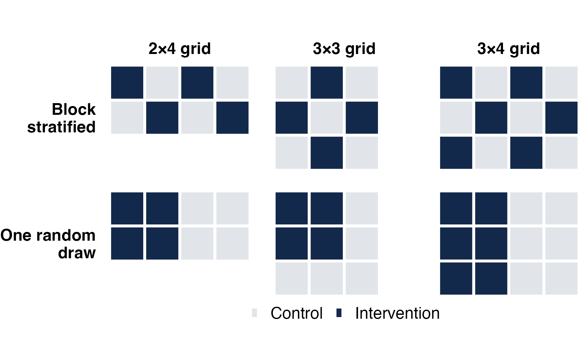
<p class="p1-caption">Dark cells are intervention clusters. The three grids studied here.</p>
:::
::: {.column .p1-small width="44%"}
<div class="p1-card" style="margin-bottom: 0.45em;"><h3>Simple random sampling (SRS)</h3>Any allocation with half the clusters treated (4 of 9 on the 3×3 grid), drawn at random. It can put all treated clusters together, as in the bottom row.</div>
<div class="p1-card navy" style="margin-bottom: 0.45em;"><h3>Block stratified sampling (BSS)</h3>No two intervention clusters share an edge, and no two controls where the grid allows. That leaves the two checkerboards on the 2×4 and 3×4 grids, and `r gi("3x3", "n_bss")` allocations on the 3×3 grid, where only intervention clusters must be separated.</div>

- An **allocation** is the list of which clusters get the intervention
- We compare designs by the **mean squared error (MSE)** of the intervention effect estimate, how far off the estimate tends to be from bias and chance together. Smaller is better
:::
:::

::: {.notes}
[1.25 min | running 5]

- So the question is whether the allocation chosen before the trial, meaning the list of which clusters get the intervention, changes how well we can estimate the effect.
- Here are the two designs on the three grids we study, with block stratified allocations on top and one random allocation below.
- Simple random sampling draws any allocation with half the clusters treated, including ones that put every treated cluster together, like the bottom row.
- Block stratified sampling keeps intervention clusters from sharing an edge, which leaves only the two checkerboards on the two-by-four and three-by-four grids, and `r gi("3x3", "n_bss")` allocations on the three-by-three grid.
- We judge them by mean squared error, which measures how far off the estimate tends to be, combining being systematically off and being off by chance, so smaller is better.
:::

## This study defines neighbors as clusters that share an edge {data-menu-title="Neighbors" data-footer-part="Methods"}

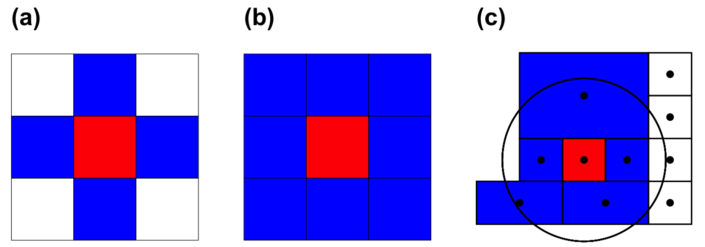

- **Rook** neighbors share an edge, **queen** neighbors share an edge or a corner, and higher-order neighbors are neighbors of neighbors
- Distance-based neighbors lie within a fixed radius
- We use **rook** neighbors throughout, the same edge rule that defines BSS, and they decide both who can receive spillover and who is spatially correlated

::: {.notes}
[0.5 min | running 5.5]

- Everything depends on how we define a neighbor.
- Rook neighbors share an edge, queen neighbors share an edge or a corner, and you can also define neighbors by distance or as neighbors of neighbors.
- This study uses rook neighbors throughout, and that one definition decides both who can receive spillover and who is spatially correlated.
:::

## Spillover may reach only control clusters, or control and intervention clusters {data-menu-title="Two spillover types" data-footer-part="Methods"}

<div class="p1-schematic">
<figure>
<figcaption>Control Clusters Only</figcaption>
<svg width="460" height="240" viewBox="0 0 460 240" role="img" aria-label="Two by four grid with the left four cells treated; only the two control cells beside them are exposed">
<g stroke="#fff" stroke-width="6">
<rect x="10" y="10" width="105" height="105" fill="#13294B"/><rect x="120" y="10" width="105" height="105" fill="#13294B"/><rect x="230" y="10" width="105" height="105" fill="#E1E5EA"/><rect x="340" y="10" width="105" height="105" fill="#E1E5EA"/>
<rect x="10" y="120" width="105" height="105" fill="#13294B"/><rect x="120" y="120" width="105" height="105" fill="#13294B"/><rect x="230" y="120" width="105" height="105" fill="#E1E5EA"/><rect x="340" y="120" width="105" height="105" fill="#E1E5EA"/>
</g>
<g fill="#FBAF3D" stroke="#13294B" stroke-width="2"><circle cx="282" cy="62" r="30"/><circle cx="282" cy="172" r="30"/></g>
<g font-size="21" font-weight="700" fill="#13294B" text-anchor="middle"><text x="282" y="70">z=1</text><text x="282" y="180">z=1</text></g>
</svg>
</figure>
<figure>
<figcaption>Control &amp; Intervention Clusters</figcaption>
<svg width="460" height="240" viewBox="0 0 460 240" role="img" aria-label="Same grid; the two exposed control cells and all four treated cells, which border other treated cells, are exposed">
<g stroke="#fff" stroke-width="6">
<rect x="10" y="10" width="105" height="105" fill="#13294B"/><rect x="120" y="10" width="105" height="105" fill="#13294B"/><rect x="230" y="10" width="105" height="105" fill="#E1E5EA"/><rect x="340" y="10" width="105" height="105" fill="#E1E5EA"/>
<rect x="10" y="120" width="105" height="105" fill="#13294B"/><rect x="120" y="120" width="105" height="105" fill="#13294B"/><rect x="230" y="120" width="105" height="105" fill="#E1E5EA"/><rect x="340" y="120" width="105" height="105" fill="#E1E5EA"/>
</g>
<g fill="#FBAF3D" stroke="#13294B" stroke-width="2"><circle cx="62" cy="62" r="30"/><circle cx="172" cy="62" r="30"/><circle cx="282" cy="62" r="30"/><circle cx="62" cy="172" r="30"/><circle cx="172" cy="172" r="30"/><circle cx="282" cy="172" r="30"/></g>
<g font-size="21" font-weight="700" fill="#13294B" text-anchor="middle"><text x="62" y="70">z=1</text><text x="172" y="70">z=1</text><text x="282" y="70">z=1</text><text x="62" y="180">z=1</text><text x="172" y="180">z=1</text><text x="282" y="180">z=1</text></g>
</svg>
</figure>
</div>

<div class="p1-legend"><span><span class="p1-swatch" style="background:#13294B"></span>Intervention cluster ($x_i = 1$)</span><span><span class="p1-swatch" style="background:#E1E5EA"></span>Control cluster ($x_i = 0$)</span><span><span class="p1-swatch" style="background:#FBAF3D; border-radius:50%"></span>Exposed to spillover ($z_i = 1$), unmarked $z_i = 0$</span></div>

- Exposure is **binary**. A cluster is exposed if at least one rook neighbor is an intervention cluster (and, for Control Clusters Only, it is itself a control), however many treated neighbors it has
- **Control Clusters Only** is classic contamination; under **Control & Intervention Clusters** treated clusters next to other treated clusters gain extra

::: {.notes}
[1 min | running 6.5]

- Spillover can travel in two ways, and this turns out to drive every result.
- Dark squares are intervention clusters, and here the left half of a two-by-four grid is treated.
- On the left, spillover reaches only control clusters, so the two controls next to the treated block are exposed, which is classic contamination.
- On the right, spillover reaches any cluster with a treated neighbor, so the four treated clusters, which all touch each other, are exposed too.
- In both cases exposure is binary, so a cluster either borders a treated cluster or it doesn't, no matter how many treated neighbors it has.
:::

## A spatial lag model separates the intervention effect, spillover and spatial dependence {data-menu-title="Model" data-footer-part="Methods"}

<div class="p1-eq">
$$
y_i \;=\; \alpha \;+\; \beta\, x_i \;+\; \psi\, z_i \;+\; \rho \sum_{j \in \mathcal{N}(i)} w_{ij}\, y_j \;+\; \varepsilon_i,
\qquad \varepsilon_i \overset{iid}{\sim} N(0, \sigma^2)
$$
</div>

<div class="p1-zdefs">
<span><span class="lab">Control Clusters Only</span> $z_i = 1$ if $x_i = 0$ and $x_j = 1$ for some $j \in \mathcal{N}(i)$</span>
<span><span class="lab">Control &amp; Intervention Clusters</span> $z_i = 1$ if $x_j = 1$ for some $j \in \mathcal{N}(i)$</span>
</div>

<div class="p1-glossary">
<span class="sym">$y_i$</span><span>Cluster-level outcome of cluster $i$</span>
<span class="sym">$\alpha$</span><span>Baseline effect (0.2 in the simulation)</span>
<span class="sym">$x_i$</span><span>Treatment indicator, 1 if cluster $i$ is an intervention cluster, 0 if control</span>
<span class="sym">$\beta$</span><span>Intervention effect, the target of estimation (1.0)</span>
<span class="sym">$z_i$</span><span>Binary spillover indicator, defined for each spillover type above</span>
<span class="sym">$\psi$</span><span>Spillover effect, a scalar coefficient on $z_i$ (0.5, 0.6, 0.7 or 0.8)</span>
<span class="sym">$\mathcal{N}(i)$</span><span>Rook neighbors of cluster $i$, the clusters sharing an edge with it</span>
<span class="sym">$\rho$</span><span>Spatial dependence (autocorrelation) coefficient (0 or 0.01; its scale is in backup)</span>
<span class="sym">$\varepsilon_i$</span><span>Independent normal error (subject-level SD $\sigma = 0.1$)</span>
<span class="sym">$w_{ij}$</span><span>Row-normalized weight, $1/|\mathcal{N}(i)|$ for each rook neighbor $j$ and 0 otherwise, so the sum is the average of the neighbors' outcomes</span>
</div>

<p class="p1-level">Subjects are placed at random over the grid (160 per replication on the 2×4 grid, about 20 per cluster). Every subject in a cluster shares its $x_i$, $z_i$ and neighbors, and outcomes vary within a cluster only through independent error, so the model is written for the cluster-level outcome $y_i$. Fitted by maximum likelihood (<code>lagsarlm</code>) with the true spillover term included wherever the allocation lets it be estimated; $\beta$, $\psi$ and $\rho$ are structural coefficients.</p>

::: {.notes}
[1.25 min | running 7.75]

- This is the spatial lag model behind every result, and every symbol is defined below.
- A cluster's outcome is a baseline alpha, plus the intervention effect beta if the cluster is treated, plus the spillover effect psi if it is exposed.
- On top of that comes rho times the average outcome of its rook neighbors, plus independent error.
- The blue box gives the two definitions of the spillover indicator z, which match the two pictures on the previous slide.
- The neighbor weights are row-normalized, so each neighbor gets weight one over the number of neighbors, and the lag term is rho times the neighbors' average.
- We fit it by maximum likelihood with the true spillover term included wherever the allocation allows it to be estimated, and in a few slides I'll show when it doesn't.
:::

## Outcomes are generated with y on both sides, so effects ripple through the neighbors {data-menu-title="Generating outcomes" data-footer-part="Methods"}

<div class="p1-eq">
$$
\mathbf{y} = \rho\mathbf{W}\mathbf{y} + \boldsymbol\alpha + \mathbf{X}\beta + \mathbf{Z}\psi + \boldsymbol\varepsilon
\quad\Longrightarrow\quad
\mathbf{y} = (\mathbf{I} - \rho\mathbf{W})^{-1}\left(\boldsymbol\alpha + \mathbf{X}\beta + \mathbf{Z}\psi + \boldsymbol\varepsilon\right)
$$
</div>

<div class="p1-eq" style="font-size: 0.8em;">
$$
(\mathbf{I} - \rho\mathbf{W})^{-1} = \mathbf{I} + \rho\mathbf{W} + \rho^2\mathbf{W}^2 + \cdots
$$
</div>

- The matrix form stacks the clusters: $\mathbf{X}$ and $\mathbf{Z}$ hold each cluster's $x_i$ and $z_i$, and $\mathbf{W}$ holds the weights $w_{ij}$
- Since $\mathbf{y}$ appears on both sides, outcomes are simulated from the solved (reduced) form on the right
- The expansion shows the ripple: each cluster's outcome passes to its neighbors ($\rho\mathbf{W}$), their neighbors ($\rho^2\mathbf{W}^2$) and so on
- The model is fitted by maximum likelihood; the likelihood is in backup

::: {.notes}
[0.5 min | running 8.25]

- The outcome appears on both sides of the model, so we can't draw it directly, and solving for it gives the reduced form on the right.
- Expanding the inverse shows what it does, passing each cluster's outcome to its neighbors, then to their neighbors, and so on, with rho controlling how fast it fades.
- Outcomes are simulated from this form and the model is fitted by maximum likelihood, with the likelihood in backup.
:::

## We enumerate every possible allocation on three small grids and compare their error {data-menu-title="Simulation design" data-footer-part="Methods"}

::: {.columns .p1-vcenter}
::: {.column width="50%"}
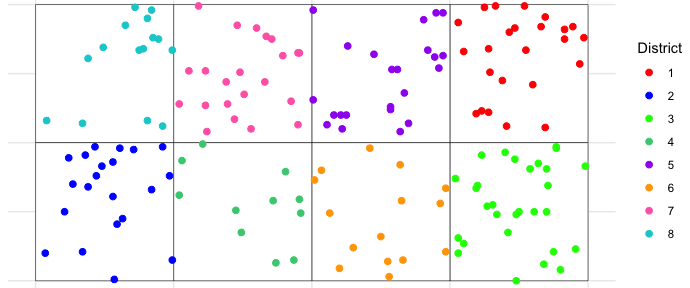
<p class="p1-caption">One replication on the 2×4 grid, 160 subjects placed at random. Only cluster membership enters the fit.</p>
:::
::: {.column .p1-small width="50%"}
| Grid | Clusters | Allocations (SRS) | BSS allocations | Replications |
|:--|:--:|:--:|:--:|:--:|
| 2×4 | `r gi("2x4","clusters")` | `r gi("2x4","n_alloc")` | `r gi("2x4","n_bss")` | `r gi("2x4","reps")` |
| 3×3 | `r gi("3x3","clusters")` | `r gi("3x3","n_alloc")` | `r gi("3x3","n_bss")` | `r gi("3x3","reps")` |
| 3×4 | `r gi("3x4","clusters")` | `r gi("3x4","n_alloc")` | `r gi("3x4","n_bss")` | `r gi("3x4","reps")` |

- 16 scenarios per grid: $\psi \in \{0.5, 0.6, 0.7, 0.8\}$ × $\rho \in \{0, 0.01\}$ × two spillover types
- Outcomes generated from the model's reduced form, $\beta$ estimated in every replication $r = 1, \dots, N$
- For each allocation, bias $= \bar{\hat\beta} - \beta$, variance $= \frac{1}{N}\sum_r(\hat\beta_r - \bar{\hat\beta})^2$, and $\text{MSE} = \frac{1}{N}\sum_{r}(\hat\beta_r - \beta)^2 = \text{bias}^2 + \text{variance}$
- A design is summarized by the **mean MSE over its allocations** and by **how much that MSE varies** across allocations (SD of MSE)
:::
:::

::: {.notes}
[1.25 min | running 9.5]

- Small grids let us enumerate every possible allocation, from `r gi("2x4","n_alloc")` on the two-by-four grid to `r gi("3x4","n_alloc")` on the three-by-four grid.
- Each grid has sixteen scenarios, four spillover sizes, two levels of spatial dependence and the two spillover types.
- For every allocation we generate outcomes from the model, fit it, and repeat `r gi("2x4","reps")` times, or `r gi("3x4","reps")` times on the largest grid.
- An allocation's mean squared error is the average squared distance between the estimate and the true beta, which splits into bias squared plus variance.
- Simple random sampling is summarized over all allocations and block stratified sampling over its few, by the mean error and by how much the error varies from one allocation to the next.
- That second number matters, because a real trial runs exactly one allocation.
:::

## With spillover into controls and correlated outcomes, block stratified sampling beats about half of random draws and avoids the worst ones {data-menu-title="Where BSS falls" data-footer-part="Simulation Results"}

::: {.columns}
::: {.column width="66%"}
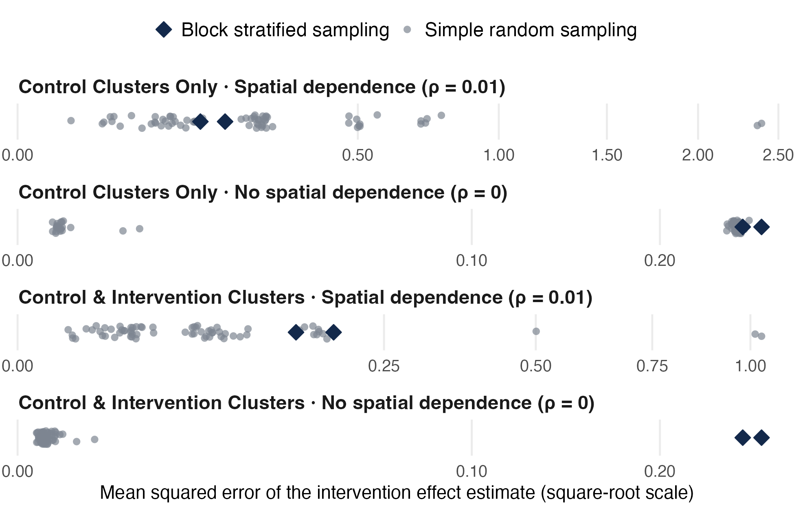
<p class="p1-note">Each dot is one allocation's MSE over its replications (2×4 grid, ψ = 0.5). Further left is better. Each row has its own scale.</p>
:::
::: {.column .p1-small width="34%"}
<div class="p1-card navy" style="margin-bottom: 0.5em;">
<span class="p1-big">`r pc(a$pct_SRS_worse)`</span><br/>of random allocations have higher MSE than BSS with spillover into controls and $\rho = 0.01$ (2×4, $\psi = 0.5$)
</div>

- The worst tenth of random draws average MSE **`r f2(rk24$worst10)`**, and the worst is **`r f2(a$SRS_max)`**; neither BSS allocation exceeds **`r f2(a$BSS_max)`**
- Across all grids and $\psi$ in that setting, BSS beats **`r sprintf("%.0f–%.0f%%", co01_pct[1], co01_pct[2])`** of random draws
- On this grid, without spatial dependence most random draws tie BSS (they also expose every control); with spillover into both arms, most do better
:::
:::

::: {.notes}
[1.75 min | running 11.25]

- I want to lead with the view that matters most for a trial, which runs one allocation.
- Each grey dot is one random allocation on the two-by-four grid with psi at one-half, and the diamonds are the two block stratified allocations.
- Further left is better, and each row has its own scale.
- In the top row, spillover into controls with spatial dependence, block stratified sampling has lower error than `r pc(a$pct_SRS_worse)` of the random draws.
- An MSE of `r f2(sa$BSS_MSE)` means the estimate is typically off by about `r f2(sqrt(sa$BSS_MSE))` on a true effect of one.
- It also never lands in the tail, where the worst random allocation has an error of `r f2(a$SRS_max)`, against at most `r f2(a$BSS_max)` for block stratified sampling.
- Across all three grids and every spillover size in that setting, it beats between `r sprintf("%.0f and %.0f", co01_pct[1], co01_pct[2])` percent of random draws, so it is a good allocation, though not the best one.
- In the second row, without spatial dependence, most random draws do better, and the dense group of draws next to the diamonds are random allocations that also leave every control exposed.
- The bottom rows are the other side of the comparison.
- When spillover reaches both arms, most random allocations do better, and I'll show why in two slides.
:::

## With spillover into controls only, block stratified sampling has lower error when outcomes are spatially correlated {data-menu-title="Control clusters only" data-footer-part="Simulation Results"}

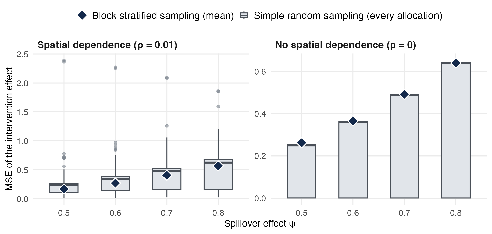

::: {.p1-cards .three style="margin-top: 0.3em; font-size: 0.82em;"}
::: {.p1-card .navy}
**With ρ = 0.01,** BSS **`r f3(sa$BSS_MSE)`** vs SRS **`r f3(sa$SRS_MSE)`** ($\psi = 0.5$), lower at every $\psi$, with the gap closing by $\psi = 0.8$ (`r f3(s8$BSS_MSE)` vs `r f3(s8$SRS_MSE)`)
:::
::: {.p1-card}
**With ρ = 0,** SRS is lower on average, **`r f3(s0$SRS_MSE)`** vs **`r f3(s0$BSS_MSE)`**
:::
::: {.p1-card .amber}
**Spread across allocations,** SD of MSE **`r f2(sa$SRS_SD)`** for random draws; BSS is effectively one allocation here (two mirror-image checkerboards)
:::
:::

::: {.notes}
[1 min | running 12.25]

- Now the averages, for spillover into controls only.
- Boxes show the random allocations and diamonds the block stratified mean, across the four spillover sizes.
- With spatial dependence, block stratified sampling has the lower average error at every spillover size, for example `r f3(sa$BSS_MSE)` against `r f3(sa$SRS_MSE)` at psi one-half, though the gap nearly closes by psi of 0.8.
- With spatial dependence the random allocations also spread widely, with a standard deviation of MSE of `r f2(sa$SRS_SD)`, while the two checkerboards are mirror images and amount to one allocation.
- Without spatial dependence, random allocation is lower on average, `r f3(s0$SRS_MSE)` against `r f3(s0$BSS_MSE)`.
- The boxes on the right reach the diamonds.
- That is because `r sprintf("%.0f", pct_col24)` percent of random allocations on this grid also leave every control exposed, and they do just as badly.
:::

## With spillover into both arms, simple random sampling has the lower average error {data-menu-title="Control & intervention clusters" data-footer-part="Simulation Results"}

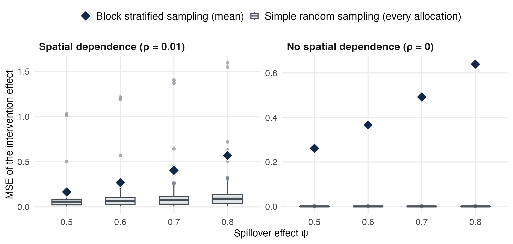

- SRS is lower in **all `r n_ci_srs_lower` of `r n_ci`** such scenarios across the three grids, for example **`r f3(cc$SRS_mean)` vs `r f3(cc$BSS_mean)`** with $\rho = 0.01$ and **`r f3(d$SRS_mean)` vs `r f3(d$BSS_mean)`** with $\rho = 0$ (2×4, $\psi = 0.5$)
- BSS results are identical under both spillover types on every grid, since no treated cluster has a treated neighbor

::: {.notes}
[0.5 min | running 12.75]

- When spillover reaches both arms, the picture flips.
- Simple random sampling has the lower average error in all `r n_ci_srs_lower` of these scenarios across the three grids, for example `r f3(cc$SRS_mean)` against `r f3(cc$BSS_mean)` with spatial dependence on the two-by-four grid.
- The block stratified numbers are exactly the same as on the previous slide, and the next slide shows why.
:::

## With spillover into controls only, an allocation that exposes every control makes exposure the exact opposite of treatment {data-menu-title="Why: collinearity" data-footer-part="Simulation Results"}

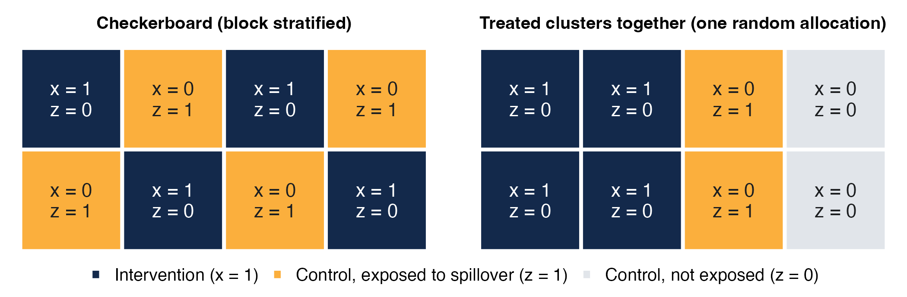

::: {.columns .p1-small style="margin-top: 0.2em;"}
::: {.column width="52%"}
- Under Control Clusters Only, if every control is exposed then $z_i = 1 - x_i$ for every cluster, $[\mathbf{1}, x, z]$ loses rank, and $\beta$ and $\psi$ cannot be separated. `lagsarlm` drops $z$, and $\hat\beta$ estimates $\beta - \psi$
- At $\rho = 0$ the 2×4 BSS bias is $-\psi$ (**`r f2(bias24_r0[2])`** to **`r f2(bias24_r0[1])`**); with spatial dependence the lag term absorbs part of it (**`r f2(bias24_r1[2])`** to **`r f2(bias24_r1[1])`**)
:::
::: {.column width="48%"}
- **Control Clusters Only.** Every checkerboard and many random allocations are collinear (**`r ncol("2x4")` of `r gi("2x4","n_alloc")`** on 2×4, `r ncol("3x3")` of `r gi("3x3","n_alloc")` on 3×3, `r ncol("3x4")` of `r gi("3x4","n_alloc")` on 3×4)
- **Control & Intervention Clusters.** Only the checkerboards are (`r ncol("2x4","CI")`, `r ncol("3x3","CI")` and `r ncol("3x4","CI")`), so random draws almost always keep the information, and SRS wins
- Collinearity can be checked from the map before the trial
:::
:::

::: {.notes}
[1.25 min | running 14]

- Here is the reason.
- With spillover into controls only, whenever every control borders an intervention cluster, the spillover indicator is exactly one minus the treatment indicator, so the model can't tell the intervention effect from the spillover effect.
- The software drops the spillover term, and the estimate comes out near beta minus psi.
- On the two-by-four grid that is a bias of minus psi without spatial dependence, and with it about `r f2(bias24_r1[2])` at psi one-half, so even in its best setting the checkerboard underestimates the effect by about a third.
- With spillover into controls only, that happens in every checkerboard but also in `r ncol("2x4")` of the `r gi("2x4","n_alloc")` random allocations on this grid, so random draws share the problem.
- With spillover into both arms, only the checkerboards are collinear, so almost every random draw keeps the information and random allocation wins.
- The useful point for design is that this can be checked from the map and the neighbor definition before any data are collected.
:::

## The same pattern holds on the 3×3 and 3×4 grids {data-menu-title="Larger grids" data-footer-part="Simulation Results"}

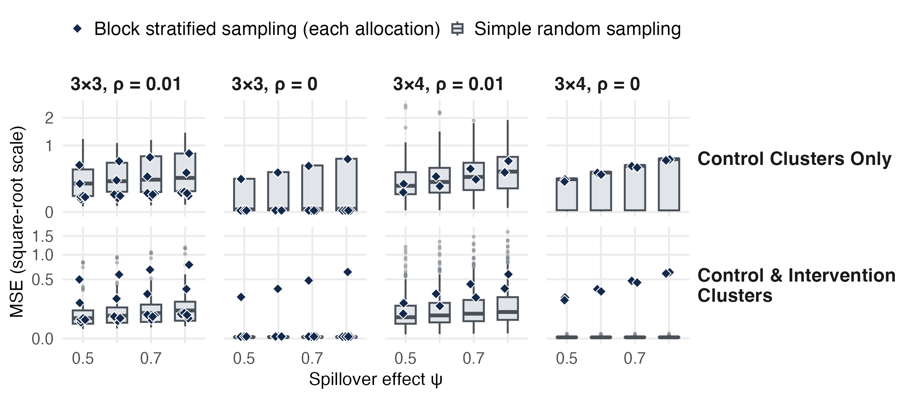

::: {.p1-small}
- The better design matches the 2×4 grid in **`r agree("3x4")` of `r n_scen_grid`** scenarios on 3×4 and **`r agree("3x3")` of `r n_scen_grid`** on 3×3. The exception (3×3, spillover into controls, $\rho = 0$) has five BSS allocations that leave a control unexposed
- Random draws spread widely. On 3×4 with spillover into controls and $\rho = 0.01$ they reach MSE **`r f2(R("3x4", CO, 0.01)$SRS_max)`**, while both BSS allocations stay at or below **`r f2(R("3x4", CO, 0.01)$BSS_max)`** ($\psi = 0.5$)
:::

::: {.notes}
[1 min | running 15]

- The larger grids tell the same story.
- On the three-by-four grid, which also has only the two checkerboards, the better design matches the two-by-four grid in all `r agree("3x4")` scenarios.
- On the three-by-three grid it matches in `r agree("3x3")` of `r n_scen_grid`, and the exception is spillover into controls without spatial dependence, where block stratified sampling is lower.
- There, only the strict checkerboard is collinear, and the other five block stratified allocations each leave a control unexposed and estimate beta almost exactly.
- Each box is every random allocation and each diamond one block stratified allocation, so the plot shows the spread a trial is drawing from.
- On the three-by-four grid with spillover into controls and spatial dependence, random draws reach an error of `r f2(R("3x4", CO, 0.01)$SRS_max)`, while both checkerboards stay at or below `r f2(R("3x4", CO, 0.01)$BSS_max)`.
:::

## North Carolina probation trials assign counties or judicial districts, natural spatial clusters {data-menu-title="NC probation districts" data-footer-part="Application"}

::: {.columns .p1-vcenter}
::: {.column width="68%"}
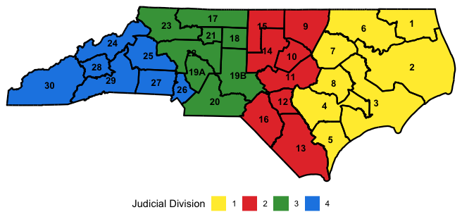
:::
::: {.column .p1-small width="32%" style="font-size: 0.82em;"}
- **30 judicial districts** in **4 divisions** (NC Division of Community Supervision)
- Chief probation/parole officers and district managers oversee districts, often spanning several counties
- **Case 1, trauma-informed supervision.** Training for officers and chiefs on specialty caseloads, randomized by county or district
- Neighbors share courts, labor markets and providers, and leaders and providers can carry the program across arms
:::
:::

::: {.notes}
[1 min | running 16]

- These questions came from two probation studies with the North Carolina Department of Adult Correction.
- Supervision is organized into thirty judicial districts in four divisions, and chiefs and district managers often span several units and counties.
- The first study trains officers and their chiefs on specialty caseloads in trauma-informed supervision, and it randomizes counties or districts.
- If counties are randomized, a manager who likes the training can carry it into control counties they oversee, and if districts are randomized, division leaders and shared providers can do the same, which is spillover into controls.
- Neighboring areas also share courts, labor markets and providers, which is spatial dependence.
- Some channels follow the organization chart rather than the map, so borders are a proxy, but they are the one a design can act on.
:::

## A second study crosses the four behavioral health management areas {data-menu-title="NC MCO areas" data-footer-part="Application"}

::: {.columns .p1-vcenter}
::: {.column width="68%"}
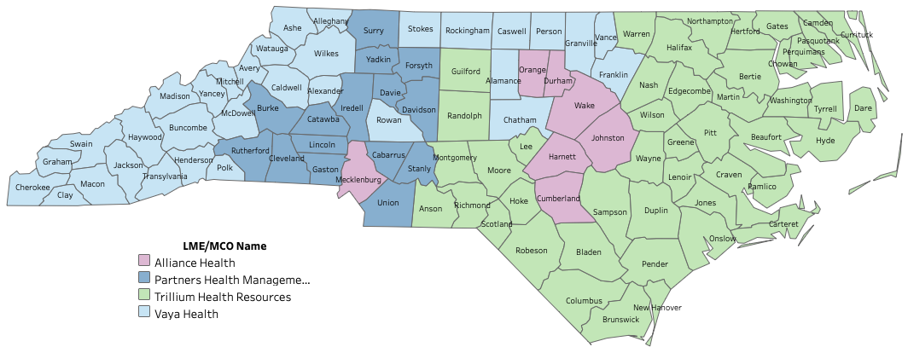
<p class="p1-caption">Each county shaded by the LME/MCO that manages its behavioral health services.</p>
:::
::: {.column .p1-small width="32%" style="font-size: 0.8em;"}
- **Case 2, specialty mental health probation.** Cross-training and joint treatment-team meetings between officers and behavioral health providers
- Each county is served by one of **4 LME/MCOs** (Local Management Entity/Managed Care Organizations)
- Large providers work across counties and MCO areas, so practices can travel into control counties
- MCO-level policies are a confounder, so the design stratifies by MCO area
:::
:::

::: {.notes}
[0.75 min | running 16.75]

- The second study tests a strategy for specialty mental health probation, built on cross-training and joint team meetings between officers and behavioral health providers.
- Behavioral health care is managed by four regional managed care organizations, and each county is served by one of them.
- Large providers work across counties and regions, so a practice adopted in one county can travel into a control county.
- The organizations' own policies could confound the result, so this study stratifies by their coverage areas.
:::

## For both studies we recommend a best-effort block stratified allocation {data-menu-title="Recommendation" data-footer-part="Application"}

::: {.columns}
::: {.column width="58%"}

<p class="p1-note">An example allocation of judicial districts (Case 1). Red, intervention; blue, control. Case 2 would do the same with counties within each MCO area.</p>
:::
::: {.column .p1-small width="42%"}
- Stratify by judicial division (Case 1) or MCO area (Case 2), then keep same-arm districts apart where the map allows
- Why controls only? With a consistent treatment effect, treated districts gain nothing more from other treated districts, but nearby controls can pick the program up
- This is a suggested, best-effort allocation for an irregular map. A refined allocation could also leave a few control districts with no intervention neighbor, which keeps the program and its spillover separable
- In Case 2, a provider who joins the training may serve several counties, carrying it into control counties as well. If treated districts were instead expected to reinforce each other, SRS would be the better choice
:::
:::

::: {.notes}
[1.25 min | running 18]

- For both studies we recommend block stratified sampling, adapted to the map, with intervention in red and control in blue.
- The recommendation rests on the proposed studies' assumption that, with a consistent treatment effect, treated districts gain nothing more from other treated districts, while nearby control districts can pick the program up.
- In the mental health study, for example, a provider who joins the training may serve several counties, carrying it into control counties as well.
- This map is a suggested, best-effort allocation for the state's irregular geography, stratified by division, and a refined version could also leave a few control districts with no intervention neighbor, so the program and its spillover can be told apart.
- To be clear, a pure checkerboard still underestimates the effect in this setting, by about a third at psi one-half, so its value is avoiding the bad draws, not being unbiased.
:::

## Match the design to the spillover and spatial correlation you expect {data-menu-title="Choosing a design" data-footer-part="Discussion"}

<table class="p1-decide">
<thead><tr><th></th><th>Neighboring outcomes move together (ρ = 0.01)</th><th>Neighboring outcomes independent (ρ = 0)</th></tr></thead>
<tbody>
<tr><td class="rowh">Spillover into control clusters only</td>
<td class="bss"><strong>Block stratified sampling.</strong> Lower MSE in `r n_co01_bss_lower` of `r n_co01` scenarios across grids (near ties at ψ = 0.8) (2×4: `r f3(sa$BSS_MSE)` vs `r f3(sa$SRS_MSE)`), and it avoids the worst random draws</td>
<td class="mix"><strong>SRS, or BSS only if some controls border no intervention cluster</strong> (never true of a strict checkerboard). What decides it is whether the allocation leaves controls unexposed</td></tr>
<tr><td class="rowh">Spillover into control and intervention clusters</td>
<td class="srs"><strong>Simple random sampling</strong> (2×4: `r f3(cc$SRS_mean)` vs `r f3(cc$BSS_mean)`), or a buffer-zone design (not evaluated here)</td>
<td class="srs"><strong>Simple random sampling.</strong> Lower in every scenario (2×4: `r f3(d$SRS_mean)` vs `r f3(d$BSS_mean)`)</td></tr>
</tbody>
</table>

<p class="p1-note">2×4 values at ψ = 0.5; the direction holds across ψ. For probation districts, which share courts, providers and labor markets, the first column is the realistic one.</p>

::: {.notes}
[1 min | running 19]

- Putting the results together, the design should follow from what investigators expect about spillover and spatial correlation.
- If spillover flows into controls and neighboring outcomes move together, which is the realistic case for probation districts, block stratified sampling had the lower error and avoided the worst draws.
- If spillover flows into controls but outcomes are independent, random allocation is the safer choice, and a separated allocation works only if some controls border no intervention cluster.
- If spillover reaches both arms, random allocation is the better choice, or possibly a buffer-zone design, which we did not evaluate.
:::

## Block stratified sampling is a good design, not the best or the worst, against rolling the dice on one random draw {data-menu-title="Take-home" data-footer-part="Discussion"}

<div class="p1-take">Choose the allocation for the spillover you expect, and know what a single random draw can cost</div>

::: {.p1-cards .three style="margin-top: 0.6em;"}
::: {.p1-card .navy}
<h3>Risk, not just the average</h3>

SRS can win on average, but one trial runs one allocation, and some random draws estimate the effect poorly.
:::
::: {.p1-card}
<h3>The spillover type matters</h3>

BSS helps most when spillover flows into controls and outcomes are spatially correlated, and most random allocations beat it when spillover reaches both arms.
:::
::: {.p1-card .amber}
<h3>State the mechanism</h3>

Justify the design by the anticipated direction of spillover, and look at which controls the chosen allocation exposes. If every control borders an intervention cluster, expect the estimate to understate the effect, and where the map allows, keep a few controls clear of treated neighbors.
:::
:::

::: {.notes}
[1 min | running 20]

- The take-home is that block stratified sampling is a good design, not the best and not the worst, and the comparison that matters is with rolling the dice on a single random draw.
- Random allocation can win on average, but a trial runs one allocation, and some random draws estimate the effect poorly.
- Block stratified sampling helps most when spillover flows into controls and outcomes are spatially correlated, and when spillover reaches both arms most random allocations beat it.
- So investigators should state the spillover they expect and choose the design to match.
- Then look at the map, and where it allows, keep a few controls clear of treated neighbors, since otherwise the estimate will understate the effect.
:::

## These results come from small regular grids and a simple spillover model {data-menu-title="Limitations and next steps" data-footer-part="Discussion"}

::: {.columns}
::: {.column width="50%"}
### Limitations
- Treatment and spillover are exactly collinear whenever every control is exposed, which includes every checkerboard
- Binary rook spillover, with no decay over distance and no added effect from more treated neighbors
- Small regular grids of equal-area clusters
- No intra-cluster correlation; results specific to the spatial lag model with the spillover term included
:::
::: {.column width="50%"}
### Next steps
- Distance-decaying and additive spillover
- Buffer-zone designs that keep some controls unexposed
- Larger, irregular geographies and more designs
- Model misspecification and other spatial models
:::
:::

<div class="p1-card navy" style="margin-top: 0.6em; font-size: 0.82em;">
Walther A, Van Deinse T, Lin F-C. Spatial cluster randomized trials: sampling design with spillover effects and spatial dependence. <em>BMC Medical Research Methodology</em> (2026). doi:10.1186/s12874-026-02968-0
</div>

::: {.notes}
[0.5 min | running 20.5]

- The most important limitation is the collinearity, which arises whenever every control is exposed.
- Spillover is binary and limited to rook neighbors, the grids are small and regular, and the model has no intra-cluster correlation and is fitted with the spillover term included.
- Next steps are spillover that decays with distance or adds up, buffer zones, larger irregular maps, more designs, and misspecified models, and this work is published in BMC Medical Research Methodology.
:::

## Thank you! {data-menu-title="Thank you & questions" data-footer-part=""}

::: {.columns .thanks-cols}
::: {.column}
#### Advisor
Feng-Chang Lin

#### Collaborator
Tonya Van Deinse
:::
::: {.column}
#### Funding
<span style="font-size: 0.8em;">National Institute of Mental Health, K01MH129619 (Dr. Van Deinse)<br/>
Bureau of Justice Assistance, 15PBJA-24-GG-01896-PRJH (NC Department of Adult Correction)</span>

#### Paper
Walther et al., *BMC Medical Research Methodology* (2026)
:::
:::

<p class="questions-welcome">Questions welcome</p>
<p class="contact-email">awalther@unc.edu</p>

::: {.notes}
[0.25 min | standalone only]

- Thank you to my advisor, Dr. Lin, and to Dr. Van Deinse, whose probation studies motivated this work.
- I'm happy to take questions.

[Backup slides follow. Press M for the menu or type a slide number and press Enter to jump.]
:::

## Backup &middot; 3×3 grid, every allocation {.backup-slide data-menu-title="B: 3×3 figure" data-footer-part="Backup"}

::: {.columns .p1-vcenter}
::: {.column width="66%"}
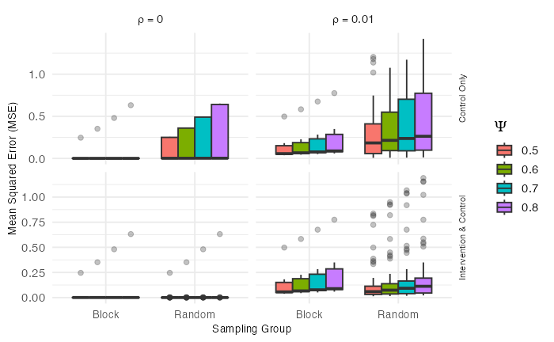
:::
::: {.column .p1-small width="34%"}
- Rows are spillover types (Control Only on top), columns are $\rho$. "Block" is the six BSS allocations and "Random" every allocation, colored by $\psi$
- The BSS spread comes from its six different allocations. One, the full checkerboard, is collinear; the other five leave a control unexposed and estimate $\beta$ almost exactly
- With spillover into controls and $\rho = 0.01$, random allocations reach MSE `r f2(R("3x3", CO, 0.01)$SRS_max)` at $\psi = 0.5$, against at most `r f2(R("3x3", CO, 0.01)$BSS_max)` for BSS
:::
:::

::: {.notes}
Use when asked for the per-allocation distributions on the 3×3 grid. This is the chapter's figure.
:::

## Backup &middot; 3×4 grid, every allocation {.backup-slide data-menu-title="B: 3×4 figure" data-footer-part="Backup"}

::: {.columns .p1-vcenter}
::: {.column width="66%"}

:::
::: {.column .p1-small width="34%"}
- Rows are spillover types (Control Only on top), columns are $\rho$. "Block" is the two checkerboards and "Random" all `r gi("3x4","n_alloc")` allocations, colored by $\psi$
- With spillover into controls and $\rho = 0.01$, random allocations reach MSE `r f2(R("3x4", CO, 0.01)$SRS_max)` at $\psi = 0.5$, while both checkerboards stay at or below `r f2(R("3x4", CO, 0.01)$BSS_max)`
- With spillover into both arms, most random allocations sit near zero and the checkerboards do not
:::
:::

::: {.notes}
Use when asked for the per-allocation distributions on the 3×4 grid. This is the chapter's figure.
:::

## Backup &middot; Where block stratified sampling falls among random allocations, every grid and setting {.backup-slide data-menu-title="B: BSS rank, all grids" data-footer-part="Backup"}

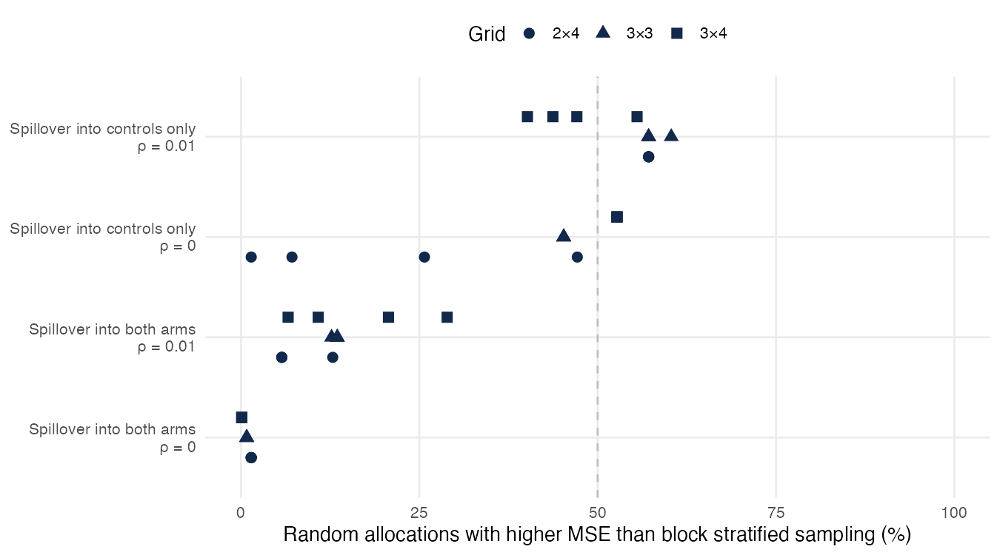
<p class="p1-note">One point per ψ; points that share a value overlap. With ρ = 0 and spillover into controls, most draws expose every control and estimate β − ψ like BSS, so the share there splits near-ties by simulation noise.</p>

::: {.notes}
Use when asked whether the 57% on the 2×4 grid is special. With spillover into controls and ρ = 0.01, BSS beats `r sprintf("%.0f to %.0f", co01_pct[1], co01_pct[2])` percent on every grid; with spillover into both arms, at most `r pc(ci_pct_max)`. The share counts random allocations with MSE above the BSS mean; the random set includes the BSS allocations, as in the paper.
:::

## Backup &middot; A good random draw can beat the checkerboard, but it cannot be picked before the trial {.backup-slide data-menu-title="B: Downside risk" data-footer-part="Backup"}

- Spillover into controls, $\rho = 0.01$, $\psi = 0.5$. The allocation is chosen before any outcome is seen, so the relevant comparison is with the whole spread of random draws
- 2×4: BSS MSE **`r f3(rk24$bss)`**; the worst tenth of random draws average **`r f2(rk24$worst10)`**, about `r sprintf("%.0f", rk24$worst10 / rk24$bss)` times as large (3×3: `r f3(rk33$bss)` vs `r f2(rk33$worst10)`; 3×4: `r f3(rk34$bss)` vs `r f2(rk34$worst10)`)
- Random draws that leave some control unexposed keep $\beta$ and $\psi$ separate, and many of them beat BSS (on 2×4, BSS beats `r id24$beats` of `r id24$n`; on 3×4, `r id34$beats` of `r id34$n`)
- But that check does not protect against a bad draw. The worst draw on each grid passes it (2×4: MSE `r f2(rk24$id_max)`, half the grid treated as one block; 3×4: `r f2(rk34$id_max)`)
- Which random draw will do best can only be known after the fact. BSS gives a reasonable error with a bounded downside, which is the trade an investigator can make in advance

::: {.notes}
Use when asked "against the random allocations that keep β identified, how does BSS do?" Answer plainly that many of them do better than a strict checkerboard, but nobody can tell in advance which ones, and the worst random draw passes the same check. BSS is chosen for its bounded downside, not because it is the best allocation.
:::

## Backup &middot; Full results, 2×4 grid {.backup-slide data-menu-title="B: Table 2×4" data-footer-part="Backup"}

`r tab_html("2x4")`

<p class="p1-note">MSE, SD of MSE across allocations, and mean bias of $\hat\beta$. Shading marks the design with lower MSE. SD here is the spread of MSE across allocations, unscaled (the chapter reports it ×10). The two 2×4 checkerboards are mirror images, so their difference (`r f3(bss_pair[1])` vs `r f3(bss_pair[2])` at ρ = 0.01, ψ = 0.5) is a guide to the Monte Carlo error.</p>

::: {.notes}
Use when asked for exact values. Generated from review/tables at render time.
:::

## Backup &middot; Full results, 3×3 grid {.backup-slide data-menu-title="B: Table 3×3" data-footer-part="Backup"}

`r tab_html("3x3")`

<p class="p1-note">As for the 2×4 table. The 3×3 grid has six BSS allocations, not all checkerboards, so BSS MSE also varies across allocations.</p>

::: {.notes}
Use when asked for exact values on the 3×3 grid.
:::

## Backup &middot; Full results, 3×4 grid {.backup-slide data-menu-title="B: Table 3×4" data-footer-part="Backup"}

`r tab_html("3x4")`

<p class="p1-note">As for the 2×4 table. 10 replications per allocation on this grid.</p>

::: {.notes}
Use when asked for exact values on the 3×4 grid.
:::

## Backup &middot; Outcomes come from the reduced form, and the model is fitted by maximum likelihood {.backup-slide data-menu-title="B: Reduced form and likelihood" data-footer-part="Backup"}

<div class="p1-eq" style="font-size: 0.74em;">
$$
\mathbf{y} = \rho \mathbf{W}\mathbf{y} + \boldsymbol\alpha + \mathbf{X}\beta + \mathbf{Z}\psi + \boldsymbol\varepsilon
\;\Longrightarrow\;
\mathbf{y} = (\mathbf{I} - \rho\mathbf{W})^{-1}\left(\boldsymbol\alpha + \mathbf{X}\beta + \mathbf{Z}\psi + \boldsymbol\varepsilon\right),
\;\; \boldsymbol\varepsilon \sim N(\mathbf{0}, \sigma^2\mathbf{I})
$$
</div>

<div class="p1-eq" style="font-size: 0.74em;">
$$
\ell(\alpha, \beta, \psi, \rho, \sigma^2) = -\frac{n}{2}\log(2\pi\sigma^2) + \log\left|\mathbf{I} - \rho\mathbf{W}\right|
- \frac{1}{2\sigma^2}\left(\mathbf{A}\mathbf{y} - \mathbf{D}\boldsymbol\theta\right)^\top\left(\mathbf{A}\mathbf{y} - \mathbf{D}\boldsymbol\theta\right)
$$
</div>

- $\mathbf{A} = \mathbf{I} - \rho\mathbf{W}$, $\mathbf{D} = [\mathbf{1}, \mathbf{X}, \mathbf{Z}]$, $\boldsymbol\theta = (\alpha, \beta, \psi)^\top$, and $n$ is the number of observations (in the simulation, the subjects, 160 on the 2×4 grid)
- For fixed $\rho$, $\boldsymbol\theta$ and $\sigma^2$ have closed forms, and $\rho$ maximizes the concentrated likelihood (`lagsarlm()` in R)
- A change in one cluster's treatment reaches every cluster through the spatial multiplier $(\mathbf{I} - \rho\mathbf{W})^{-1}$
- When $z = 1 - x$, $\mathbf{D}$ is rank-deficient and $\beta$, $\psi$ are not separately identified. Under Control & Intervention Clusters, $z \equiv 1$ in `r n_allexp("2x4")`, `r n_allexp("3x3")` and `r n_allexp("3x4")` allocations; then $\psi$ is aliased with $\alpha$ and $\beta$ is unaffected
- In the simulation code the generating $\mathbf{W}$ is subject-level and binary (see the ρ backup)

::: {.notes}
Use when asked how outcomes were generated and how the model was estimated. The Jacobian term log|I − ρW| is what distinguishes this from least squares on the lagged outcome.
:::

## Backup &middot; Row-normalized rook weights make the lag term a neighbor average {.backup-slide data-menu-title="B: Weights matrix" data-footer-part="Backup"}

::: {.columns .p1-vcenter style="min-height: 600px;"}
::: {.column width="50%"}
<svg width="100%" viewBox="0 0 560 300" role="img" aria-label="Two by four grid with cells numbered 1 to 8 row by row and cell 2 highlighted with its three rook neighbors">
<g stroke="#fff" stroke-width="5">
<rect x="10" y="10" width="130" height="130" fill="#FBAF3D"/><rect x="145" y="10" width="130" height="130" fill="#13294B"/><rect x="280" y="10" width="130" height="130" fill="#FBAF3D"/><rect x="415" y="10" width="130" height="130" fill="#E1E5EA"/>
<rect x="10" y="145" width="130" height="130" fill="#E1E5EA"/><rect x="145" y="145" width="130" height="130" fill="#FBAF3D"/><rect x="280" y="145" width="130" height="130" fill="#E1E5EA"/><rect x="415" y="145" width="130" height="130" fill="#E1E5EA"/>
</g>
<g font-size="34" font-weight="700" text-anchor="middle" fill="#13294B"><text x="75" y="88">1</text><text x="210" y="88" fill="#fff">2</text><text x="345" y="88">3</text><text x="480" y="88">4</text><text x="75" y="223">5</text><text x="210" y="223">6</text><text x="345" y="223">7</text><text x="480" y="223">8</text></g>
</svg>
<p class="p1-note">Cells numbered row by row for this example; cluster 2 and its rook neighbors (amber).</p>
:::
::: {.column width="50%"}
<div style="font-size: 0.8em;">

$$
w_{ij} = \frac{c_{ij}}{\sum_k c_{ik}}, \qquad c_{ij} = \begin{cases} 1 & \text{edge shared} \\ 0 & \text{otherwise} \end{cases}
$$

</div>

- Cluster 2 has rook neighbors 1, 3 and 6, so $w_{21} = w_{23} = w_{26} = 1/3$
- Each row sums to 1, so $\sum_j w_{ij} y_j$ is the average neighbor outcome and $\rho$ is comparable across clusters with different numbers of neighbors
- The same rook structure defines $z_i$, so spillover and spatial dependence share one neighbor definition
:::
:::

::: {.notes}
Use when asked how W is defined and why it is row-standardized. Corner clusters have two neighbors and edge clusters three on the 2×4 grid. For how the simulation's generating weights relate to this, see the next slide.
:::

## Backup &middot; How large is ρ = 0.01? {.backup-slide data-menu-title="B: Scale of rho" data-footer-part="Backup"}

- In the simulation code, outcomes were generated for the subjects with **subject-level binary weights**, linking each subject to every subject in a rook-neighboring cluster, about 40 to 60 links
- The model is fitted with the **row-normalized** version of the same neighbor structure
- On that fitted scale, $\rho = 0.01$ in the generating process corresponds to roughly $0.01 \times (40\text{ to }60) \approx 0.4$ to $0.6$, and the median $\hat\rho$ across 2×4 allocations is **`r f2(rhohat_med)`** (spillover into controls, $\psi = 0.5$)
- For the two checkerboards, which cannot estimate $\psi$, $\hat\rho$ is **`r f2(bss_rhohat[1])`** and **`r f2(bss_rhohat[2])`**, consistent with the lag term absorbing part of the dropped spillover and BSS bias shrinking with spatial dependence
- The long tail of random draws exists only with dependence. The worst 2×4 random draw at $\rho = 0.01$ (MSE `r f2(a$SRS_max)`, half the grid treated as one block) has MSE `r f3(w0)` at $\rho = 0$, where the largest MSE of any allocation is `r f2(srs_max_r0)`, a checkerboard

::: {.notes}
Use when asked "isn't ρ = 0.01 essentially zero?", why adding it changes the error so much, or how the subject-level and cluster-level weights relate. On the scale of the fitted model it is about one half. If asked about the weights, say plainly that outcomes were simulated for subjects within clusters, with a subject-level weights matrix linking each subject to every subject in the neighboring clusters, and the model was fitted to the subjects. Every subject in a cluster shares x, z and neighbors, so the cluster's signal is the subjects' common mean, which is why the paper writes the model at the cluster level with row-normalized weights. The two scales of ρ differ, which this slide shows. Results are reported as published; review/notes/2026-10-28-rho-scale-note.md records a quick check of how the generating weights affect the comparison, which would be the first thing to examine in follow-up work.
:::

## Backup &middot; Spillover and spatial dependence are different parameters {.backup-slide data-menu-title="B: Spillover vs dependence" data-footer-part="Backup"}

::: {.p1-cards .two style="margin-top: 0.6em;"}
::: {.p1-card .amber}
<h3>Spillover $\psi$</h3>

Caused by treatment crossing a boundary. A coefficient on the exposure indicator $z_i$, of direct scientific interest, and zero if no one is treated.
:::
::: {.p1-card .navy}
<h3>Spatial dependence $\rho$</h3>

Background correlation from shared conditions, present with or without treatment. A nuisance parameter that must be modeled for valid inference.
:::
:::

- Both use the same rook neighbors, so they are hard to separate when both are large
- Leaving $\rho$ out of the model can let $\hat\psi$ absorb background correlation and overstate spillover

::: {.notes}
Use when asked "aren't spillover and spatial autocorrelation the same thing?"
:::

## Backup &middot; BSS admits too few allocations for randomization inference, so inference is model-based {.backup-slide data-menu-title="B: Inference" data-footer-part="Backup"}

- BSS admits **`r min(grid_info$n_bss)`–`r max(grid_info$n_bss)`** allocations on these grids, so it gives no usable permutation distribution
- With spillover into controls and correlated outcomes, BSS rules out the clustered allocations that give the worst errors; with spillover into both arms and no spatial dependence, the checkerboards are themselves the worst allocations
- Maximum likelihood conditions on the realized allocation and gives $\hat\beta$ a sampling distribution from the outcome error, whether the allocation came from SRS or BSS, **provided the allocation leaves $\beta$ and $\psi$ identified** (some controls unexposed)
- For the checkerboards (both BSS allocations on 2×4 and 3×4, one of six on 3×3) it does not, so `lagsarlm` drops the spillover term and $\hat\beta$ estimates $\beta - \psi$
- In the simulation, replication-to-replication variation is outcome variation for a fixed allocation, not re-randomization
- Compared with covariate-constrained randomization, BSS restricts by spatial isolation rather than covariate balance

::: {.notes}
Use when asked "is BSS still randomized?" or "how would you do inference?" Be direct that the checkerboard's estimate is of β − ψ, which is the collinearity on the main slide.
:::

## Backup &middot; Buffer-zone designs could restore identifiability {.backup-slide data-menu-title="B: Buffer zones" data-footer-part="Backup"}

::: {.columns}
::: {.column width="45%"}
<svg width="560" height="420" viewBox="0 0 560 420" role="img" aria-label="Five by four style grid with a treated cell, a ring of excluded cells around it, and distant control cells">
<g stroke="#fff" stroke-width="4">
<rect x="10" y="10" width="100" height="100" fill="#E1E5EA"/><rect x="115" y="10" width="100" height="100" fill="#E1E5EA"/><rect x="220" y="10" width="100" height="100" fill="#E1E5EA"/><rect x="325" y="10" width="100" height="100" fill="#E1E5EA"/><rect x="430" y="10" width="100" height="100" fill="#E1E5EA"/>
<rect x="10" y="115" width="100" height="100" fill="#E1E5EA"/><rect x="115" y="115" width="100" height="100" fill="#fff" stroke="#9aa3ad" stroke-dasharray="8 6"/><rect x="220" y="115" width="100" height="100" fill="#fff" stroke="#9aa3ad" stroke-dasharray="8 6"/><rect x="325" y="115" width="100" height="100" fill="#fff" stroke="#9aa3ad" stroke-dasharray="8 6"/><rect x="430" y="115" width="100" height="100" fill="#E1E5EA"/>
<rect x="10" y="220" width="100" height="100" fill="#E1E5EA"/><rect x="115" y="220" width="100" height="100" fill="#fff" stroke="#9aa3ad" stroke-dasharray="8 6"/><rect x="220" y="220" width="100" height="100" fill="#13294B"/><rect x="325" y="220" width="100" height="100" fill="#fff" stroke="#9aa3ad" stroke-dasharray="8 6"/><rect x="430" y="220" width="100" height="100" fill="#E1E5EA"/>
<rect x="10" y="325" width="100" height="90" fill="#E1E5EA"/><rect x="115" y="325" width="100" height="90" fill="#fff" stroke="#9aa3ad" stroke-dasharray="8 6"/><rect x="220" y="325" width="100" height="90" fill="#fff" stroke="#9aa3ad" stroke-dasharray="8 6"/><rect x="325" y="325" width="100" height="90" fill="#fff" stroke="#9aa3ad" stroke-dasharray="8 6"/><rect x="430" y="325" width="100" height="90" fill="#E1E5EA"/>
</g>
</svg>
<div class="p1-legend"><span><span class="p1-swatch" style="background:#13294B"></span>Intervention</span><span><span class="p1-swatch" style="background:#fff; border-style:dashed"></span>Excluded buffer</span><span><span class="p1-swatch" style="background:#E1E5EA"></span>Unexposed control</span></div>
:::
::: {.column width="55%"}
- Exclude, or analyze separately, controls that border intervention clusters
- Then the remaining controls have $z_i = 0$ and $x_i = 0$, and the contrast with treated clusters estimates $\beta$ without collinearity
- Needs grids large enough that interior controls remain, which these small grids are not
- Trades the number of usable clusters against separation (McCann et al., Int J Epidemiol 2018)
:::
:::

::: {.notes}
Use when asked what to do about the collinearity problem.
:::

## Backup &middot; β and ψ are structural coefficients, not potential-outcome contrasts {.backup-slide data-menu-title="B: Estimands" data-footer-part="Backup"}

- In the reduced form, a change in one cluster's treatment reaches every cluster through $(\mathbf{I} - \rho\mathbf{W})^{-1}$
- Write $Y_i(a, \mathbf{a}_{-i})$ for cluster $i$'s potential outcome when it has assignment $a$ and the other clusters have $\mathbf{a}_{-i}$. An indirect effect such as $E[Y_i(0, \mathbf{1})] - E[Y_i(0, \mathbf{0})]$, the focal cluster held at control while all others are treated versus none, depends jointly on $\beta$, $\psi$, $\rho$ and $\mathbf{W}$ and equals no single coefficient
- With $\rho \neq 0$, even control-only spillover propagates among treated clusters through the multiplier
- The study evaluates how well each design recovers the structural $\beta$ used to generate the data; causal estimands under explicit identifying assumptions are future work

::: {.notes}
Use when asked which causal estimand β corresponds to.
:::

## Backup &middot; Simulation algorithm, step by step {.backup-slide data-menu-title="B: Simulation algorithm" data-footer-part="Backup"}

1. Fix the scenario (grid, $\psi$, $\rho$, spillover type), with $\alpha = 0.2$, $\beta = 1$, $\sigma = 0.1$
2. Enumerate every allocation with $\lfloor K/2 \rfloor$ of the $K$ clusters treated (`r gi("2x4","n_alloc")`, `r gi("3x3","n_alloc")`, `r gi("3x4","n_alloc")`) and flag the BSS ones (`r gi("2x4","n_bss")`, `r gi("3x3","n_bss")`, `r gi("3x4","n_bss")`)
3. For each allocation and each of $N$ replications (`r gi("2x4","reps")`; `r gi("3x4","reps")` on 3×4): place 160, 180 or 240 subjects at random over the grid (about 20 per cluster), assign $x$ and $z$ from the cluster, generate outcomes from the reduced form
4. Fit the spatial lag model by maximum likelihood and record $\hat\alpha, \hat\beta, \hat\psi, \hat\rho$
5. For each allocation, compute bias, variance and MSE of $\hat\beta$ over the $N$ replications
6. Summarize SRS over all allocations and BSS over its allocations: mean MSE, SD of MSE, mean bias
7. Repeat for every scenario and grid

::: {.notes}
Use when asked how many replications were run or how the BSS allocations were identified.
:::
