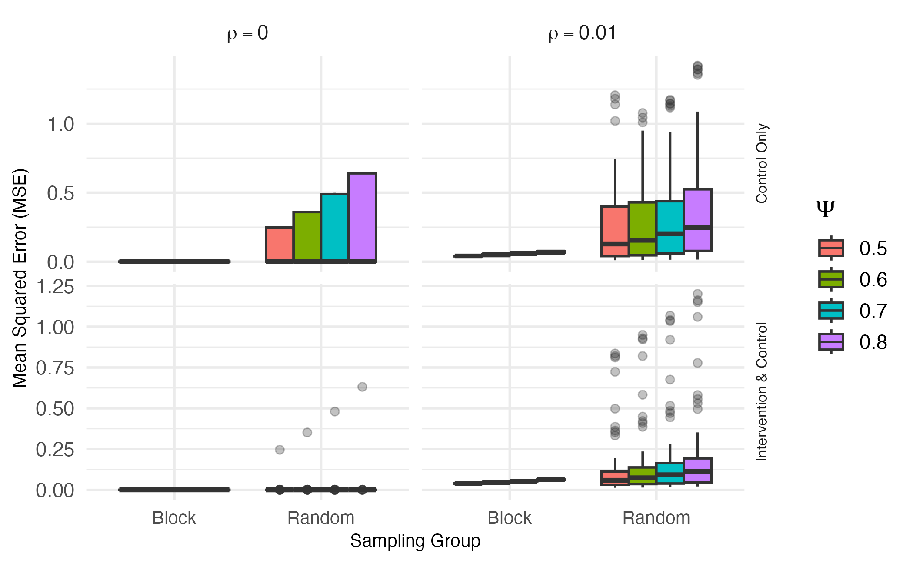
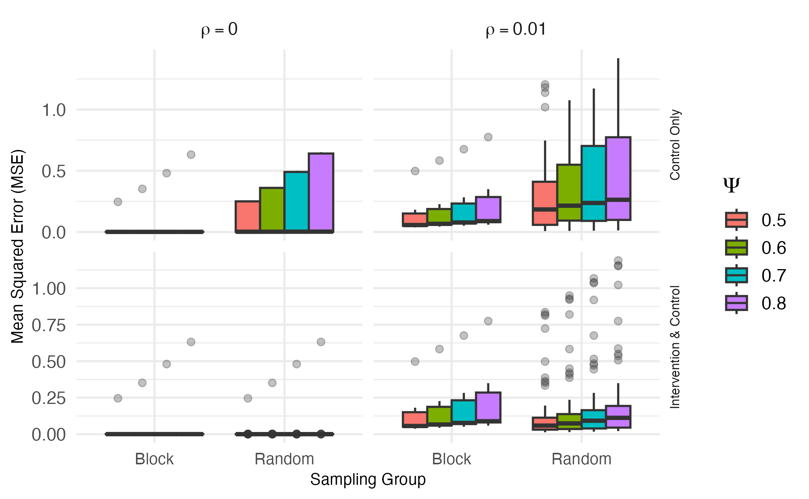
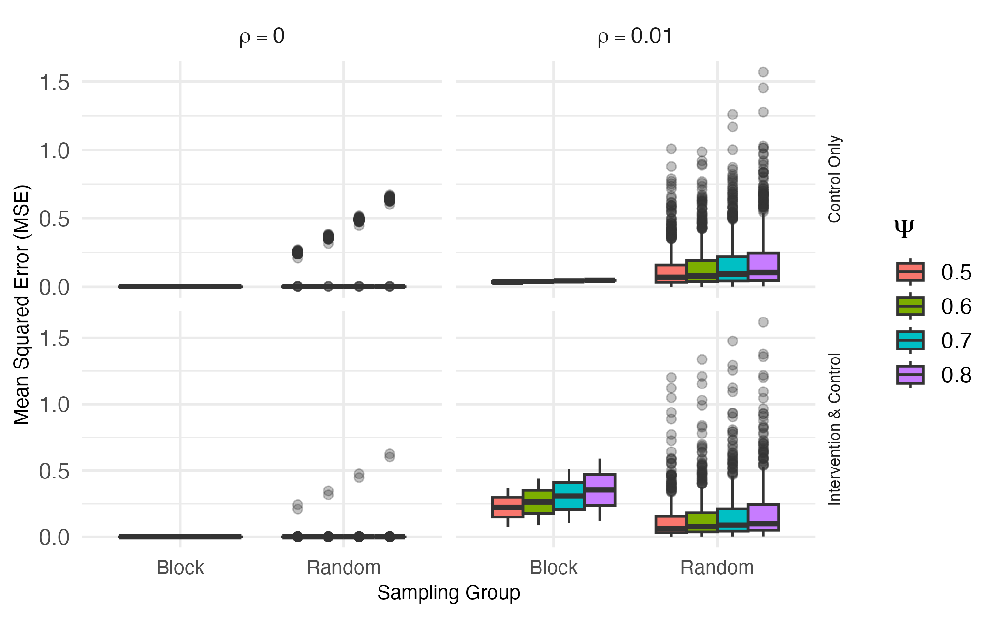
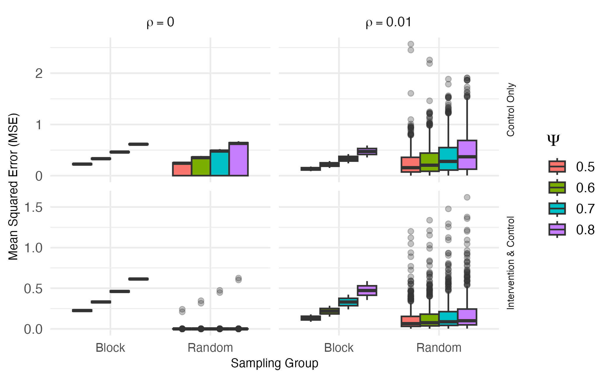

```{r setup}
# ============================================================
# Script: review/change-brief/change_brief.qmd
# Purpose: Short before/after brief of the manuscript changes from the 3x3/3x4
#          correction, for the advisor. Every number is read from review/tables/.
# Author: Andrew Walther
# Created: 2026-11-04
# Dependencies: dplyr, knitr, kableExtra
# ============================================================
# Render from review/change-brief/ with RStudio's bundled Quarto:
#   quarto render change_brief.qmd --to html,pdf
suppressMessages({library(dplyr); library(knitr); library(kableExtra)})

latex <- knitr::is_latex_output()
tab_dir <- "../tables"
fig_dir <- "../figures/paper_size"

#' Read one beta-MSE summary table (unscaled) built by code/build_tables_figures.R.
#'
#' @param grid "2x4", "3x3" or "3x4".
#' @param version "published" or "corrected".
#' @return Data frame with one row per spillover type x rho x psi.
read_tab <- function(grid, version) {
  read.csv(file.path(tab_dir, sprintf("beta_mse_table_%s_%s.csv", grid, version)))
}
tabs <- list()
for (g in c("2x4", "3x3", "3x4")) for (v in c("published", "corrected"))
  tabs[[paste(g, v)]] <- read_tab(g, v)

# Paper units: Table 2 (3x3) shows SD x10; Table 3 (3x4) shows SRS SD x100,
# BSS MSE x10 and BSS SD x100. Bias and the remaining MSEs are unscaled.
scales <- list(`3x3` = c(SRS_MSE = 1, SRS_SD = 10,  SRS_bias = 1, BSS_MSE = 1,  BSS_SD = 10,  BSS_bias = 1),
               `3x4` = c(SRS_MSE = 1, SRS_SD = 100, SRS_bias = 1, BSS_MSE = 10, BSS_SD = 100, BSS_bias = 1),
               `2x4` = c(SRS_MSE = 1, SRS_SD = 10,  SRS_bias = 1, BSS_MSE = 1,  BSS_SD = 10,  BSS_bias = 1))

#' One cell value, formatted to 3 decimals in the paper's units.
#'
#' @param grid,version Which table.
#' @param spill "Control Only" or "Intervention & Control".
#' @param rho,psi Scenario.
#' @param col Column, e.g. "BSS_MSE".
#' @param unscaled If TRUE, ignore the paper's display scaling.
#' @return Character, e.g. "0.147".
v <- function(grid, version, spill, rho, psi, col, unscaled = FALSE) {
  d <- tabs[[paste(grid, version)]]
  x <- d[d$TrtSpill == spill & abs(d$Rho - rho) < 1e-9 & abs(d$Psi - psi) < 1e-9, col]
  stopifnot(length(x) == 1)
  s <- if (unscaled) 1 else scales[[grid]][[col]]
  out <- sprintf("%.3f", x * s)
  # values that round to 0.000 (e.g. published 3x4 BSS MSE) get one significant digit
  if (out %in% c("0.000", "-0.000")) out <- format(signif(x * s, 1), scientific = FALSE)
  out
}
CO <- "Control Only"; IC <- "Intervention & Control"

#' Range of a column over psi within one spillover x rho block, as "a to b".
rng <- function(grid, version, spill, rho, col) {
  x <- sapply(c(0.5, 0.6, 0.7, 0.8), function(p) v(grid, version, spill, rho, p, col, TRUE))
  sprintf("%s to %s", x[1], x[4])
}

# Optimal allocation counts (distinct minimum-MSE allocations per grid)
n_opt <- function(grid, version) {
  d <- read.csv(file.path(tab_dir, sprintf("optimal_combos_%s_%s.csv", grid, version)))
  c(n = length(unique(d$best_combo)), bss = sum(d$is_BSS))
}
```

## Summary

While reviewing the paper and corresponding code for thesis integration, we found two coding errors that affect only the 3×3 and 3×4 grids. The summary script used the 2×4 BSS allocations for every grid, such that the BSS columns for 3×3 and 3×4 summarized two allocations that are not the block stratified design on those grids. The control-only spillover loop in the 3×3 and 3×4 simulation scripts also stopped at district 8 (for the 2x4 grid) instead of indexing to 9 and 12. Therefore, the higher-numbered (9-12) treated districts never passed spillover to their control neighbors. That second error changed the SRS control-only results only.

Fixing both issues changes two figures (Figures 6 and 7), two tables (Tables 2 and 3), the results paragraphs for the 3×3 and 3×4 grids, and one paragraph of the discussion section (the "checkerboard paradox", which is removed). A handful of summary sentences elsewhere are altered to match the updated results. The methods, the 2×4 results (Table 1, Figure 5) and the North Carolina recommendation (Application) do not change.

The paper's findings and its recommendation are unchanged, and the corrected results support them more consistently across grids than the published ones did. After the fix, the 3×4 grid follows the same pattern as the 2×4 grid in all 16 scenarios. On every grid SRS has the lower average MSE when spillover reaches both arms, BSS has the lower MSE when spillover goes into control clusters and spatial dependence is present, and BSS is usually the less variable design. Some individual 3×3 and 3×4 values do move a lot, and in two settings the better design flips. The tables and figures below show each of those changes.

## Findings and recommendation

```{r winners}
#' Which design has lower mean MSE in one spillover x rho block.
#'
#' @return e.g. "BSS 4/4" (ties count for neither; none occur here).
winner <- function(grid, version, spill, rho) {
  d <- tabs[[paste(grid, version)]] %>% filter(TrtSpill == spill, abs(Rho - rho) < 1e-9)
  b <- sum(d$BSS_MSE < d$SRS_MSE); s <- sum(d$SRS_MSE < d$BSS_MSE)
  if (b >= s) sprintf("BSS %d/4", b) else sprintf("SRS %d/4", s)
}
sd_lower <- function(grid, version) {
  d <- tabs[[paste(grid, version)]]
  sprintf("%d/16", sum(d$BSS_SD < d$SRS_SD))
}
rows <- list(c("2x4", "published", "2×4 (unchanged)"),
             c("3x3", "published", "3×3 before"), c("3x3", "corrected", "3×3 after"),
             c("3x4", "published", "3×4 before"), c("3x4", "corrected", "3×4 after"))
win <- do.call(rbind, lapply(rows, function(r) data.frame(
  Grid = r[3],
  a = winner(r[1], r[2], CO, 0.01), b = winner(r[1], r[2], CO, 0),
  c = winner(r[1], r[2], IC, 0.01), d = winner(r[1], r[2], IC, 0),
  e = sd_lower(r[1], r[2]))))

# Mark cells whose winner differs from the 2x4 pattern
ref <- unlist(win[1, 2:5])
flag <- function(x, col) {
  diff <- substr(x, 1, 3) != substr(ref[[col]], 1, 3)
  ifelse(diff, cell_spec(x, bold = TRUE, format = if (latex) "latex" else "html"), x)
}
for (cc in c("a", "b", "c", "d")) win[[cc]] <- flag(win[[cc]], cc)

kbl(win, escape = FALSE, booktabs = TRUE, align = "lccccc",
    col.names = c("Grid", "ρ = 0.01", "ρ = 0", "ρ = 0.01", "ρ = 0", "BSS less variable"),
    caption = "Design with the lower mean MSE across the four ψ values in each setting. Bold marks a winner that differs from the 2×4 grid. The last column counts scenarios where the SD of MSE across allocations is smaller for BSS.") %>%
  add_header_above(c(" " = 1, "Control Only" = 2, "Intervention & Control" = 2, " " = 1)) %>%
  kable_styling(latex_options = c("HOLD_position"), full_width = FALSE, font_size = if (latex) 9 else NULL)
```

Prior to the correction, the 3×3 grid showed BSS leading SRS everywhere, and the 3×4 grid showed BSS leading in every setting except intervention-and-control spillover with ρ = 0.01. Those results were derived from incorrect allocations. After the fix, the only disagreement between grids is control-only spillover with ρ = 0, where BSS still outperforms SRS on the 3×3 grid.

```{r conclusions}
o2 <- n_opt("2x4", "corrected"); o3 <- n_opt("3x3", "corrected"); o4 <- n_opt("3x4", "corrected")
p3 <- n_opt("3x3", "published"); p4 <- n_opt("3x4", "published")
concl <- data.frame(
  Claim = c(
    "SRS vs. BSS is a risk-management trade-off (BSS stable, SRS better on average but variable)",
    "BSS preferred when spillover flows into controls, especially with spatial dependence",
    "SRS often has lower MSE when spillover reaches both arms",
    "MSE rises with ψ",
    "Spatial dependence raises MSE for both designs",
    "SRS has lower bias, BSS lower variance",
    "BSS “consistently exhibits minimal MSE”",
    sprintf("%d allocations are each optimal somewhere, BSS never the single best", p3[["n"]]),
    "“Checkerboard paradox” (BSS backfires under bidirectional spillover with ρ > 0)",
    "NC probation recommendation (BSS when spillover flows mainly to controls)"),
  After = c(
    "Holds. Exception is 3×3 intervention-and-control spillover, where BSS is neither lower nor more stable",
    "Holds, and now consistent across all three grids",
    "Holds, and stronger. SRS wins every such scenario on every grid (published 3×3 said the opposite)",
    "Holds",
    "Holds for SRS on every grid. For BSS only on 3×3 (it was already false for 2×4 BSS as published)",
    "Holds for 2×4 and 3×4, not for 3×3",
    "Dropped. Not true on any grid, including the unchanged 2×4",
    sprintf("BSS never best still holds. Counts are now %d, %d and %d (was %d, %d, %d)",
            o2[["n"]], o3[["n"]], o4[["n"]], o2[["n"]], p3[["n"]], p4[["n"]]),
    "Removed. The real mechanism is treatment-spillover collinearity in checkerboards (bias near −ψ)",
    "Holds"))
kbl(concl, booktabs = TRUE, col.names = c("Claim in the accepted paper", "After the correction"),
    caption = "The paper's claims, checked against the corrected results.", longtable = latex) %>%
  kable_styling(latex_options = c("repeat_header"), full_width = !latex, font_size = if (latex) 9 else NULL) %>%
  column_spec(1, width = "3.1in") %>% column_spec(2, width = "3.5in")
```

## Figures 6 and 7

In each pair the published figure is on the left and the corrected one on the right.

{width=49% fig-alt="Published Figure 6"} {width=49% fig-alt="Corrected Figure 6"}

*Figure 6, 3×3 grid. The BSS boxes are now built from the six valid 3×3 allocations instead of the BSS allocations from the 2x4 grid. Under ρ = 0.01 they rise from near zero to a level below SRS for control-only spillover but above SRS for intervention-and-control spillover. Under ρ = 0 most BSS allocations still sit near zero, with one outlier (combo 77, a checkerboard-like allocation where $\hat{\beta}$ absorbs the spillover). The SRS control-only boxes rise slightly from the loop fix.*

{width=49% fig-alt="Published Figure 7"} {width=49% fig-alt="Corrected Figure 7"}

*Figure 7, 3×4 grid. Now BSS is the two 3×4 checkerboards (combos 313 and 612), which give identical results under both spillover types. Their MSE rises with ψ and sits well above zero in every panel. The SRS control-only boxes roughly double after the loop fix (y-axis now runs past MSE=2). The intervention-and-control SRS panels are unchanged.*

## Tables 2 and 3

Each cell shows the corrected value. When a value changed, the published value comes first and the cell is shaded. Units follow the mechanics of the original paper.

```{r tables}
cols <- c("SRS_MSE", "SRS_SD", "SRS_bias", "BSS_MSE", "BSS_SD", "BSS_bias")
arrow <- if (latex) " $\\rightarrow$ " else " → "
shade <- "#FFE8B3"

#' Before/after version of Table 2 or 3, in the paper's units, changed cells shaded.
#'
#' @param grid "3x3" or "3x4".
#' @return list(kable, n_changed).
ba_table <- function(grid) {
  pub <- tabs[[paste(grid, "published")]]; cor <- tabs[[paste(grid, "corrected")]]
  stopifnot(all(pub$TrtSpill == cor$TrtSpill), all(pub$Rho == cor$Rho), all(pub$Psi == cor$Psi))
  out <- data.frame(psi = sprintf("%.1f", cor$Psi))
  n_changed <- 0
  for (cc in cols) {
    s <- scales[[grid]][[cc]]
    a <- sprintf("%.3f", pub[[cc]] * s); b <- sprintf("%.3f", cor[[cc]] * s)
    ch <- a != b; n_changed <- n_changed + sum(ch)
    txt <- ifelse(ch, paste0(a, arrow, b), b)
    out[[cc]] <- if (latex) ifelse(ch, paste0("\\cellcolor[HTML]{FFE8B3}", txt), txt)
                 else ifelse(ch, cell_spec(txt, format = "html", background = shade), txt)
  }
  grp <- paste0(cor$TrtSpill, ", ", ifelse(cor$Rho == 0, "ρ = 0", "ρ = 0.01"))
  hdr <- if (grid == "3x3")
    c("ψ", "MSE", "SD (×10)", "Bias", "MSE", "SD (×10)", "Bias") else
    c("ψ", "MSE", "SD (×100)", "Bias", "MSE (×10)", "SD (×100)", "Bias")
  k <- kbl(out, escape = FALSE, booktabs = TRUE, align = "c", col.names = hdr,
           caption = sprintf("Manuscript Table %s (%s grid), published%scorrected. %d of %d cells changed.",
                             if (grid == "3x3") "2" else "3", sub("x", "×", grid), arrow,
                             n_changed, length(cols) * nrow(out))) %>%
    add_header_above(c(" " = 1, "Simple Random Sampling" = 3, "Block Stratified Sampling" = 3)) %>%
    kable_styling(latex_options = c("HOLD_position"), full_width = FALSE,
                  font_size = if (latex) 8 else NULL)
  for (gname in unique(grp)) {
    idx <- which(grp == gname)
    k <- pack_rows(k, gname, min(idx), max(idx))
  }
  list(k = k, n = n_changed)
}
t2 <- ba_table("3x3"); t3 <- ba_table("3x4")
t2$k
```

In Table 2, the published BSS values of about 0.001 under ρ = 0 come from two allocations that are not block stratified on 3×3. For the six valid allocations, BSS MSE is `r rng("3x3", "corrected", CO, 0, "BSS_MSE")` and still well below SRS for control-only spillover, but above SRS for intervention-and-control spillover. The one SRS change under intervention-and-control spillover (ψ = 0.8, ρ = 0.01) comes from regenerating a stored result file and only the third decimal place is altered.

```{r table3}
t3$k
```

In Table 3, the BSS MSE (×10 in the table) increases from near zero to `r rng("3x4", "corrected", CO, 0, "BSS_MSE")` on the original scale under ρ = 0. This is due to the fact that in a BSS allocation the spillover indicator equals 1 − x and $\hat{\beta}$ absorbs the spillover. The BSS bias is close to −ψ there (`r v("3x4", "corrected", CO, 0, 0.5, "BSS_bias")` at ψ = 0.5). The SRS control-only MSE approximately doubles, and its mean bias goes from slightly positive to clearly negative (`r v("3x4", "published", CO, 0.01, 0.5, "SRS_bias")` to `r v("3x4", "corrected", CO, 0.01, 0.5, "SRS_bias")` at ψ = 0.5, ρ = 0.01). SRS under intervention-and-control spillover is unchanged.

## Text changes

The text edits are limited to statements that depended on the 3×3 and 3×4 numbers. Section names follow the manuscript.

```{r prose}
x <- function(...) v(...)  # shorthand for inline values below
bh <- if (latex) "$\\hat{\\beta}$" else "β̂"   # STIX renders combining hats badly
prose <- data.frame(
  Section = c(
    "Abstract",
    "Results, 2×4 grid",
    "Results, 3×3 grid",
    "Results, 3×4 grid",
    "Recommendations",
    "Discussion, bias and variance",
    "Discussion, effect of ρ",
    "Discussion, spillover types",
    "Discussion, optimal allocations",
    "Discussion, checkerboard paragraph",
    "Limitations, Future Considerations",
    "Declarations"),
  Before = c(
    "BSS gives “minimal” or “near-zero” variation in MSE and “minimizes” variance.",
    "Spatial dependence raises MSE for both designs on every grid.",
    sprintf("BSS beats SRS on MSE, SD and bias under both spillover types. BSS MSE about %s (CO, ρ = 0) and %s (IC, ρ = 0.01).",
            x("3x3", "published", CO, 0, 0.5, "BSS_MSE"), x("3x3", "published", IC, 0.01, 0.5, "BSS_MSE")),
    sprintf("BSS “dramatically outperforms” SRS under control-only spillover (%s vs. %s at ρ = 0). Under both-arm spillover with ρ = 0.01, BSS loses through a “checkerboard paradox”.",
            x("3x4", "published", CO, 0, 0.5, "BSS_MSE", TRUE), x("3x4", "published", CO, 0, 0.5, "SRS_MSE")),
    "If bidirectional spillover and spatial dependence are expected, BSS can amplify bias (checkerboard paradox).",
    "SRS gives lower bias, BSS “consistently” lower variance.",
    "Even small ρ generally raises MSE for both designs.",
    "Control-only spillover favors BSS. Both-arm spillover often favors SRS.",
    sprintf("%d allocations are each optimal on every grid. BSS “consistently exhibits minimal MSE”, so it is prudent to recommend.", p3[["n"]]),
    "Names the “checkerboard paradox”: complete separation of arms amplifies spillover bias under bidirectional spillover.",
    "Collinear BSS error is bias because the BSS SD is near zero. Future work targets the “amplified bias” scenarios.",
    "“National Institutes of Mental Health”."),
  After = c(
    "Wording softened to “generally less” and “generally reduces”. No numbers in the abstract change.",
    sprintf("True for SRS everywhere. For BSS on 2×4, ρ = 0.01 lowers MSE (%s vs. %s at ψ = 0.5). Results unchanged, sentence corrected.",
            x("2x4", "corrected", CO, 0.01, 0.5, "BSS_MSE"), x("2x4", "corrected", CO, 0, 0.5, "BSS_MSE")),
    sprintf("BSS still wins every control-only scenario (MSE %s vs. SRS %s at ρ = 0). Under both-arm spillover SRS wins every scenario (BSS %s, SRS %s at ρ = 0.01).",
            rng("3x3", "corrected", CO, 0, "BSS_MSE"), rng("3x3", "corrected", CO, 0, "SRS_MSE"),
            rng("3x3", "corrected", IC, 0.01, "BSS_MSE"), rng("3x3", "corrected", IC, 0.01, "SRS_MSE")),
    sprintf("Same pattern as 2×4 in every scenario. Control-only, BSS wins at ρ = 0.01 (%s vs. %s) and SRS at ρ = 0 (%s vs. %s). Both-arm spillover, SRS wins everywhere. Paradox replaced by the collinearity explanation.",
            x("3x4", "corrected", CO, 0.01, 0.5, "BSS_MSE", TRUE), x("3x4", "corrected", CO, 0.01, 0.5, "SRS_MSE"),
            x("3x4", "corrected", CO, 0, 0.5, "SRS_MSE"), x("3x4", "corrected", CO, 0, 0.5, "BSS_MSE", TRUE)),
    "If spillover among treated units is expected, SRS had lower average MSE in every such scenario. The recommendation itself is unchanged.",
    "Holds on 2×4 and 3×4. On 3×3 BSS has the smaller bias in most scenarios and varies more under both-arm spillover.",
    "Always raises MSE for SRS. For BSS it rises on 3×3 but falls for the 2×4 and 3×4 checkerboards.",
    "Same message, made exact. Control-only with ρ > 0 favors BSS on every grid. Both-arm spillover favors SRS in every scenario.",
    sprintf("Counts are %d, %d and %d. BSS is never the single best and does not give the lowest average MSE. Its value is limiting the worst case.",
            o2[["n"]], o3[["n"]], o4[["n"]]),
    paste0("Replaced by a short note that in a checkerboard spillover equals 1 − x under both spillover types, so β and ψ are not separately identifiable and ", bh, " has bias near −ψ."),
    "Reason restated as variance small relative to squared bias. Future work targets allocations where treatment and spillover are collinear.",
    "“National Institute of Mental Health” (typo fix, unrelated to the correction)."))
kbl(prose, booktabs = TRUE, escape = FALSE, col.names = c("Section", "Before", "After"),
    caption = "Text changes, by manuscript section. CO = control-only spillover, IC = intervention-and-control spillover.",
    longtable = latex) %>%
  kable_styling(latex_options = c("repeat_header"), full_width = !latex, font_size = if (latex) 8 else NULL) %>%
  column_spec(1, width = "1.2in") %>% column_spec(2, width = "2.6in") %>% column_spec(3, width = "2.9in")
```
