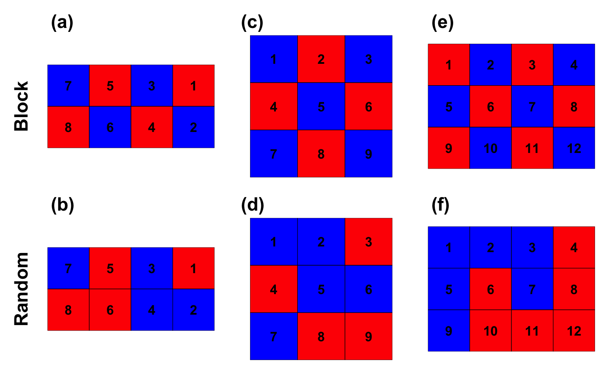
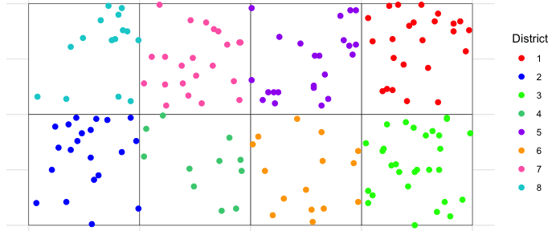
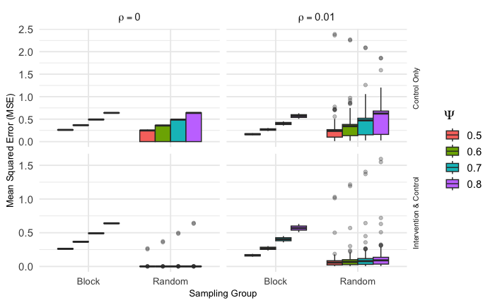
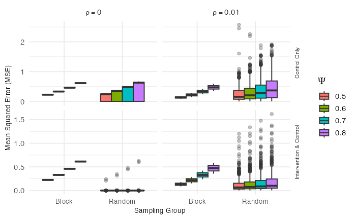
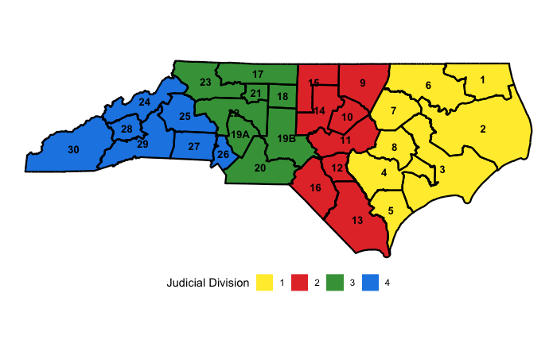
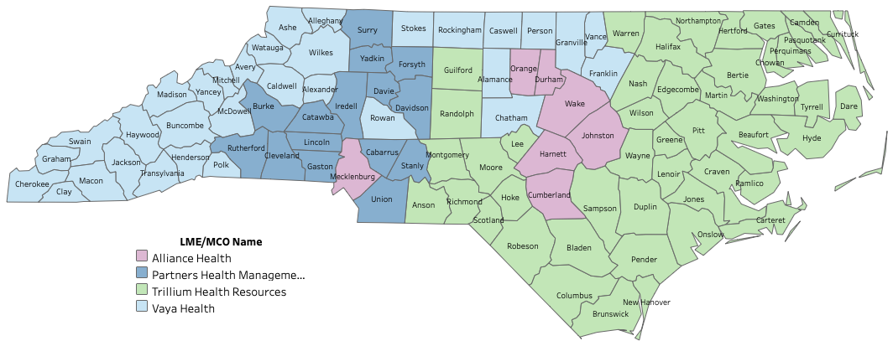
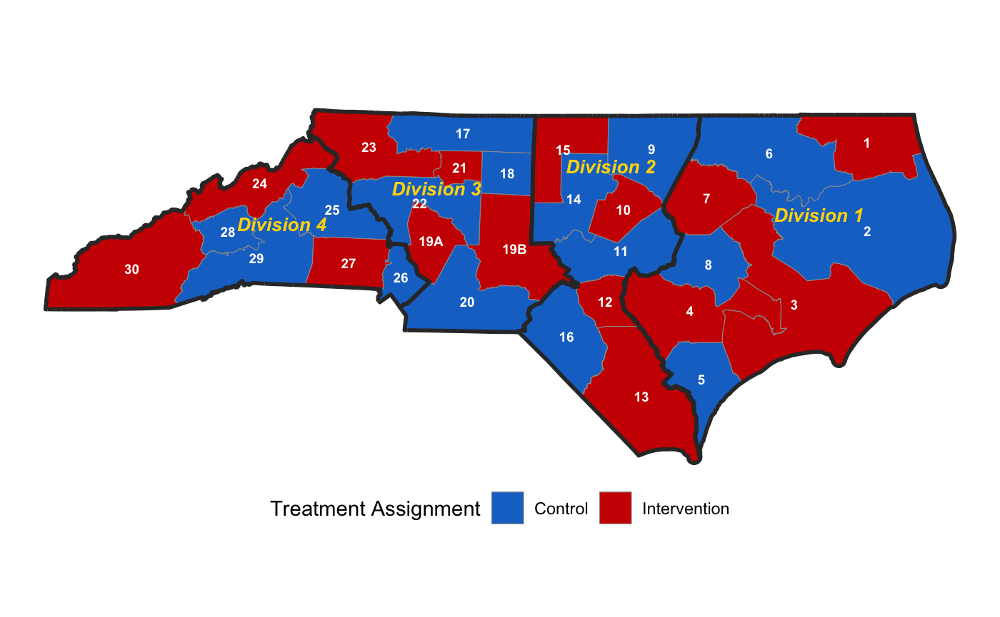

<!--
Working draft of the prelim's Chapter 2, per
prelim/project-proposals/notes/chapter2-integration-plan.md.

This is integration, not writing: the manuscript is accepted and published.
Prose is not rewritten, improved, or restructured -- the only edits are
numeric-to-author-date citation conversion and, where a citation is a
sentence's subject, narrative-form rewording. See the plan for the full
element-by-element conversion table and the 9-step execution sequence.

Status: Step 4 (floats) in progress, section by section. Sections not yet
ported keep an empty heading as a placeholder.

Hand-typed narrative citations (e.g. "Binka et al. (1998)") are kept
verbatim as plain prose rather than converted to a pandoc @key citation.
Converting one to @key would make the mechanical prose-fidelity checker
see 0 words there instead of the manuscript's literal "binka et al 1998",
a real mismatch it would (correctly) flag. Where the same key is also
cited plainly elsewhere, its redundant \cite is just dropped; where the
hand-typed mention is a key's ONLY citation, the key is listed in the YAML
`nocite` block instead so it isn't silently dropped from the References
section.
-->

```{=latex}
\frontmatter
\renewcommand{\contentsname}{TABLE OF CONTENTS}
\tableofcontents
\mainmatter
\setcounter{chapter}{1}
```

# Spatial Cluster Randomized Trials - Sampling Design with Spillover Effects & Spatial Dependence

## Introduction {#sec-introduction}

### Background & Motivation

Randomized controlled trials (RCTs) represent the gold standard for
assessing the efficacy and safety of new interventions [@pocock_clinical_1983; @smith_field_2015]. However, in many
real-world scenarios, particularly in public health, education, and the
social sciences, randomizing individuals is not feasible due to logistical
constraints, ethical considerations, or the inherent nature of the
intervention itself, which may be administered at a community level. In
such cases, the cluster randomized trial (CRT) emerges as the preferred and
most rigorous design, where intact social units or groups such as
villages, schools, or clinics are randomized to intervention or control
arms [@hayes_cluster_2017; @donner_design_2000].

A key advantage of the CRT design is its ability to evaluate interventions
where there is high risk of contamination between treated and untreated
individuals within the same cluster [@hayes_cluster_2017; @hudgens_toward_2008]. Furthermore, CRTs allow estimation of
not only the direct effects of an intervention on those who receive it but
also the indirect spillover effects on untreated individuals, typically
those in control clusters. Measuring these spillover effects is often of
primary scientific and policy interest, as it provides a comprehensive
assessment of an intervention's total public health impact [@hayes_cluster_2017; @hayes_design_2000]. When trial
clusters are defined by geographic areas, as is frequently the case, the
design must contend with inherent spatial complexities that can challenge
the core statistical assumption of cluster independence. Two primary and
interrelated spatial phenomena can profoundly influence trial outcomes and
compromise the validity of the results: spillover effects and spatial
dependence [@hayes_cluster_2017; @smith_field_2015].

Spillover occurs when an intervention's effects in one cluster extend or
“spill over", into neighboring clusters, creating significant analytical
challenges [@anayaizquierdo_spatial_2021; @jarvis_spatial_2017]. This is
especially common in trials of infectious disease interventions. A study on
the use of permethrin-impregnated bed nets by Binka et al. (1998) provided
early, compelling evidence of this phenomenon, demonstrating that child
mortality was significantly lower in control villages situated near
intervention villages, presumably due to a reduction in the local mosquito
population [@gimnig_effect_2003; @hawley_community-wide_2003]. Similarly,
the work by Miguel and Kremer (2004) on a school-based de-worming program in
Kenya found significant positive externalities, showing that the health and
school attendance of untreated children improved if they lived near schools
that were part of the intervention. The critical implication is that
failing to account for such positive spillover can lead to a substantial
underestimation of the intervention's true effect, as the measured outcomes
in the control group are artificially improved by their proximity to the
intervention arm. Compounding this issue is spatial dependence, a
fundamental concept supported by Tobler's First Law of Geography that
asserts nearby observations tend to be more related than distant ones
[@jarvis_spatial_2017; @tobler_computer_1970]. In the context of a CRT,
this principle suggests that outcomes in nearby clusters may be correlated
due to unmeasured, spatially-patterned environmental, social, or
demographic factors. The presence of this spatial autocorrelation violates
the assumption that clusters are independent units, which can lead to
biased standard errors and an increased Type I error rate, undermining
statistical inference [@getis_history_2008; @cressie_statistics_1993;
@tobler_computer_1970].

In response to these challenges, a body of literature has emerged focusing
on post-hoc analytical adjustments to account for spatial effects after the
data have been collected. Jarvis et al. (2017) classifies these approaches
into two categories: the spatial variable approach, which constructs a new
covariate from distance or density metrics, and spatial modeling. Examples
include measuring the straight-line distance from control participants to
the nearest intervention household (Hawley et al., 2003 & Gimnig et al.,
2003), calculating outcome rates across different distance bands (Binka et
al., 1998), or quantifying the density of treated individuals within a
predefined radius (Miguel & Kremer, 2004 & Lenhart et al., 2008). More
recently, Chao et al. (2015) developed a “potential exposure" metric to
quantify the spatially heterogeneous risk surrounding an individual. In
contrast, the spatial modeling approach is more statistically sophisticated,
directly incorporating the geographic structure of the data into the random
effects component of a statistical method. The method employed by
Alexander et al. (2003) considers a distance-decay function in the
covariance matrix and an alternative by Silcocks and Kendrick (2010) using
spatial weights matrices treats spatial correlation as an underlying
unobserved process. Watson & Smith (2025) propose a distinct framework in
which treatment is measured as a continuous dose based on distance to the
nearest intervention site, estimating a dose-response function (DRF)
rather than a discrete cluster-level intervention or spillover effect.

Despite the growing sophistication of these analytical tools, they are
fundamentally post-hoc corrective solutions to a problem that could (and
should) be addressed proactively at the design stage. The existing
literature reveals a noticeable lack of research into how the initial
sampling and allocation of treatments across a geographic landscape can be
optimized to manage these known spatial complexities. The review by Jarvis
et al. (2017) highlights this gap, noting that in practice, the impact of
location on trial results is definitely an afterthought and oftentimes
entirely ignored. In fact, trial designs explicitly intended to mitigate
spatial effects, such as creating well-separated clusters or buffer zones,
were so uncommon that studies employing them were excluded from their
primary analysis, underscoring how peripheral these considerations have
been to standard practice [@jarvis_spatial_2017].

This oversight has significant consequences because known studies that
compare spatial analytical approaches consistently find that accounting
for spatial effects is important. Silcocks and Kendrick (2010) demonstrated
that spatial models not only fit primary care trial data better than
standard CRT models, but also that their inclusion altered both the
intervention effect point estimate and its precision. Similarly, Chao et
al. (2015) found that adjusting for their spatial exposure metric lowered
the estimated effect of a typhoid vaccine. The logical conclusion is that
standard trial designs that rely on the simple random allocation of
clusters may be systematically producing biased or inefficient estimates
without investigators being aware. This motivates the central question of
this study: “How does the choice of an *a priori* treatment assignment
sampling strategy impact the estimation of intervention effects in the
presence of both spatial spillover effects and spatial dependence?" While
we have methods to analyze the problem after a study is completed, there is
currently a lack of evidence-based guidance for investigators on how to
design a cluster randomized trial to mitigate these issues from the outset
of study planning.

### Aims & Contributions

This study aims to address this critical gap by moving beyond post-hoc
analysis to investigate the important role of treatment sampling design in
spatial CRTs. Through a comprehensive simulation study, we systematically
compare the performance of two contrasting approaches for assigning study
clusters to intervention and control arms: simple random sampling (SRS),
representing the standard practice for treatment assignment, and a block
stratified sampling (BSS) method. The BSS strategy is intentionally
designed to create spatial separation between clusters of the same
treatment assignment by isolating them to potentially reduce the
confounding influence of spillover and spatial dependence.

Our simulations explore how the estimation error of the intervention
effect, quantified by Mean Squared Error which is composed of bias and
variance, varies across a range of realistic conditions including
different magnitudes of spillover effects, the presence or absence of
underlying spatial dependence, and variation of restrictions on the
geographic distance over which spillover can occur. By identifying the
systematic patterns that emerge, this novel research provides practical,
evidence-based guidance for investigators designing future spatial CRTs.
The findings will equip researchers with the knowledge to select sampling
strategies that align with their specific study goals, ultimately leading
to more robust, efficient, and valid estimates of intervention effects in
complex spatial settings.

The remainder of this article is organized as follows: [@sec-design] outlines
the theoretical framework of the study, including the data generation
process, treatment sampling procedures, and estimation methods employed.
[@sec-simulation] details the procedure and results of the simulation study
undertaken to evaluate the sampling methods considered. [@sec-application]
considers an application of these findings to make a recommendation for
other investigators. Finally, [@sec-discussion] discusses the implications of our
findings, potential drawbacks to the work performed, and potential areas
for continued future research.

## Design of Spatial CRTs {#sec-design}

### Cluster Randomized Trials

The randomized controlled trial (RCT) serves as the gold standard design to
evaluate intervention efficacy [@kim_handbook_2021]. Its core principle,
the random allocation of individual participants, is expected to balance
both measured and unmeasured confounding variables across treatment arms
[@matthews_introduction_2006]. However, individual randomization is often
impractical, or an intervention is delivered at a group level,
necessitating an alternative approach [@donner_design_2000;
@hayes_cluster_2017]. In these scenarios, the cluster randomized trial
(CRT) is employed, where intact social units or groups like households,
clinics, or geographic areas are randomized to intervention arms
[@donner_design_2000; @murray_design_1998]. A key advantage of this design
is the limitation of treatment contamination, where control group members
are inadvertently exposed to the intervention, which would otherwise bias
the estimated treatment effect toward the null [@hayes_cluster_2017].
Statistical considerations in a CRT are the measured response from an
intervention and the inherent correlation among outcomes of individuals
within the same cluster, a dependency quantified by the intraclass
correlation coefficient (ICC) [@donner_design_2000; @hemming_how_2017]. The
ICC measures how similar the outcomes of individuals within a cluster are
likely to be, relative to those of other clusters. This intra-cluster
correlation violates the standard assumption of independence between
observations. The failure to account for this feature in the analysis
leads to underestimated standard errors and an inflated probability of a
Type I error [@campbell_how_2014; @ntani_consequences_2021]. Therefore, the
valid design and analysis of CRTs require specialized statistical methods
that properly account for this clustering structure, with comprehensive
frameworks provided by Donner & Klar (2000) and Hayes & Moulton (2017).

### Neighbor Definitions

#### Contiguity-Based

Contiguity-based neighbors [@fotheringham_sage_2009] are constructed with
the assumption that neighbors of a given area (individual cells in the case
of this study) are other clusters (or cells) that share a common boundary.
This boundary may be an edge and/or vertex. The $\textbf{spdep}$ R package
[@bivand_r_2022; @bivand_comparing_2018; @pebesma_spatial_2023;
@bivand_applied_2008] includes functions for working with spatial
neighbors and spatial dependence structures. In this study, we consider
Rook neighbors (shown in @fig-neighbor-types (a)), which fulfill a
contiguity condition where a pair of clusters share a common boundary made
up by an edge. Queen neighbors (shown in @fig-neighbor-types (b)) are
another type of contiguity-based neighbors that fulfill a contiguity
condition where a pair of clusters share a common boundary of either an
edge and/or a vertex [@fotheringham_sage_2009]. Clusters may also have
Bishop neighbors where a common boundary at the vertex (corner) of the
spatial region is shared. Clusters may also have higher-order neighbors
where they do not directly share an edge or vertex, but rather have a
common boundary with a cluster that is a neighbor of another cluster. In
other words, these are “neighbors of neighbors" of the reference cluster.

![(a) Rook neighbors (blue) share an edge with a reference spatial region (red), (b) Queen neighbors (blue) share either an edge or vertex (or both) with a reference spatial region (red), and (c) Distance-based neighbors (blue) have centroids within a fixed radius of the reference cluster (red). Clusters with centroids beyond this distance are not considered as neighbors (white) [@moraga_spatial_2024]](figures/Neighbors/RookQueen2ndContiguityColored.png){#fig-neighbor-types width=100%}

#### Distance-Based

Distance-based neighbors [@fotheringham_sage_2009] identify as neighbors
any cluster whose centroid falls within a specified radius of a reference
cluster (illustrated in @fig-neighbor-types (c)). A complete description of
distance-based neighbor construction and the corresponding spatial weights
formulation is provided in [Appendix @sec-apx-distance]. The simulation
study presented in this paper relies exclusively on Rook contiguity for
neighbor definition.

### Intervention & Spillover Effects

Two primary effect types are considered to understand how treatments
affect subjects in clusters where they are applied and subjects in the
surrounding areas. The intervention effect and spillover effect are two
parameters that are estimated in this study. Spatial cluster randomized
trials have subjects or regions that are assigned to receive an
intervention and others assigned as controls that do not receive an
intervention. Observation of the resulting outcomes allows for estimation
of the direct intervention effect and indirect spillover effect on the
study region.

#### Intervention Effect {#sec-intervention-effect}

The intervention effect ($\beta$) is the *direct* structural coefficient of
the intervention in the spatial autoregressive model of
[@sec-sar]: the change in a cluster's outcome
attributable to its own receipt of the intervention, holding the spillover
indicator $z_i$ and the spatial lag fixed. Estimation of this coefficient
is possible due to the presence of clusters assigned as controls for
comparison. The relevant intervention could be a vaccine to prevent
infectious disease, a training program for government employees, an
educational program for students, or many others. When spillover
propagates back into intervention clusters (the Control & Intervention
mechanism; see [@sec-spillover-effect-types]), $\beta$
remains the direct coefficient, and the spillover received by treated
units is carried separately by the coefficient $\psi$ on $z_i$ rather than
being absorbed into $\beta$.

#### Spillover Effect Methods {#sec-spillover-effect-methods}

The spillover effect ($\psi$) is the structural coefficient on the
spillover indicator $z_i$ in the SAR model ([@sec-sar]),
quantifying the model-estimated change in outcome for a cluster that is
adjacent to at least one intervention cluster, an indirect (spillover)
effect on clusters where the intervention was not directly applied
[@benjamin-chung_spillover_2017; @benjamin-chung_extension_2024]. In
general, a spillover effect can be specified as a function of spatial
proximity to the locations where an intervention is applied, for example
as a decay function of the distance from a unit to the nearest intervention
cluster, or as a function of the number of neighboring intervention
clusters to which a unit is exposed. In this study, however, spillover is
modeled as a single binary cluster-level exposure: the indicator $z_i \in
\{0,1\}$ equals 1 when cluster $i$ shares a Rook edge with at least one
intervention cluster (and the spillover type permits it) and 0 otherwise.
Because $z_i$ is a binary $0/1$ indicator rather than a distance- or
count-valued quantity, the associated parameter $\psi$ is a single scalar
multiplier rather than a function. Because $z_i$ is defined at the cluster
level, all subjects within a cluster share the same spillover exposure, so
spillover does not vary across individuals within a cluster. Richer
specifications that allow spillover to decay with distance or to
accumulate over multiple treated neighbors are natural extensions,
discussed in [@sec-discussion], but are beyond the scope of
the present study.

A consequence of representing spillover through a binary cluster-level
indicator is that, on the small grids considered here, $z_i$ can be
strongly correlated with the treatment indicator $x_i$, and for some
allocations the two are exactly collinear, in which case $\beta$ and $\psi$
are not separately identifiable from the model fit alone. The conditions
under which this occurs and its consequences for estimating $\beta$ are
examined in [@sec-simulation].

#### Spillover Effect Types {#sec-spillover-effect-types}

In this study, there are two specific ways in which spillover of the
applied intervention is allowed to propagate to other cells or subjects.
In both cases, spillover effects originate from areas where the original
intervention treatment is applied. The first case allows for spillover to
propagate from cells receiving the intervention into only cells assigned
as control cells. In this case, the effect of the intervention is not
permitted to spillover into other intervention cells. This suggests a case
where the intervention effect applied is the maximum observable effect and
any potential spillover cannot increase the observed effect of a
particular intervention. Another method of spillover application is
considered where spillover effects are permitted to be applied to both
control AND intervention cells that are neighbors of a cell that receives
an intervention. This application suggests that an effect greater than
that of the original intervention applied can potentially be observed in a
cell that received an intervention and also had spillover from another
intervention cell. It is also to be expected that any change in the
estimated effects would not be observed in spatial settings where the
treatment allocation does not satisfy block stratification conditions
(where no intervention cells are rook neighbors with other intervention
cells). @fig-trt-spill-comparison provides a comparative representation of
how these two methods permit the application of spillover effects on
clusters based on their treatment assignment. In all scenarios of this
simulation study, the application of any spillover effect is simply a
binary indication of whether a cluster receives a spillover effect or not.
Even if spillover exposure could potentially be directed from multiple
neighboring clusters, the modeling in this study does not consider any
additive spillover effects.

{#fig-trt-spill-comparison width=80%}

### Simple Random vs. Block Stratified Sampling

In this study, two different treatments are considered: intervention &
control. Assignment of these treatments is considered under two sampling
methods: Simple Random Sampling (SRS) & Block Stratified Sampling (BSS).
Random sampling treatment assignment considers all possible combinations
of intervention & control arrangements on a specified spatial grid and
provides equal probability of assignment for any given combination of
intervention and control. For example, a 2 row by 3 column spatial grid
has 6 total cells. Consideration of a 1:1 ratio between intervention and
control treatments provides that three cells are assigned as intervention
and three cells are assigned as control. Therefore, there are
$_{6}C_{3}=20$ different combinations of treatments for this specific
spatial region.

Block stratified sampling ensures a balanced number of intervention and
control cells are selected, with the added condition that no intervention
or control cells share a common edge boundary. This approach is analogous
to geographically stratified randomization in standard CRTs, where spatial
proximity is used to define strata rather than demographic or clinical
covariates [@mccann_spatial_2018; @crisp_covariate-constrained_2023;
@hayes_cluster_2017]. The added spatial isolation condition, that no two
same-treatment clusters may share a Rook edge, is a novel constraint
introduced in this work to directly minimize cross-cluster spillover at
the design stage. An exception to this rule occurs in spatial setups where
both dimensions are odd. In this case, the count of intervention and
control cells must be out of balance and we assert that the control class
will always be in the majority. In these instances, we relax the common
edge boundary restriction for control cells and only require that
intervention cells not share a common edge boundary in order to satisfy
the block stratification condition.

We now consider a series of spatial grid setups to address efficient
estimation of the intervention effect. These spatial grids have dimensions
denoted as (row $\times$ column) and we seek to apply a balanced
distribution between intervention and control cells where possible. When
this is not possible, we defer to the control group being the majority
class as mentioned previously.

#### 2×4 Grid

One representative spatial setting considered is grid of 8 individual
cells laid out in an arrangement of 2 rows and 4 columns. For this grid
setup, a balanced set of intervention and control cells can be assigned
where 4 cells are intervention regions and 4 cells are control regions.
For a grid of 8 total cells and 4 cells of each treatment type, there are
$_{8}C_{4}=70$ unique arrangements of treatment and control assignments.
@fig-grids-combined (a) displays one of these combinations that satisfies
the block stratified condition where intervention and control cells do
not have any rook neighbors of the same treatment type. For this spatial
setting, there are 2 (out of 70) combinations that satisfy the block
stratification condition. @fig-grids-combined (b) displays an example of
the $2\times4$ grid spatial setting with a randomly sampled arrangement of
intervention and control cells. Note that both treatment types have cells
that are rook neighbors with the same treatment. These spatial grids are
constructed with Simple Features for R package [@pebesma_simple_2018;
@pebesma_spatial_2023].

{#fig-grids-combined width=100%}

#### 3×3 Grid

The $3\times3$ symmetric grid setting of 9 cells allows for
$_{9}C_{4}=_{9}C_{5}=126$ unique combinations of intervention and control
cells where 5 cells are allocated as control and 4 cells are treatment
regions. The majority class of 5 cells is the control group for the sake
of hypothetical resource management. @fig-grids-combined (c) illustrates
one combination of treatment and control cells that completely satisfies
the block stratification conditions. Additional cluster combinations
satisfy a relaxed condition of block stratification where control cells
are allowed to have other control cells as rook neighbors. This is
possible in spatial grid settings where both dimensions (row, column) are
odd in length. There is one combination for the $3\times3$ grid setting
that satisfies the strongest block stratification condition and 5 more
combinations that satisfy the relaxed block stratification condition for a
total of 6. An example of random sampling treatment assignment that does
not satisfy block stratification conditions is provided in
@fig-grids-combined (d).

#### 3×4 Grid

The final spatial setting considered was a 3 row by 4 column ($3\times4$)
grid of 12 total cells. This grid, with a balanced allocation of 6
intervention cells and 6 control cells allows for $_{12}C_{6}=924$ unique
arrangements of the two treatments in the spatial region. For this
particular grid size, 2 of the 924 treatment combinations satisfy the
block stratification condition and @fig-grids-combined (e) presents one of
these, with a “checkerboard" design. The remaining treatment combinations
are achieved via random sampling of a balanced number of intervention and
control cells. @fig-grids-combined (f) illustrates another randomly
sampled arrangement of the treatments onto the spatial area where control
and intervention cells each have rook neighbors of the same treatment
type.

### Spatial Autoregressive (SAR) Model {#sec-sar}

Outcomes in the presence of spatial dependence and spillover effects can
be considered via modeling with a spatial autoregressive model
[@waller_applied_2004; @fotheringham_sage_2009; @ullah_handbook_1998]. For
the design considered in this study, the spatial autoregressive model
for the cluster-level outcome has the form:

$$
y_i = \alpha + \beta x_i + \psi z_i + \rho\sum_{j \in \mathcal{N}(i)} w_{ij} y_j + \varepsilon_i,
$$ {#eq-sar}

where $y_i$ is the cluster-level outcome for cluster $i$ (the modeled
quantity); $\alpha$ is the baseline effect; $\beta$ is the intervention
effect; $x_i \in \{0,1\}$ is the cluster-level treatment indicator (1 if
cluster $i$ receives the intervention, 0 otherwise); $\psi$ is the scalar
spillover parameter (in this study, spillover is determined by binary
cluster adjacency, with the indicator $z_i$ capturing which clusters are
exposed, so $\psi$ is a scalar multiplier rather than a function of
distance); $z_i \in \{0,1\}$ is the cluster-level spillover indicator (1 if
cluster $i$ is a Rook neighbor of at least one treated cluster and the
spillover type permits it; 0 otherwise); $\mathcal{N}(i)$ denotes the set
of clusters that share a Rook edge with cluster $i$ (i.e., its immediate
horizontal and vertical neighbors); $w_{ij}$ are elements of the
row-normalized spatial weights matrix $\mathbf{W}$, equal to
$1/|\mathcal{N}(i)|$ for each Rook neighbor $j$ of cluster $i$ and 0
otherwise (full construction in [Appendix @sec-apx-weights]); $\rho$ is
the spatial autocorrelation coefficient; and $\varepsilon_i$ is the i.i.d.
error term for cluster $i$. In matrix form,

$$
\mathbf{y} = \boldsymbol\alpha + \mathbf{X}\beta + \mathbf{Z}\psi + \rho\mathbf{W}\mathbf{y} + \boldsymbol\varepsilon.
$$

Within any given cluster, all subjects share the same intervention status
($x_i$), spillover exposure ($z_i$), and spatial neighborhood structure
($w_{ij}$); the only within-cluster variation in outcomes is through an
independent (i.i.d.) random error. The outcome $y_i$ is therefore modeled
at the cluster level, reflecting the shared structural signal across all
subjects in cluster $i$. This model specification does not parameterize
intra-cluster correlation (ICC). Rather, the cluster-level outcome $y_i$
captures the structural and design signal while individual variation is
treated as independent noise.

It is important to clarify the conceptual distinction between two spatial
quantities in this model: the spatial autocorrelation parameter $\rho$ and
the spillover effect $\psi$. The parameter $\rho$ is a *nuisance*
parameter reflecting background spatial correlation in outcomes: nearby
clusters tend to produce similar outcomes due to shared environmental,
demographic, or social factors, independent of any intervention. In
contrast, the spillover effect $\psi$ is a *structural, design-level*
parameter, specifically the coefficient on the spillover indicator $z_i$,
representing the indirect (spillover) effect that an intervention in one
cluster exerts on outcomes in neighboring clusters. While both quantities
involve spatial proximity, $\rho$ is an intrinsic property of the
data-generating process that must be accounted for in order to obtain
valid inferences, whereas $\psi$ is of direct scientific interest and
often a primary estimand alongside the intervention effect $\beta$.
Failure to distinguish these two quantities, or to include both in the
model, can produce confounded estimates of the intervention effect. In
particular, when spatial dependence is high, failing to include $\rho$ in
the model may cause the spillover estimate $\hat{\psi}$ to absorb
background correlation, overstating the apparent indirect effect of the
intervention.

The quantities $\beta$, $\psi$, and $\rho$ are *structural coefficients* of
the spatial autoregressive model rather than marginal potential-outcome
contrasts. This distinction matters because the SAR specification in
Equation ([-@eq-sar]) places the response on both sides of the equation, so the
model's reduced (equilibrium) form is

$$
\mathbf{y} = \left(\mathbf{I}-\rho \mathbf{W}\right)^{-1}\left(\boldsymbol\alpha + \mathbf{X}\beta + \mathbf{Z}\psi + \boldsymbol\varepsilon\right),
$$ {#eq-reduced-form}

where $\mathbf{X}$ and $\mathbf{Z}$ are the cluster-level intervention and
spillover indicator vectors (with entries $x_i$ and $z_i$), $\boldsymbol\alpha$
is the common baseline, and $\boldsymbol\varepsilon$ is the error vector. A
change in any cluster's treatment status therefore propagates to every
cluster through the spatial multiplier $\left(\mathbf{I} -
\rho\mathbf{W}\right)^{-1}$. As a consequence, a potential-outcome
indirect effect such as $E[Y(0,\mathbf{1})] - E[Y(0,\mathbf{0})]$ (the
contrast between every other cluster being treated versus untreated while
a focal cluster is held at control) is a *derived* quantity that depends
jointly on $\beta$, $\psi$, $\rho$, and $\mathbf{W}$, and equals no single
coefficient in the model. In particular, when $\rho \neq 0$ even
“control-only'' spillover induces propagation among treated clusters
through the multiplier, so $\psi$ should be read as the structural
spillover coefficient on $z_i$ rather than as the marginal indirect effect
itself. Accordingly, the simulation study that follows evaluates how well
each design recovers the *structural* intervention coefficient $\beta$
used in the data-generating process, and neither $\beta$ nor $\psi$ is
equated with a marginal potential-outcome contrast.

### Spatial Dependence {#sec-spatial-weights-matrix}

Spatial dependence, used interchangeably with spatial autocorrelation,
refers to the property of spatial data where observations close to each
other tend not to be independent of each other. Rather, observations that
are close to each other tend to be dependent on each other and influence
values of surrounding data. Hence, there is an implied systematic
correlation between data at neighboring locations. Spatial correlation can
be positive, where similar values tend to be clustered close together, or
negative, where dissimilar values are close together. Appropriate
consideration of spatial dependence is necessary for performing valid
statistical inference as well as for accurate estimation of effects that
are modeled. A pair of common methods for assessing spatial autocorrelation
are Moran's $\textit{I}$ [@moran_interpretation_1948; @moran_notes_1950] and
Geary's $\textit{C}$ [@geary_contiguity_1954; @waller_applied_2004]. Moran's $\textit{I}$
standardizes the spatial autocovariance by the variance of the data and
Geary's $\textit{C}$ utilizes the sum of the squared differences between pairs of
data as a measure of co-variation. These test statistics are reliant on
the spatial weights matrix. Both can be computed in R via the **spdep**
package [@bivand_comparing_2018].

The spatial weights matrix $\mathbf{W}$ encodes the strength of spatial
connections between clusters; its elements $w_{ij}$ can be constructed as
indicator-based (Rook contiguity) or distance-based weights, both of which
are row-normalized to ensure comparability across clusters with differing
numbers of neighbors. In this study, row-normalized indicator (Rook
contiguity) weights are used throughout. The spatial dependence term of
the SAR model is therefore

$$
\rho\mathbf{Wy} = \rho\sum_{j \in \mathcal{N}(i)}w_{ij}y_j,
$$ {#eq-spatial-dep-term}

where $j$ indexes clusters and $w_{ij} = 0$ whenever clusters $i$ and $j$
are not Rook neighbors, so the sum reduces naturally to neighboring
clusters only. Full definitions of indicator-based and distance-based
weight construction, including row-normalization formulas, are provided in
[Appendix @sec-apx-weights].

### Estimation for SAR Model

Maximum likelihood estimation is used to estimate the cluster-level
spatial lag model in Equation ([-@eq-sar]) [@ord_estimation_1975;
@bivand_comparing_2015; @bivand_computing_2013]. The full likelihood and
log-likelihood expressions, along with details of the MLE derivation, are
provided in [Appendix @sec-apx-sar]. In practice, estimates are obtained
via the `lagsarlm()` function from the **spdep** R library
[@bivand_r_2022].

## Simulation Study {#sec-simulation}

A simulation study was carried out to consider the contrast of block
stratified and random treatment assignment sampling methods with
consideration for spillover effects, spatial dependence, and restrictions
on spillover application between intervention and control regions. The
results of this study are detailed in the remainder of this section.

### Simulation Scenarios & Response

We carry out a simulation study to explore how estimation error of the
intervention effect in a Spatial CRT varies across a range of spillover
effect sizes, the presence or absence of spatial dependence, varying
restrictions on clusters where spillover is permitted to occur, and the
method of sampling for treatment assignment. Each simulation scenario is
composed of a set of these parameters. The baseline effect, $\alpha$, is
always assigned as $0.2$. The intervention effect, $\beta$, is always
assigned as $1.0$. The spillover effect, $\psi$, has possible values
$0.5$, $0.6$, $0.7$, and $0.8$. The spatial dependence parameter, $\rho$,
is set as either $0.00$ or $0.01$. The sampling design for each scenario is
either Block Stratified Sampling (BSS) or Simple Random Sampling (SRS).
Finally, the spillover application type is (1) Control Clusters Only or
(2) Control & Intervention Clusters. Each simulation setting is replicated
for each of the spatial grid dimensions discussed previously ($2\times4$,
$3\times3$, and $3\times4$).

Given that the form of the spatial lag model in [@sec-sar] contains the
response on both sides of the expression, outcomes are generated from the
reduced (equilibrium) form derived in Equation ([-@eq-reduced-form])
[@fotheringham_sage_2009; @baltagi_spatial_2003], with $\boldsymbol\varepsilon
\sim \mathcal{N}(\mathbf{0}, \sigma^2\mathbf{I})$ and $\sigma^2 = 0.01$, and
simulation parameter values $\alpha = 0.2$, $\beta = 1.0$, $\psi \in \{0.5,
0.6, 0.7, 0.8\}$, and $\rho \in \{0.00, 0.01\}$ as specified above.

Block stratified sampling is itself the treatment allocation mechanism: an
investigator adopting BSS deliberately selects one of the spatially
isolated allocations that satisfy the block stratification condition,
rather than drawing an allocation at random from the full set of balanced
assignments. Because only a small number of allocations satisfy this
condition (2 for the 2×4 grid, 6 for the 3×3 grid, and 2 for
the 3×4 grid), BSS does not induce a usable randomization
distribution, and we make no claim that it supports permutation-based or
randomization-based inference. This near-determinism is a deliberate
property of the design rather than a defect: by restricting allocation to
spatially favorable arrangements, BSS removes the high-error allocations
that simple random sampling can draw by chance, bounding an investigator's
worst-case estimation error across the feasible allocations for a given
grid.

Frequentist inference for the intervention effect does not, however, rely
on a randomization distribution over allocations. For any single realized
allocation, including a BSS allocation, the estimator $\hat{\beta}$ has a
well-defined sampling distribution arising from the stochastic outcome
process: model-based inference via SAR maximum likelihood estimation (the
`lagsarlm()` R function) conditions on the realized allocation and derives
this distribution from the random error term, independent of how many
alternative allocations exist. Model-based SAR inference is therefore the
appropriate framework for practitioners implementing either SRS or BSS in
an applied study, and the small size of the BSS allocation set does not
invalidate it. The replication-to-replication variation in our simulation
is correspondingly outcome-level Monte Carlo variation for a fixed
allocation, not variation induced by re-randomizing the allocation. Within
this framing, the relevant question is not how many allocations a design
admits but whether the principled fixed allocation it selects yields a
low-error estimator. This study uses exhaustive enumeration of all
possible treatment allocations, feasible here given the small grids (70,
126, and 924 total combinations, respectively), precisely to characterize
that full design space and identify which sampling strategy produces more
favorable bias–variance properties when the true data-generating model
(SAR with spillover) is correctly specified.

### Simulation Procedure {#sec-sim-procedure}

The algorithm implemented to perform the simulations for this study is
illustrated in the following section. The simulation is performed over
all potential cluster treatment combinations (intervention/control) for
each of the $2\times4$, $3\times3$, and $3\times4$ cluster spatial grid
geometries. The simulation procedure is as follows:

For each spatial grid geometry and simulation scenario, the complete set
of possible treatment combinations was enumerated exhaustively (70 for the
2×4 grid, 126 for the 3×3 grid, and 924 for the 3×4
grid). For each combination, $N = 50$ simulation replications were
performed for the 2×4 and 3×3 grids and $N = 10$ for the
3×4 grid, with 20 subjects uniformly sampled per cluster in each
replication. Outcomes were generated from the SAR closed-form
data-generating process (@eq-reduced-form), and parameters $(\alpha, \beta,
\psi, \rho)$ were estimated via `lagsarlm()` for each replication.
BSS-valid combinations were identified and tracked separately (2 for the
2×4 grid, 6 for 3×3, and 2 for 3×4). The complete
step-by-step algorithm, including BSS identification criteria and
aggregation procedures, is provided in [Appendix @sec-apx-simalg].

The structural parameters $(\alpha, \beta, \psi, \rho)$ were estimated
jointly for each replication via SAR maximum likelihood, with both the
intervention indicator $x_i$ and the spillover indicator $z_i$ included
alongside the spatial lag term (@eq-sar). In scenarios where spillover
propagates only to adjacent control clusters, however, the spillover
indicator $z_i$ is determined by adjacency to intervention clusters and
can become highly correlated with, or in certain allocation configurations
exactly collinear with, the intervention indicator $x_i$. When such
collinearity is present, the jointly estimated $\hat{\beta}$ may absorb
part of the spillover signal, producing a systematic negative bias
approximately equal to $-\psi$. This mechanism underlies the $\hat{\beta}$
bias pattern visible in the control-clusters-only results
(`Tables~\ref{tbl-est-2x4}--\ref{tbl-est-3x4}`{=latex}).

@fig-sampled-points presents an example of the 8 cluster $2\times4$
spatial grid object. 160 subjects (20 subjects for each cluster) with
uniformly distributed coordinates are sampled over the area of the spatial
object and colored according to their cluster membership. Subject counts
are not necessarily identical between any pair of clusters as the sample
of subjects is considered over the whole space. Points in any cluster on
the grid are subject to the selected treatment (intervention/control) and
experience the same spillover exposure, either all exposed or all
unexposed, as every other point in that cluster. The individual
within-cluster coordinates are used only to assign subjects to clusters
and to visualize the sampled grid; beyond determining cluster membership,
they are not consequential to the SAR fit. All cluster-level quantities
($x_i$, $z_i$, $w_{ij}$) are shared by every subject in the cluster, so
the fitted model depends on each subject only through cluster membership.
Within-cluster variation in individual outcomes contributes to the
error-variance estimate but carries no information about $\beta$, $\psi$,
or $\rho$. Treating spillover or treatment as a function of a specific
individual's location within a cluster is a natural extension left to
future work.

{#fig-sampled-points width=80%}

### Simulation Evaluation Metrics

Estimates for the baseline effect ($\alpha$), intervention effect
($\beta$), spillover effect ($\psi$), and spatial correlation parameter
($\rho$) were collected for each iteration of the simulation procedure for
every treatment assignment combination. Considering the initial fixed
simulation parameters, the following metrics are computed for estimation
of the intervention effect for the evaluation of each set of simulation
conditions.

`\noindent`{=latex} $\textbf{Bias.}$ A measure of how different the estimated parameter value is
from the true parameter value. Small bias means that the parameter
estimate is quite close to the true value.

`\noindent`{=latex} $\textbf{Variance.}$ A measure of the spread of a set of estimates from multiple
simulation iterations. Smaller variance indicates that the estimates are
tightly grouped together and large variance means that the estimates are
spread out.

`\noindent`{=latex} $\textbf{Mean Squared Error (MSE).}$ Measures the average squared difference
between each estimate and the true value of a parameter. Mean Squared
Error combines variance to understand the consistency of a set of
estimates as well as bias to understand any trend in deviation from the
true value into a measure of estimation accuracy.

Since $\text{MSE} = \text{Bias}^2 + \text{Variance}$, differences in MSE
between SRS and BSS can be attributed to either systematic bias or
sampling variability across allocations. This decomposition is visually
reflected in the grouped bar figures throughout the Results section
(`Figures~\ref{fig-beta-mse-2x4}--\ref{fig-beta-mse-3x4}`{=latex}), where
the relative contribution of bias-driven versus variance-driven error is
apparent from differences in bar height across sampling methods and
conditions.

Mean Squared Error is the primary metric of consideration to understand the
efficient estimation of the intervention effect under all simulation
settings. The following subsections detail the findings from the simulation
study, focusing on the Mean Squared Error (MSE), standard deviation (SD),
and bias of the intervention effect ($\beta$) estimates under various
conditions (simulation scenarios). The analysis compares Simple Random
Sampling (SRS) and Block Stratified Sampling (BSS) across different spatial
grid configurations, spillover effect magnitudes, spatial dependence levels,
and spillover application types. The 3×3 and 3×4 results reported here were
recomputed after the article was accepted, to correct two coding errors that
affected only those grids. The 2×4 results are unchanged.

### Intervention Effect Estimates (2×4 Grid)

For the 2×4 spatial grid, the simulation results (@tbl-est-2x4,
@fig-beta-mse-2x4) reveal a risk-management trade-off between SRS and BSS
rather than a uniform advantage for either method.

Under the Control Clusters Only (TrtNoSpill) spillover condition,
performance depends on the level of spatial dependence. When spatial
dependence is present ($\rho = 0.01$), BSS substantially outperforms SRS
(e.g., BSS MSE $= 0.165$ vs. SRS MSE $= 0.304$ at $\psi = 0.5$). However,
when spatial dependence is absent ($\rho = 0$), SRS achieves lower average
MSE (e.g., SRS MSE $= 0.173$ vs. BSS MSE $= 0.262$ at $\psi = 0.5$).
Crucially, the standard deviation (SD) of BSS estimates is consistently
far smaller than that of SRS across all conditions under TrtNoSpill. This
reflects the fact that the two BSS allocations for this grid are
structurally similar, yielding reliably consistent estimation error, while
the 70 SRS allocations span a wide range of spatial configurations, some
well-balanced and some poorly concentrated, producing highly variable MSE.

Under the Intervention & Control Clusters (TrtSpill) spillover condition,
SRS achieves lower average MSE in every scenario (e.g., SRS MSE $= 0.008$
vs. BSS MSE $= 0.262$ at $\psi = 0.5$, $\rho = 0$). However, the SD of SRS
estimates is substantially larger, meaning that while the average SRS
allocation performs better, some randomly drawn allocations carry
considerable estimation risk. BSS delivers stable, though higher, average
MSE with near-zero SD, ensuring that practitioners never encounter a
catastrophically poor allocation.

The presence of spatial dependence ($\rho = 0.01$) increased the MSE of SRS
relative to the no-dependence setting in every scenario, a pattern that
persists across all grid sizes. For BSS on this grid, spatial dependence
lowered MSE (e.g., $0.165$ vs. $0.262$ at $\psi = 0.5$). The central message
from the 2×4 results is that BSS bounds the worst-case outcome at the cost
of a somewhat higher average MSE in certain spillover regimes, whereas SRS
offers the possibility of a lower average MSE but with substantially greater
risk of a high-MSE realization.

{#fig-beta-mse-2x4 width=80%}

```{=latex}
\begin{table}[ht!]
\centering
{\linespread{1.0}\selectfont\renewcommand{\arraystretch}{1.0}\small\setlength{\tabcolsep}{4pt}
\begin{tabular}{l c c ccc ccc}
    \toprule
    \textbf{\makecell{Spillover \\ Application}} & \textbf{\makecell{Spatial \\ Dependence \\ ($\rho$)}} & \textbf{\makecell{Spillover \\ Effect \\ ($\psi$)}} & \multicolumn{3}{c}{\textbf{\makecell{Simple Random\\ Sampling}}} & \multicolumn{3}{c}{\textbf{\makecell{Block Stratified\\ Sampling}}} \\
    \cmidrule(lr){4-6} \cmidrule(lr){7-9}
    & & & MSE & \makecell{SD \\ ($\times 10$)} & Bias & MSE & \makecell{SD \\ ($\times 10$)} & Bias \\
    \midrule
    \multirow{8}{*}{\makecell{Control Only\\ Spillover}} & \multirow{4}{*}{\makecell{Yes ($0.01$)}} & 0.5 & 0.304 & 4.053 & -0.270 & 0.165 & 0.294 & -0.349 \\
    & & 0.6 & 0.382 & 4.062 & -0.342 & 0.269 & 0.462 & -0.471 \\
    & & 0.7 & 0.471 & 4.143 & -0.414 & 0.404 & 0.653 & -0.594 \\
    & & 0.8 & 0.573 & 4.390 & -0.486 & 0.569 & 0.867 & -0.716 \\
    \cmidrule(lr){2-9}
    & \multirow{4}{*}{\makecell{No ($0$)}} & 0.5 & 0.173 & 1.170 & -0.343 & 0.262 & 0.095 & -0.496 \\
    & & 0.6 & 0.248 & 1.683 & -0.411 & 0.366 & 0.100 & -0.597 \\
    & & 0.7 & 0.338 & 2.291 & -0.480 & 0.492 & 0.095 & -0.697 \\
    & & 0.8 & 0.441 & 2.994 & -0.548 & 0.639 & 0.081 & -0.798 \\
    \midrule
    \multirow{8}{*}{\makecell{Intervention \&\\ Control Spillover}} & \multirow{4}{*}{\makecell{Yes ($0.01$)}} & 0.5 & 0.095 & 1.762 & 0.031 & 0.165 & 0.294 & -0.349 \\
    & & 0.6 & 0.115 & 2.082 & 0.030 & 0.269 & 0.462 & -0.471 \\
    & & 0.7 & 0.138 & 2.423 & 0.029 & 0.404 & 0.653 & -0.594 \\
    & & 0.8 & 0.162 & 2.787 & 0.027 & 0.569 & 0.867 & -0.716 \\
    \cmidrule(lr){2-9}
    & \multirow{4}{*}{\makecell{No ($0$)}} & 0.5 & 0.008 & 0.438 & -0.014 & 0.262 & 0.095 & -0.496 \\
    & & 0.6 & 0.011 & 0.614 & -0.017 & 0.366 & 0.100 & -0.597 \\
    & & 0.7 & 0.015 & 0.825 & -0.020 & 0.492 & 0.095 & -0.697 \\
    & & 0.8 & 0.019 & 1.072 & -0.023 & 0.639 & 0.081 & -0.798 \\
    \bottomrule
\end{tabular}}
\caption{SRS vs. BSS: Intervention Effect Error Estimates - $2\times4$ Spatial Grid Setting {#tbl-est-2x4}}
\end{table}
```

### Intervention Effect Estimates (3×3 Grid)

The results for the 3×3 spatial grid are summarized in
@tbl-est-3x3 and @fig-beta-mse-3x3.

For the Control Clusters Only (TrtNoSpill) spillover application, BSS
yielded lower MSE, SD, and bias than SRS in every scenario. With $\rho=0$,
BSS MSE ranged from $0.042$ to $0.106$, while SRS MSE ranged from $0.114$ to
$0.291$. With spatial dependence ($\rho=0.01$), BSS MSE ranged from $0.147$
to $0.240$, against $0.274$ to $0.455$ for SRS. Both designs showed negative
bias that grew in magnitude with $\psi$, and the bias was smaller for BSS
(e.g., $-0.078$ vs. $-0.226$ at $\rho=0$, $\psi=0.5$).

In the Intervention & Control Clusters (TrtSpill) spillover scenario, SRS
achieved lower average MSE than BSS in every scenario. For $\rho=0$, SRS MSE
ranged from $0.002$ to $0.005$, whereas BSS MSE ranged from $0.042$ to
$0.106$. With $\rho=0.01$, SRS MSE ranged from $0.103$ to $0.167$ and BSS
MSE from $0.147$ to $0.240$. Unlike the 2×4 and 3×4 grids, where the BSS
allocations are the two checkerboards, the six BSS allocations on this grid
differ in structure, so their MSE also varies across allocations. Under
TrtSpill, the SD of BSS was larger than that of SRS.

{#fig-beta-mse-3x3 width=80%}

```{=latex}
\begin{table}[ht!]
\centering
{\linespread{1.0}\selectfont\renewcommand{\arraystretch}{1.0}\small\setlength{\tabcolsep}{4pt}
\begin{tabular}{l c c ccc ccc}
    \toprule
    \textbf{\makecell{Spillover \\ Application}} & \textbf{\makecell{Spatial \\ Dependence \\ ($\rho$)}} & \textbf{\makecell{Spillover \\ Effect \\ ($\psi$)}} & \multicolumn{3}{c}{\textbf{\makecell{Simple Random\\ Sampling}}} & \multicolumn{3}{c}{\textbf{\makecell{Block Stratified\\ Sampling}}} \\
    \cmidrule(lr){4-6} \cmidrule(lr){7-9}
    & & & MSE & \makecell{SD \\ ($\times 10$)} & Bias & MSE & \makecell{SD \\ ($\times 10$)} & Bias \\
    \midrule
    \multirow{8}{*}{\makecell{Control Only\\ Spillover}} & \multirow{4}{*}{\makecell{Yes ($0.01$)}} & 0.5 & 0.274 & 2.631 & -0.089 & 0.147 & 1.799 & -0.054 \\
    & & 0.6 & 0.330 & 2.964 & -0.135 & 0.174 & 2.115 & -0.064 \\
    & & 0.7 & 0.390 & 3.472 & -0.181 & 0.205 & 2.460 & -0.073 \\
    & & 0.8 & 0.455 & 4.140 & -0.227 & 0.240 & 2.839 & -0.083 \\
    \cmidrule(lr){2-9}
    & \multirow{4}{*}{\makecell{No ($0$)}} & 0.5 & 0.114 & 1.247 & -0.226 & 0.042 & 1.002 & -0.078 \\
    & & 0.6 & 0.164 & 1.798 & -0.271 & 0.059 & 1.434 & -0.096 \\
    & & 0.7 & 0.223 & 2.449 & -0.316 & 0.081 & 1.959 & -0.113 \\
    & & 0.8 & 0.291 & 3.203 & -0.362 & 0.106 & 2.577 & -0.130 \\
    \midrule
    \multirow{8}{*}{\makecell{Intervention \&\\ Control Spillover}} & \multirow{4}{*}{\makecell{Yes ($0.01$)}} & 0.5 & 0.103 & 1.480 & 0.071 & 0.147 & 1.799 & -0.054 \\
    & & 0.6 & 0.122 & 1.688 & 0.082 & 0.174 & 2.115 & -0.064 \\
    & & 0.7 & 0.143 & 1.905 & 0.092 & 0.205 & 2.460 & -0.073 \\
    & & 0.8 & 0.167 & 2.133 & 0.102 & 0.240 & 2.839 & -0.083 \\
    \cmidrule(lr){2-9}
    & \multirow{4}{*}{\makecell{No ($0$)}} & 0.5 & 0.002 & 0.219 & -0.004 & 0.042 & 1.002 & -0.078 \\
    & & 0.6 & 0.003 & 0.313 & -0.004 & 0.059 & 1.434 & -0.096 \\
    & & 0.7 & 0.004 & 0.428 & -0.005 & 0.081 & 1.959 & -0.113 \\
    & & 0.8 & 0.005 & 0.562 & -0.006 & 0.106 & 2.577 & -0.130 \\
    \bottomrule
\end{tabular}}
\caption{SRS vs. BSS: Intervention Effect Error Estimates - $3\times3$ Spatial Grid Setting {#tbl-est-3x3}}
\end{table}
```

### Intervention Effect Estimates (3×4 Grid)

@tbl-est-3x4 and @fig-beta-mse-3x4 present the intervention effect estimates
for the 3×4 spatial grid. These results follow the same pattern as the 2×4
grid in every scenario.

Under the Control Clusters Only (TrtNoSpill) spillover condition,
performance again depends on the level of spatial dependence. With spatial
dependence ($\rho = 0.01$), BSS achieves lower MSE than SRS (e.g., BSS MSE
$= 0.133$ vs. SRS MSE $= 0.244$ at $\psi = 0.5$). With no spatial dependence
($\rho = 0$), SRS achieves lower average MSE (e.g., SRS MSE $= 0.133$ vs.
BSS MSE $= 0.226$ at $\psi = 0.5$). The SD of BSS is smaller than that of
SRS throughout, because the two valid BSS checkerboard allocations for this
grid give similar estimation error.

Under the Intervention & Control Clusters (TrtSpill) spillover condition,
SRS achieves lower average MSE in every scenario (e.g., SRS MSE $= 0.112$
vs. BSS MSE $= 0.133$ at $\psi = 0.5$, $\rho = 0.01$, and $0.001$ vs.
$0.226$ at $\rho = 0$). In both checkerboard allocations, every control
cluster borders an intervention cluster and no intervention cluster borders
another, so the spillover indicator equals $1 - x_i$ and the two spillover
types produce identical BSS results. $\beta$ and $\psi$ are then not
separately identifiable, and $\hat{\beta}$ absorbs the spillover effect,
with bias near $-\psi$ when $\rho = 0$ (e.g., $-0.463$ at $\psi = 0.5$;
@sec-limitations).

The 3×4 results reinforce the broader conclusion: BSS bounds worst-case
estimation error and has its advantage under TrtNoSpill with spatial
dependence, while SRS offers lower average MSE when spillover reaches both
treatment arms.

{#fig-beta-mse-3x4 width=80%}

```{=latex}
\begin{table}[ht!]
\centering
{\linespread{1.0}\selectfont\renewcommand{\arraystretch}{1.0}\small\setlength{\tabcolsep}{4pt}
\begin{tabular}{l c c ccc ccc}
    \toprule
    \textbf{\makecell{Spillover \\ Application}} & \textbf{\makecell{Spatial \\ Dependence \\ ($\rho$)}} & \textbf{\makecell{Spillover \\ Effect \\ ($\psi$)}} & \multicolumn{3}{c}{\textbf{\makecell{Simple Random\\ Sampling}}} & \multicolumn{3}{c}{\textbf{\makecell{Block Stratified\\ Sampling}}} \\
    \cmidrule(lr){4-6} \cmidrule(lr){7-9}
    & & & MSE & \makecell{SD \\($\times 100$)} & Bias & \makecell{MSE \\($\times 10$)} & \makecell{SD \\($\times 100$)} & Bias \\
    \midrule
    \multirow{8}{*}{\makecell{Control Only\\ Spillover}} & \multirow{4}{*}{\makecell{Yes ($0.01$)}} & 0.5 & 0.244 & 24.422 & -0.190 & 1.332 & 6.416 & -0.273 \\
    & & 0.6 & 0.311 & 28.926 & -0.242 & 2.180 & 9.471 & -0.391 \\
    & & 0.7 & 0.390 & 34.937 & -0.292 & 3.309 & 12.806 & -0.509 \\
    & & 0.8 & 0.480 & 42.507 & -0.341 & 4.721 & 16.429 & -0.627 \\
    \cmidrule(lr){2-9}
    & \multirow{4}{*}{\makecell{No ($0$)}} & 0.5 & 0.133 & 12.497 & -0.264 & 2.255 & 2.274 & -0.463 \\
    & & 0.6 & 0.191 & 18.005 & -0.317 & 3.315 & 2.196 & -0.570 \\
    & & 0.7 & 0.260 & 24.518 & -0.370 & 4.609 & 1.991 & -0.676 \\
    & & 0.8 & 0.339 & 32.042 & -0.423 & 6.137 & 1.659 & -0.782 \\
    \midrule
    \multirow{8}{*}{\makecell{Intervention \&\\ Control Spillover}} & \multirow{4}{*}{\makecell{Yes ($0.01$)}} & 0.5 & 0.112 & 12.873 & 0.022 & 1.332 & 6.416 & -0.273 \\
    & & 0.6 & 0.131 & 14.762 & 0.021 & 2.180 & 9.471 & -0.391 \\
    & & 0.7 & 0.151 & 16.817 & 0.020 & 3.309 & 12.806 & -0.509 \\
    & & 0.8 & 0.173 & 19.046 & 0.018 & 4.721 & 16.429 & -0.627 \\
    \cmidrule(lr){2-9}
    & \multirow{4}{*}{\makecell{No ($0$)}} & 0.5 & 0.001 & 1.051 & -0.001 & 2.255 & 2.274 & -0.463 \\
    & & 0.6 & 0.001 & 1.542 & -0.001 & 3.315 & 2.196 & -0.570 \\
    & & 0.7 & 0.001 & 2.143 & -0.002 & 4.609 & 1.991 & -0.676 \\
    & & 0.8 & 0.002 & 2.853 & -0.002 & 6.137 & 1.659 & -0.782 \\
    \bottomrule
\end{tabular}}
\caption{SRS vs. BSS: Intervention Effect Error Estimates - $3\times4$ Spatial Grid Setting {#tbl-est-3x4}}
\end{table}
```

## Application {#sec-application}

The findings from our simulation study provide relevant insights for
investigators designing CRTs in real-world applications where spatial
dependence and spillover effects are present and must be accounted for. In
this case, a pair of studies in development that we consider involve the
North Carolina Department of Adult Correction. The structure of
correctional systems, particularly community supervision, often involves
geographically clustered units where staff from different clusters may
interact and regional similarities can influence outcomes. The
investigators leading these studies desire recommendations for treatment
assignment methodology regarding the spatially clustered nature of their
design.

### Background of Probation in North Carolina

The North Carolina Department of Adult Correction Division of Community
Supervision (NC DCS) provides a clear example of a spatially structured
organization, making it an ideal context for applying our research. The NC
DCS is organized into four geographic Divisions numbered 1 through 4 from
East to West, which are subdivided into 30 Districts that make up the
entirety of the state. Each district is composed of one or more counties.
If there is more than one county in the district, the counties are
adjacent, but some districts are composed of only a singular county. In
these districts, Probation and Parole Officers (PPOs) supervise
individuals at the county level and are themselves managed by Chief
Probation/Parole Officers (CPPOs) and Judicial District Managers (JDMs)
who oversee districts. Each division (composed of multiple districts) is
managed by a Judicial Division Director (JD Dir) as well. A map of the
segmentation of each division and district is presented in
@fig-ncdcs-map.

{#fig-ncdcs-map width=80%}

This geographic and administrative structure means that Chiefs and
Judicial District Managers (JDMs) often span multiple units and counties,
creating a direct channel for spillover effects among regions under their
supervision. For instance, if leadership views an intervention in one
county favorably, they may implement its components in other counties
under their jurisdiction, even if those areas were not assigned the
intervention. Furthermore, adjacent counties within the same region often
share demographic characteristics, labor market conditions, and similar
judicial cultures, as well as the same managed care organizations and
treatment providers, leading to spatial dependence in probation outcomes.
The choice of treatment assignment sampling strategy in this context is
non-trivial when considering potential options of either simple random
sampling (SRS) or block-stratified sampling (BSS). Selection of the
appropriate treatment sampling strategy may yield beneficial downstream
outcomes when considering the error of intervention & spillover estimates.

### Case 1: Trauma-Informed and Engaged Supervision

One proposed study involves implementing a trauma-informed supervision
model for PPOs managing specialty caseloads like domestic violence, sex
offender, or gang affiliated cases. The intervention consists of intensive
training and follow-up sessions delivered to cohorts of PPOs and CPPOs.
The primary outcomes would be changes in officer knowledge and attitudes,
as well as impacts on individuals under their supervision. The key design
decision for this study is the unit of randomization. Randomizing at the
PPO level is not feasible due to the high likelihood of spillover within a
county office. Therefore, a cluster randomized design at the county or
district level is necessary. This cluster randomization decision is also
supported by agency-related logistics in addition to considerations for
spillover. Original plans for a similar study, acknowledging the risk of
contamination between adjacent units, considered randomization at the
district level specifically to minimize spillover. This scenario directly
reflects the conditions modeled in our simulation, where the effectiveness
of an intervention in one cluster may influence outcomes in neighboring
control clusters where an intervention is not applied.

### Case 2: Testing an implementation strategy for specialty mental health probation

Another study proposal aims to test a strategy for improving the
implementation of Specialty Mental Health Probation (SMHP). The
intervention involves enhancing collaboration between PPOs and
community-based behavioral health service providers through
cross-training sessions and joint treatment team meetings. The primary
outcome is improved collaboration, with secondary outcomes related to
treatment engagement for individuals on probation. This case presents a
more complex spatial challenge. In addition to the geographic proximity of
probation districts, the behavioral health system in North Carolina is
managed by four large Managed Care Organizations (MCOs), each responsible
for a different coverage area. Some service provider agencies are large,
operating in multiple counties and potentially across different MCO
regions. This creates multiple, overlapping layers of potential spillover.
@fig-ncmco-map presents a map of which counties in the state that each MCO
operates. An intervention implemented in one county could be adopted by a
provider and informally carried into a neighboring control county, or an
MCO could promote a similar initiative, confounding the study's results.
This complex spatial linkage underscores the importance of a robust
treatment assignment strategy in order to efficiently estimate the impact
of the intervention.

{#fig-ncmco-map width=80%}

### Recommendations for treatment assignment

The results of our simulation study indicate a clear trade-off: we
previously concluded that Simple Random Sampling (SRS) reduces the average
mean squared error (MSE) across many randomizations (intervention/control
combinations), while Block Stratified Sampling (BSS) reduces the variance of
the error although it is not minimized. Put simply, BSS is less likely to
produce a “perfect" assignment by chance but is also robust against a
“worst-case" assignment that could render the study results invalid. For
both case studies presented, Block Stratified Sampling (BSS) is our
recommended approach, subject to an explicit qualification: the
recommendation rests on the expectation that spillover in these
correctional-supervision settings flows primarily from intervention units
into neighboring control units, the regime in which BSS reliably controls
estimation variance and bounds worst-case allocation risk. If substantial
spillover among treated units is instead anticipated, SRS achieved lower
average MSE in every simulated scenario of that type (@sec-discussion). In
that regime Simple Random Sampling, or an analysis-stage buffer-zone design
(@sec-discussion, Future Considerations), may be preferable. We therefore
encourage investigators to state their anticipated spillover mechanism
explicitly when justifying the chosen design.

In Case 1 (Trauma-Informed Supervision), a simple random assignment of
districts could, by chance, result in a geographic imbalance,
concentrating treated districts in one part of the state. This would
confound the intervention effect with regional characteristics. A more
robust design would be to stratify by the four state divisions and
randomize districts to intervention and control conditions within each
division with a block stratification strategy. This ensures geographic
balance and leverages the finding that BSS minimizes estimation variance,
providing a more stable and defensible estimate of the intervention
effect.

In Case 2 (SMHP Implementation), the rationale for BSS is even stronger
due to the complex potential for spillover. A simple random assignment of
counties would ignore the significant structural influence of the MCOs.
The most effective design would be to stratify by MCO coverage area,
randomizing counties to the implementation strategy (intervention) or
control condition within each MCO. This approach directly controls for
the significant confounding variable of MCO-level policies and provider
networks. However, some challenges with this MCO stratification do
persist. For example, it is possible that a county is selected for the
intervention and is supervised by a CPPO or even a judicial district
manager that oversees a control group county. Furthermore, multiple
service providers may serve a given county in the coverage area of an MCO
and it is possible that multiple service providers begin team meetings.
Another consideration is that some service providers are very large and
have offices around the state and contract with more than one MCO. Based
on this, we must consider potential spillover if after participating in a
treatment team meeting, a service provider intends to initiate those
practices in another part of the state. Given the high risk of
contamination, the robustness of BSS in minimizing error variance makes it
the most prudent choice for achieving a reliable effect estimate. While
SRS might achieve a lower MSE (intervention error estimate) in theory, the
risk of a single, poorly distributed randomization in a complex,
real-world setting outweighs the potential benefit. Therefore, it is wise
to proceed with a sampling strategy that aims to manage estimation error
with minimal variation.

A representation of this block stratified sampling strategy where we
“block" treatment and control districts together with an effort to
isolate districts of a particular intervention status from each other is
shown in @fig-recommendation-map. Note that across the entire map of the
state and specifically in Judicial Division 1 (easternmost region) that
when possible districts of the same intervention status are isolated from
each other. When districts share a border with multiple other districts,
this sampling method ensures that treatment districts are isolated from
other treatment districts as best as possible. It is important to note
that, unlike the idealized rectangular grids examined in the simulation
study, real-world jurisdictions have irregular shapes and varying numbers
of shared borders. The allocation depicted in @fig-recommendation-map
therefore represents a *best-effort* block stratification: the assignment
minimizes shared borders between same-treatment districts while
acknowledging that perfect spatial separation cannot always be achieved in
practice. Investigators applying BSS to real-world geographic settings
should expect some deviation from the strict no-common-edge criterion and
should document the degree to which the chosen allocation approximates the
ideal.

{#fig-recommendation-map width=80%}

## Discussion {#sec-discussion}

### Relevance of results

This simulation study provides insights into the efficiency of treatment
assignment methodologies in spatial cluster randomized trials (CRTs) when
considering spillover effects and spatial dependence. A primary
contribution of this work is the direct comparison between Simple Random
Sampling (SRS) and Block Stratified Sampling (BSS) across various
scenarios, offering practical guidance for investigators designing such
trials.

The spatial separation principle underlying BSS has antecedents in
spatially balanced experimental designs. For example, McCann et al. (2018)
demonstrated that spatially stratified allocation in field trials reduces
confounding by ensuring treatment balance across the spatial domain.
However, the formal comparison of SRS and BSS within the context of
spatial cluster randomized trials that incorporate both a spatial
autoregressive (SAR) model for background dependence *and* an explicit
spillover mechanism represents a novel contribution of the present work.
To our knowledge, no prior study has examined how the choice between these
two allocation strategies affects the bias–variance decomposition of the
intervention effect estimator under SAR modeling with simultaneous
spillover effects, nor has the exhaustive enumeration of all feasible
allocations been used to characterize the full design space of a spatial
CRT.

A related line of work concerns covariate-constrained randomization, in
which the set of eligible allocations is restricted to those achieving
covariate balance across treatment arms [@crisp_covariate-constrained_2023].
While BSS and covariate-constrained randomization both restrict the
allocation space, they operate on fundamentally different principles: BSS
imposes a spatial isolation condition based on cluster adjacency (no two
same-treatment clusters share a Rook boundary), whereas
covariate-constrained randomization restricts allocations based on
balance of measured covariates. These approaches are complementary and
could in principle be combined; however, the present work focuses on the
spatial isolation constraint as the design criterion, leaving
covariate-balance extensions to future research.

Our findings show a clear relationship between the magnitude of spillover
effects and the estimation error of the intervention effect. As the
spillover effect ($\psi$) increases, the Mean Squared Error (MSE) for the
intervention effect ($\beta$) generally rises, regardless of the sampling
method or the presence of spatial dependence. This highlights the importance
of accounting for spillover effects, as their increasing influence can
diminish the accuracy of intervention effect estimates. On the 2×4 and 3×4
grids, randomly selected treatment assignments led to lower bias when
estimating intervention effects, while block stratified treatment
assignments resulted in less variation in MSE across allocations in most
scenarios. On the 3×3 grid, whose six BSS allocations are not all
checkerboards, BSS had the smaller bias in most scenarios, and under
TrtSpill its MSE varied more across allocations than that of SRS. This
suggests a trade-off: SRS provides a more accurate central estimate on
average, whereas BSS offers greater precision and consistency across
repeated trials, potentially with higher bias.

The study also clarifies the impact of spatial dependence ($\rho$) on
intervention effect estimation error. The presence of even a small degree of
spatial dependence (e.g., $\rho=0.01$) increased MSE for SRS in every
scenario. For BSS, the effect depended on the grid: MSE rose on the 3×3 grid
but fell for the checkerboard allocations of the 2×4 and 3×4 grids. This
indicates that spatial correlation among observations can impede the
accurate estimation of intervention effects if not managed during the design
phase. The observed patterns across different spatial grid dimensions (2×4,
3×3, and 3×4) support these conclusions, demonstrating the consistency of
the findings across varying spatial configurations.

The investigation into cluster spillover restrictions (spillover to control
clusters only vs. spillover to both control and intervention clusters) also
identified important differences. When spillover was restricted to control
clusters only and spatial dependence was present, the MSE for the
intervention effect was higher for SRS than for BSS on every grid. Without
spatial dependence, SRS had the lower MSE on the 2×4 and 3×4 grids and BSS
on the 3×3 grid. Conversely, when spillover was permitted for both control
and intervention clusters, SRS exhibited lower MSE in every scenario,
especially when spatial dependence was absent. This understanding of
spillover application types provides investigators with a more precise basis
for selecting a sampling strategy that aligns with their specific hypotheses
regarding how an intervention's effects might propagate.

It is also insightful to note that for each simulation grid setup (2×4, 3×3,
and 3×4), there are 7, 4, and 6 different treatment assignment combinations,
respectively, each of which is the overall “optimal" combination for at
least one of the simulation scenarios in terms of MSE of the intervention
effect estimate. It appears that the optimal treatment combination shifts as
the components of each simulation scenario are adjusted and there is no
consistent treatment combination from the Simple Random Sampling strategy
that is optimal. The BSS treatment combinations are never the absolute best
case in terms of MSE for any given simulation scenario, and BSS does not
give the lowest average MSE in general. Its benefit is that it excludes the
poorly balanced allocations that SRS can draw, which limits the worst case,
most clearly when spillover flows into control clusters and spatial
dependence is present.

Strict checkerboard allocations, which are the BSS allocations on the 2×4
and 3×4 grids, warrant a further note in the context of practical design
recommendations. In a checkerboard, every control cluster borders an
intervention cluster and no intervention cluster borders another, so the
spillover indicator equals $1 - x_i$ under both spillover types. The two
spillover types then produce identical data, $\beta$ and $\psi$ are not
separately identifiable, and $\hat{\beta}$ absorbs the spillover effect,
with bias near $-\psi$ when $\rho = 0$ (@sec-limitations). This is why the
BSS results on these grids are identical under the two spillover types.
Investigators should therefore consider their prior knowledge of the
spillover mechanism when selecting between SRS and BSS, with BSS most
advantageous when spillover is expected to flow primarily into control
clusters.

In summary, this study offers a comparison of two opposing sampling
methodologies in spatial CRTs. The patterns observed regarding spillover
magnitude, spatial dependence, and spillover application types provide
practical information for investigators. They must consider the goal of an
unbiased average estimate (generally favored by SRS) versus the need for
consistent, low-variance estimates (generally achieved with BSS), especially
when designing studies where spillover effects are expected.

### Limitations {#sec-limitations}

While this simulation study provides valuable insights, it is important
to acknowledge a few key limitations that may affect the generalizability
and scope of its findings. As described in [@sec-sim-procedure], in
scenarios where spillover propagates only to adjacent control clusters,
the spillover indicator $z_i$ can become highly correlated with, or
exactly collinear with, the intervention indicator $x_i$ for certain
allocation configurations. When this collinearity is present, $\hat{\beta}$
may absorb part of the spillover signal, producing systematic negative
bias; this pattern reflects a structural property of the small grid
geometries examined here, where the set of feasible allocations is
limited, rather than a limitation of the estimation approach itself.

The magnitude of this bias warrants candid discussion. With a true
intervention effect of $\beta = 1.0$ and spillover magnitudes $\psi \in
[0.5, 0.8]$, an exactly collinear allocation yields $\hat{\beta} \approx
\beta - \psi$, so the bias of $\hat{\beta}$ is approximately $-\psi$, a
distortion of $50$–$80\%$ of the true effect, large enough to materially
understate or even reverse a practical conclusion. We acknowledge that, in
this regime, the estimation error can be severe. Two observations place that
severity in context. First, because the variance of these collinear
estimates is small relative to their squared bias, this error is almost
entirely *bias* arising from lost identifiability rather than *variance*: it
is a predictable consequence of the exact $x_i$–$z_i$ confounding and
afflicts any allocation that surrounds every control cluster with treated
neighbors, not block stratification in particular, as the equally collinear
Simple Random Sampling allocations exhibit comparable bias. Second, where
the allocation instead permits the spillover term to be estimated
separately, as in many Simple Random Sampling allocations under
bidirectional spillover, the bias of $\hat{\beta}$ falls to roughly
$1$–$2\%$ of $\beta$ (@tbl-est-2x4). The comparative, risk-management
findings of this study are therefore unaffected by the magnitude of the
absolute bias; rather, that magnitude motivates analysis-stage remedies that
restore identifiability directly, which we discuss in
[@sec-future-considerations]. As discussed in [@sec-sar], $\rho$ (background
spatial autocorrelation) and $\psi$ (spillover) are conceptually distinct
but both depend on the same neighborhood structure, creating an
identification challenge when both are large; in such settings, estimates of
$\hat{\psi}$ and $\hat{\rho}$ may exhibit instability, inflating MSE for
both parameters. It is also necessary to note that the expanded simulation
space quickly becomes computationally infeasible. The current study explored
a specific range of spillover effect sizes, spatial dependence parameters,
and grid dimensions. However, a more extensive exploration of additional
parameters (e.g., different baseline effects, varying intervention effect
sizes, or a wider range of spatial dependence values) or more complex
spatial structures would require significantly greater computational
resources. This limitation restricted the number of scenarios that could be
thoroughly investigated within the current framework.

An additional notable limitation is the rudimentary spillover mechanism
(binary effect) applied. This simulation study modeled spillover as a
fixed, binary event, meaning a unit either experienced the full potential
spillover effect or none, based solely on contiguity (Rook neighbors).
This approach does not account for more realistic scenarios where
spillover effects may decay with distance, or where cumulative exposure
from multiple treated neighbors could lead to additive or non-linear
effects. The absence of more sophisticated distance-based decay functions
(e.g., linear, categorical, exponential, or Gaussian decay) or mechanisms
for additive spillover limits the direct applicability of these specific
quantitative results to real-world situations where such nuanced
spillover dynamics are likely. A further limitation is the cluster-level
uniformity of spillover exposure. The current simulation assigns binary
spillover at the cluster level: all subjects within a cluster either
experience or do not experience spillover based solely on whether their
cluster shares a Rook boundary with an intervention cluster. In practice,
subjects near the boundary of a control cluster may experience stronger
spillover than those near the center, while subjects near
non-intervention boundaries may experience none at all. This
within-cluster heterogeneity in spillover exposure is not captured by the
current model, and future work could explore boundary-level or
subject-level spillover mechanisms that account for the spatial position
of subjects within clusters.

Because this study evaluates estimator properties through exhaustive
enumeration of all possible treatment allocations, the findings
characterize the *design-space* performance of each sampling strategy
rather than the sampling distribution arising from a single
randomization. A consequence of the block stratification condition is
that BSS admits only a small number of valid allocations (2–6 across the
grids studied), so it does not generate a randomization distribution and
does not support permutation- or randomization-based inference. This does
not constrain the Frequentist inference available to practitioners:
model-based SAR maximum likelihood estimation conditions on the realized
allocation and yields a valid sampling distribution for the intervention
effect from a single fixed design, whether that design was obtained
through SRS or BSS. The simulation results should accordingly be
interpreted as describing how well each design tends to perform across the
full space of feasible allocations for a given grid geometry, with the
near-deterministic BSS allocation understood as a deliberate, risk-averse
design choice rather than a limitation of inference.

The current specification models cluster-level outcomes and therefore
does not estimate or account for intra-cluster correlation (ICC);
incorporating individual-level outcomes with a cluster-specific random
effect to capture within-cluster correlation is left to future work. The
current model also did not consider higher-order neighbors beyond
immediate (Rook) contiguity. The study also utilized homogeneous cluster
sizes and regular grid shapes. Real-world clusters often exhibit irregular
shapes and varying sizes, which could influence spillover dynamics and the
efficiency of different sampling strategies. The current findings may not
fully extend to such heterogeneous spatial arrangements. Furthermore, the
study assumes a fixed treatment allocation ratio (primarily 1:1 or near
1:1). Varying the proportion of intervention to control clusters could
impact the statistical power and bias of intervention effect estimates,
especially in the presence of spillovers. Finally, it is crucial to note
that the results obtained and recommendation for a Block Stratified
Sampling (BSS) strategy hold under the conditions of the spatial
autoregressive (SAR) model and it cannot be guaranteed that the apparent
benefits of BSS persist under the conditions of an alternative spatial
model.

We also emphasize the intended scope of this work. Its goal is design
guidance, identifying how investigators should allocate treatment and
control clusters so as to minimize estimation error for the structural
intervention coefficient $\beta$ under the SAR model, rather than the
identification of formal causal estimands. As developed in [@sec-sar],
$\beta$ and $\psi$ are structural model coefficients, not marginal
potential-outcome contrasts, and a contrast such as $E[Y(0,\mathbf{1})] -
E[Y(0,\mathbf{0})]$ is a derived function of the full parameter set and
the spatial multiplier rather than any single coefficient. The SAR
specification could in principle support explicitly causal
interpretations under additional identifying assumptions; pursuing such
causal-centered estimands, rather than the design-focused error comparison
studied here, is a natural direction for future work.

### Future Considerations {#sec-future-considerations}

Building on this study's findings, several areas for future research can
further improve our understanding of sampling design in spatial cluster
randomized trials. A key next step involves incorporating additional
spillover structures beyond the binary mechanism. Future simulations
should explore various distance-based decay functions, such as linear,
categorical/step-wise, exponential, or Gaussian decay. This would provide
a more realistic representation of how intervention effects attenuate
over space and allow for the identification of optimal sampling
strategies under different decay profiles. For example, an intervention
with rapid exponential decay might benefit from a different sampling
approach than one with a more gradual linear decay.

Furthermore, the current model's assumption of non-additive spillover
effects could be relaxed. Future research should consider the
implications of “additive" spillover, where being a neighbor to multiple
intervention cells allows for a greater cumulative spillover effect. This
would reflect scenarios where the intensity of exposure to the
intervention's indirect effects scales with the number or proximity of
treated neighbors. Understanding how sampling methods perform under such
additive spillover mechanisms is important for interventions where
collective exposure drives indirect effects. Exploring other neighbor
structures beyond Rook contiguity is also warranted. Investigating Queen
neighbors (sharing an edge or vertex) or higher-order neighbors (neighbors
of neighbors) would provide a more complete understanding of how
different definitions of “proximity" influence spillover propagation and,
consequently, the performance of various sampling designs.

Additionally, future work could investigate the impact of “prior"
weighting of intervention based on cluster subject density. In real-world
settings, clusters rarely have uniform population density. Incorporating
variable subject densities within clusters and exploring how this
influences spillover effects and optimal sampling strategies would add
realism to the simulations. An extension of the simulation parameters to
cover a broader range of values for spillover effects, spatial dependence,
and grid dimensions would allow for a more comprehensive mapping of the
parameter space and a more robust set of recommendations for
practitioners. This would enable a deeper understanding of the conditions
under which each sampling method (SRS vs. BSS) is most advantageous,
leading to more efficient and reliable designs for spatial cluster
randomized trials.

Future research could also investigate the robustness of findings to
model misspecification. This includes evaluating how different sampling
strategies perform when alternative spatial models (e.g., Spatial Error
Model, Spatial Durbin Model) are used for analysis, or when the true
underlying spatial process deviates from the assumed SAR model. A natural
model extension is to incorporate individual-level outcomes with a
cluster-specific random effect, which would allow intra-cluster
correlation (ICC) to be parameterized and estimated alongside the SAR
spatial dependence and spillover coefficients. Finally, exploring optimal
allocation ratios of intervention to control clusters in the presence of
spillover effects and spatial dependence could provide valuable insights
for maximizing statistical power or minimizing estimation error.
Incorporating cost-effectiveness analysis into the design framework would
also be beneficial, as different sampling strategies may have varying
logistical and financial implications in real-world implementation.

A particularly promising direction is the evaluation of buffer-zone
(“fried-egg") designs, in which control clusters bordering an intervention
cluster are excluded from the primary analysis to reduce spillover
contamination [@jarvis_spatial_2017]. Such designs address the
identifiability problem at its root: by removing the contaminated boundary
controls, they restore $z_i = 0$ for the analyzed control clusters, breaking
the exact $x_i$–$z_i$ collinearity by construction and allowing $\beta$ and
$\psi$ to be estimated separately rather than conflated. In this respect,
buffer zones target the source of the large biases characterized in
[@sec-limitations], whereas the allocation-stage strategies studied here
manage that error only through the bias–variance trade-off. A practical
obstacle is that buffer-zone exclusion is not feasible on the compact grids
examined in this study: under the block-stratified checkerboard, every
control cluster borders an intervention cluster, so excluding the boundary
controls would remove the entire control arm. Evaluating buffer-zone designs
therefore requires larger spatial layouts in which interior clusters survive
boundary exclusion. Characterizing the comparative performance of SRS, BSS,
and buffer-zone exclusion on such layouts, especially for allocations in
which treatment and spillover exposure are collinear, would provide more
complete guidance for practitioners and is an important next step in this
line of research.

```{=latex}
\appendix
\addtocontents{toc}{\protect\renewcommand{\protect\uncTocChapPrefix}{APPENDIX}}
```

# Supplementary Material for Chapter 2

## Spatial Weights Matrix Formulation {#sec-apx-weights}

The spatial weights matrix $\mathbf{W}$ encodes the presence and strength of
spatial connections between observations $i$ and $j$. Two types of weights
are considered in this work.

### Indicator-Based (Contiguity) Weights {.unnumbered}

Indicator-based weights are defined as

$$
\tilde{w}_{ij} =
\begin{cases}
1, & \text{if clusters $i$ and $j$ are Rook neighbors (shared edge)}\\
0, & \text{otherwise}
\end{cases}
$$

and are row-normalized via

$$
W_{ij} = \frac{\tilde{w}_{ij}}{\displaystyle\sum_{j \in \mathcal{N}(i)} \tilde{w}_{ij}}
$$

so that each row of $\mathbf{W}$ sums to 1, making the spatial lag
$\rho\mathbf{Wy}$ a weighted average of neighboring observations'
responses.

### Distance-Based Weights {.unnumbered}

Distance-based weights assign strength proportional to the inverse
distance between cluster centroids:

$$
\tilde{w}_{ij} =
\begin{cases}
\dfrac{1}{d_{ij}}, & \text{if } 0 < d_{ij} < d_{\max}\\[4pt]
0, & \text{otherwise}
\end{cases}
$$

where $d_{ij}$ is the distance between clusters $i$ and $j$ and $d_{\max}$
is the maximum distance threshold for neighborhood inclusion. These
weights are also row-normalized via

$$
W_{ij} = \frac{\tilde{w}_{ij}}{\displaystyle\sum_{j \neq i}\tilde{w}_{ij}}.
$$

In this study, indicator-based (Rook contiguity) weights are used
throughout all simulation experiments.

## SAR Model: Full Likelihood {#sec-apx-sar}

The cluster-level spatial lag model is

$$
y_i = \alpha + \beta x_i + \psi z_i + \rho \sum_{j \in \mathcal{N}(i)} w_{ij} y_j + \varepsilon_i
$$

with residuals

$$
\varepsilon_i = y_i - \left(\alpha + \beta x_i + \psi z_i\right) - \rho \sum_{j \in \mathcal{N}(i)} w_{ij} y_j.
$$

Assuming $\varepsilon_i \overset{\text{iid}}{\sim} \mathcal{N}(0,\sigma^2)$,
the likelihood function is

$$
L\!\left(\alpha,\beta,\psi,\rho,\sigma^2\right)
= \frac{|\mathbf{I} - \rho\mathbf{W}|}{\left(2\pi\sigma^2\right)^{n/2}}
  \exp\!\left(-\frac{1}{2\sigma^2}\,\boldsymbol{\varepsilon}^{\top}\boldsymbol{\varepsilon}\right)
$$

where $|\mathbf{I}-\rho\mathbf{W}|$ is the Jacobian of the transformation
from $\boldsymbol{\varepsilon}$ to $\mathbf{y}$. The log-likelihood is

$$
\begin{aligned}
\log L\!\left(\alpha,\beta,\psi,\rho,\sigma^2\right)
&= \log|\mathbf{I} - \rho\mathbf{W}|
   - \frac{n}{2}\log\!\left(2\pi\sigma^2\right) \\
&\quad - \frac{1}{2\sigma^2}
    \sum_{i=1}^{n}
    \left(y_i - \alpha - \beta x_i - \psi z_i - \rho\sum_{j \in \mathcal{N}(i)}w_{ij}y_j\right)^{\!2}
\end{aligned}
$$

which is maximized with respect to $\alpha, \beta, \psi, \rho$, and
$\sigma^2$. In practice, this maximization is performed by the
`lagsarlm()` function from the **spdep** R library [@bivand_r_2022].

## Simulation Algorithm {#sec-apx-simalg}

The step-by-step simulation procedure used to generate results for all
spatial grid geometries and scenarios is as follows.

```{=latex}
\begin{enumerate}
    \item\label{step-define} \textbf{Define scenario.} Specify the spatial grid geometry and fix the simulation parameters $(\alpha = 0.2,\; \beta = 1.0,\; \psi \in \{0.5, 0.6, 0.7, 0.8\},\; \rho \in \{0.00, 0.01\})$ along with the spillover application type (TrtNoSpill or TrtSpill).

    \item \textbf{Enumerate treatment combinations.} List all possible combinations of intervention and control cluster assignments for the specified grid: 70 for the $2\times4$ grid, 126 for the $3\times3$ grid, and 924 for the $3\times4$ grid.

    \item \textbf{Construct spatial object.} Build the grid object (8, 9, or 12 clusters) using the \textbf{sf} R package and define Rook neighbors for each cluster.

    \item \textbf{Identify BSS allocations.} From the full set of combinations, identify those satisfying the block stratification condition: 2 for the $2\times4$ grid, 6 for the $3\times3$ grid, and 2 for the $3\times4$ grid.

    \item\label{step-sim} \textbf{Simulate for each combination.} For each treatment combination:
    \begin{enumerate}
        \item Sample 20 subjects per cluster with uniformly distributed coordinates over the spatial extent (160, 180, or 240 subjects total).
        \item Assign each subject to its cluster and intervention/control status.
        \item Determine spillover eligibility: for each subject, set $z_i = 1$ if the subject's cluster has at least one Rook neighbor assigned to the intervention and the spillover application type permits it; otherwise $z_i = 0$.
        \item Generate outcomes from the reduced (equilibrium) form (Equation~\ref{eq-reduced-form}): $\mathbf{y} = (\mathbf{I}-\rho \mathbf{W})^{-1}(\boldsymbol\alpha + \mathbf{X}\beta + \mathbf{Z}\psi + \boldsymbol\varepsilon)$, where $\boldsymbol\varepsilon \sim \mathcal{N}(\mathbf{0}, \sigma^2\mathbf{I})$ with $\sigma^2 = 0.01$.
        \item Fit the spatial lag model via \texttt{lagsarlm()} and retain estimates $(\hat\alpha, \hat\beta, \hat\psi, \hat\rho)$.
        \item Repeat (a)--(e) $N = 50$ times for the $2\times4$ and $3\times3$ grids; $N = 10$ times for the $3\times4$ grid.
    \end{enumerate}

    \item \textbf{Aggregate estimates.} For each treatment combination, compute the mean, variance, bias, and MSE of $\hat\beta$ (and other parameters) across the $N$ replications.

    \item \textbf{Summarize by design.} Aggregate metrics across all SRS combinations and separately across all BSS combinations to produce the summary statistics reported in Tables~\ref{tbl-est-2x4}--\ref{tbl-est-3x4}.

    \item\label{step-repeat} \textbf{Repeat.} Repeat Steps~\ref{step-define}--\ref{step-sim} for each grid geometry ($2\times4$, $3\times3$, $3\times4$).
\end{enumerate}
```

## Distance-Based Neighbor Construction {#sec-apx-distance}

Distance-based neighbors [@fotheringham_sage_2009] are constructed under
the assumption that clusters within a specified distance of a reference
cluster are considered neighbors. As illustrated in @fig-neighbor-types
(c), the reference cell (dark) claims as neighbors all cells whose
centroids lie within a specified radius $d_{\max}$.

Formally, cluster $j$ is a distance-based neighbor of cluster $i$ if

$$
d_{ij} < d_{\max}
$$

where $d_{ij}$ is the Euclidean distance between the centroids of clusters
$i$ and $j$. Distance-based neighborhoods can also be defined for
individual point observations rather than areal units; in that case, any
point within $d_{\max}$ of the reference point is a neighbor. This
definition generalizes Rook contiguity in the sense that, for a regular
grid with appropriately chosen $d_{\max}$, the distance-based neighbors
coincide with the Rook neighbors (or Queen neighbors if $d_{\max}$ is
slightly larger). For irregular geographies, distance-based neighbors offer
a flexible alternative that does not require shared boundaries. The
corresponding distance-based spatial weights and their row normalization
are given in [Appendix @sec-apx-weights].

```{=latex}
\chapter*{References}
\addcontentsline{toc}{chapter}{References}
```

::: {#refs}
:::
